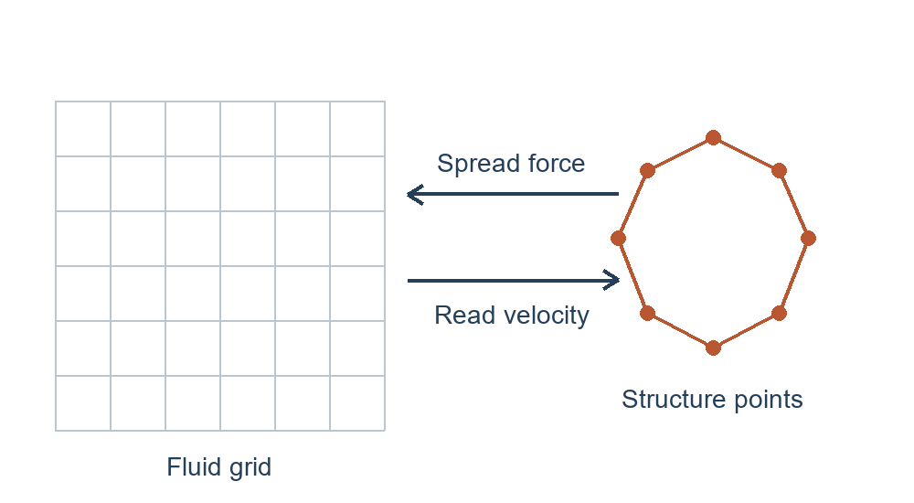

# Lesson 00: Find your way around

Locate the files used by an IBAMR application and follow how the program starts. Then connect its main software components to the familiar fluid and IB equations. This guide assumes a basic familiarity with shell commands and C++ syntax.

## Before you start

Start with an installed IBAMR and a copy of the `learning-ibamr-examples` repository. The application source and inputs are supplied in this repository; you do not need to find IBAMR's own source checkout.

Open a terminal in the example repository's top-level directory and set two names:

```bash
export EXAMPLES_SRC="$PWD"
export EXAMPLES_BUILD="$EXAMPLES_SRC/build"
```

`EXAMPLES_SRC` identifies this repository, and `EXAMPLES_BUILD` identifies its build directory. Application source stays in the repository; compiled programs, run inputs, and output stay under the build directory. Keep quotation marks around paths containing spaces.

Set `IBAMR_ROOT` to your IBAMR installation directory:

```bash
export IBAMR_ROOT=$HOME/sfw/ibamr/linux-dbg
```

Replace `$HOME/sfw/ibamr/linux-dbg` with the path to your installation, containing IBAMR's installed headers and libraries. `$HOME` refers to your home directory. The installation may have been made with autoibamr or built and installed separately. Use the same compiler and MPI environment as that installation. Configure the examples:

```bash
cmake -S "$EXAMPLES_SRC" -B "$EXAMPLES_BUILD" \
  -DCMAKE_BUILD_TYPE=Release \
  -DCMAKE_C_COMPILER="$(command -v mpicc)" \
  -DCMAKE_CXX_COMPILER="$(command -v mpicxx)" \
  -DCMAKE_PREFIX_PATH="${IBAMR_ROOT:?Set the installed IBAMR prefix first}"
cmake --build "$EXAMPLES_BUILD" --target navier_stokes-ex1-2d --parallel 4
```

Use `Debug` for a debug IBAMR installation. CMake locates the installed IBAMR package; the example's `target_link_libraries(... PRIVATE IBAMR::IBAMR2d)` supplies its headers, dependencies, and two-dimensional compile settings. See the [IBAMR application documentation](https://ibamr.github.io/applications) for this external build interface. Resolve configuration or build errors before continuing.

## Four kinds of files

Look at the supplied fluid example:

```bash
ls "$EXAMPLES_SRC/examples/navier_stokes/ex1"
ls "$EXAMPLES_BUILD/examples/navier_stokes/ex1/main2d"
ls "$EXAMPLES_SRC/examples/navier_stokes/ex1/input2d"
```

| Item | What it does | When you change it |
| --- | --- | --- |
| Source, such as `example.cpp` | Describes the application: create solvers, provide model data, advance time, write results | To add behavior the application does not already provide |
| Build directory | Contains compiled libraries and programs; `main2d` is the program you run | Rebuild after changing C++ |
| Input, here `input2d` | Supplies values and expressions read when the program starts | To change an exposed model or run setting; no C++ rebuild needed |
| Run directory under the build directory | Holds one run's input, log, and results | Use a separate subdirectory for each comparison |

The example's `CMakeLists.txt` describes how to build it. The source and build directories are different places, even though their example subfolders look similar. In the next lesson, copy the supplied input into a run subdirectory under the build directory and edit that copy.

## How the program starts

Open `examples/navier_stokes/ex1/example.cpp` in the source directory. For this first reading, find `main` and the following two excerpts. They are parts of the existing application, not complete programs to copy into a new file.

```cpp
IBTKInit ibtk_init(argc, argv, MPI_COMM_WORLD);
```

`main` is where the executable begins. `argc` and `argv` describe its command-line arguments, including the input filename. `IBTKInit` initializes IBAMR's supporting libraries and arranges their shutdown. `MPI_COMM_WORLD` identifies the group of processes used by the application; our first run uses one process.

```cpp
Pointer<AppInitializer> app_initializer = new AppInitializer(argc, argv, "INS.log");
Pointer<Database> input_db = app_initializer->getInputDatabase();
```

`AppInitializer` reads the application setup, including the input and standard output/restart options. A `Database` here is an in-memory collection of named settings.

`Pointer<...>` is SAMRAI's smart pointer. It tracks references to an object and automatically deletes the object when the last reference is released.

The spatial dimension is chosen when compiling: the supplied `main2d` links to `IBAMR::IBAMR2d`, which sets `NDIM = 2`. A 3D executable would instead link to `IBAMR::IBAMR3d`, which sets `NDIM = 3`. This repository currently supplies 2D applications. The input must match that dimension. For example, the two-dimensional input has two entries in each coordinate array, such as `x_lo = 0,0`, and two velocity expressions, `function_0` and `function_1`. A three-dimensional input needs three coordinate entries and a third velocity expression, `function_2`; grid-index bounds and refinement-ratio arrays must also have three entries. Moving from 2D to 3D therefore requires both the matching executable and dimensionally consistent input data. Parameters such as viscosity are read at startup and can be changed between runs without rebuilding.

## How it works: fluid, structure, and coupling

For an incompressible fluid with constant density and viscosity, the equations have the form

$$
\rho\left(\frac{\partial\mathbf u}{\partial t}+\mathbf u\cdot\nabla\mathbf u\right)
=-\nabla p+\mu\nabla^2\mathbf u+\mathbf f,
\qquad \nabla\cdot\mathbf u=0.
$$

Here $\mathbf u$ is velocity, $p$ is pressure, $\rho$ is density, $\mu$ is dynamic viscosity, and $\mathbf f$ is force per fluid volume. The pressure helps enforce incompressibility. We keep density in the equation rather than assume it has been absorbed into other quantities.

In classical IB, structure points have positions $\mathbf X(s,t)$, where $s$ labels material points. Structural forces are spread to the fluid, and fluid velocity is read back to move the points:

$$
\mathbf f(\mathbf x,t)=\int \mathbf F(s,t)\,
\delta(\mathbf x-\mathbf X(s,t))\,ds,
\qquad
\frac{\partial\mathbf X}{\partial t}(s,t)
=\int \mathbf u(\mathbf x,t)\,
\delta(\mathbf x-\mathbf X(s,t))\,d\mathbf x.
$$

$\mathbf x$ is a fluid position and $\mathbf F$ is force per reference measure $ds$. The delta function expresses the exchange between the two descriptions. The numerical method replaces it with a smooth, localized kernel and the integrals with sums. A structure law supplies $\mathbf F$; for an elastic energy $E$, the restoring-force convention is $\mathbf F=-\delta E/\delta\mathbf X$.



*Conceptual diagram. Structure forces act on the fluid grid; fluid velocities move the structure points. The separate drawings show the two descriptions, not two separate physical domains.*

IBAMR separates these jobs. A fluid integrator advances the fluid equations. In the classical IB examples, `IBMethod` manages the structure representation and exchange, a force generator supplies structural forces, and an IB hierarchy integrator coordinates the coupled time advance. Later lessons will follow their actual setup calls. You do not need to write those pieces to run an existing application.

## Locate an input setting

To see how an input file controls a simulation setting, open `examples/navier_stokes/ex1/input2d` in the source directory and find:

```text
MU  = 0.0001
```

`MU` sets the fluid viscosity, $\mu$, in the fluid equation above. The application reads this value when a run starts, so you can change viscosity through the input file and run the same executable without recompiling it. In lesson 01, you will use this to run two cases with different viscosities. For now, just locate the setting; that lesson will show how to copy the input into a run directory before editing it.

Changes to the C++ source require rebuilding the executable before you run it again. For example, adding a calculation to `example.cpp` changes what the program does, so editing that file alone is not enough: you must compile the updated source. Changing a value already read from the input file, such as `MU`, does not require this step.

## Before moving on

This lesson introduced the application source, build directory, executable, and input file, and explained which changes require rebuilding. You should have the example repository configured, the fluid executable `main2d` built, and `EXAMPLES_SRC`, `EXAMPLES_BUILD`, and `IBAMR_ROOT` set in your terminal.

Continue to [lesson 01](01-first-run.md) to run the fluid example using the source, build, and input files introduced here.
