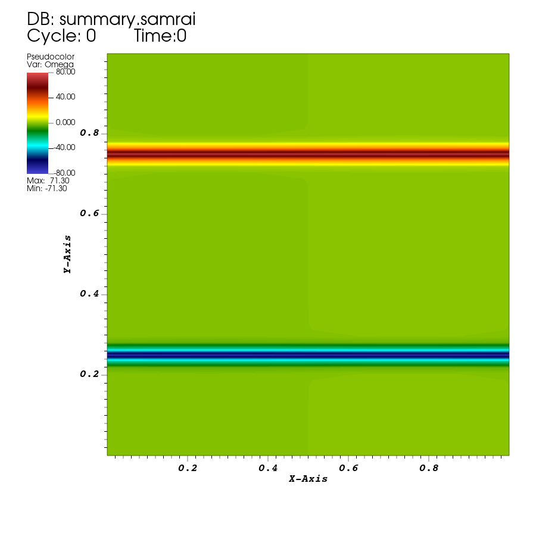
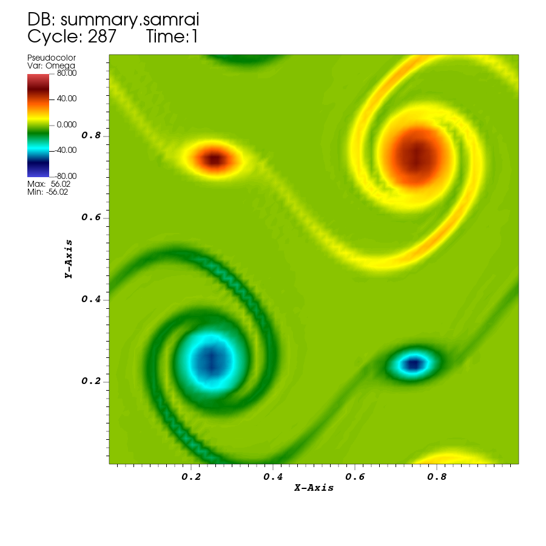
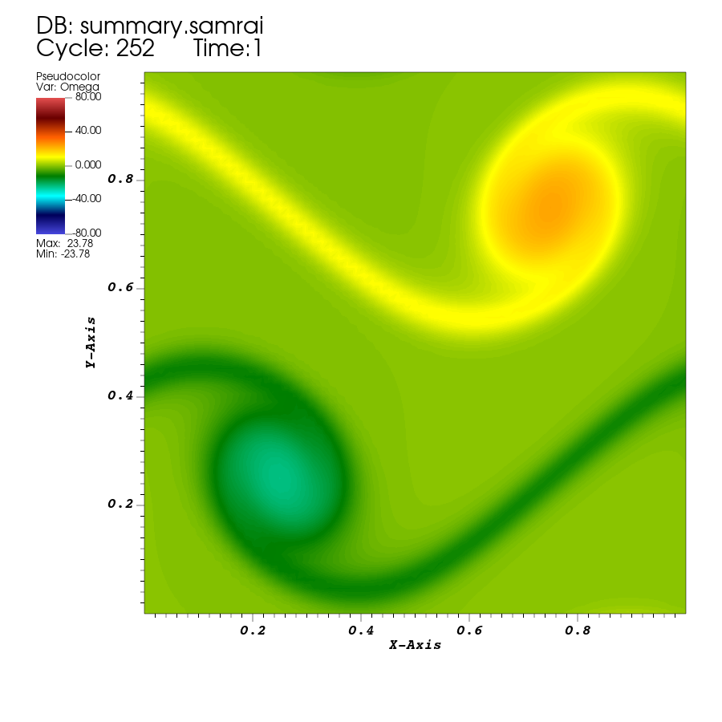

# Tutorial 02: See what the flow is doing

## Introduction

Open the two runs from tutorial 01 in VisIt, select fields and saved times, and export comparable images.

## Before you start

Finish both runs in [tutorial 01](01-first-run.md). Use VisIt with its SAMRAI reader available. This tutorial uses the fluid example in `examples/navier_stokes/ex1`.

Open `examples/navier_stokes/ex1/first-flow/viz_INS2d/dumps.visit` under `EXAMPLES_BUILD`, the example repository's build directory.

## Opening the saved example

This tutorial works with the completed runs from tutorial 01.

### Draw the fluid output

1. Start VisIt. Click **Open** in the main controls, select the baseline `dumps.visit`, and open it.
2. Under **Plots**, choose **Add → Pseudocolor → Omega**. Click **Draw**. If a grid-level plot was added automatically, hide or delete it for this first view.
3. Use the time slider to select the first saved state. Check the displayed physical time is `0`.



*Reference IBAMR result at $t=0$. Two narrow bands mark the initial shear layers. This image uses vorticity limits $[-80,80]$, which you will set below for consistent comparisons.*

### Find your way around the interface

The main controls contain the open databases, time controls, and plot list. The visualization window displays the plots. Here, a **database** is the saved simulation output opened through `dumps.visit`.

The plot list shows which variables you are displaying and how they are drawn. Click a plot's row to select it before changing its settings. **Hide/Show** toggles its visibility, while **Delete** removes it from the list. Double-clicking a plot opens its attributes, such as its color limits.

VisIt provides several tools that you will use throughout the guide:

| Tool | What it does | Example |
| --- | --- | --- |
| Plot | Draws a variable | Pseudocolor maps `Omega` to colors; Vector draws arrows for `U` |
| Expression | Calculates a new variable from existing fields | Compute speed from `U` |
| Operator | Changes the data used by a plot | Clip shows a selected region; Slice cuts through a 3D field |
| Query | Reports a measurement | Find the minimum and maximum of `Omega` |

The [VisIt interface overview](https://visit-sphinx-github-user-manual.readthedocs.io/en/3.4rc/intro/Understanding_how_VisIt_works.html) explains these tools in more detail.

### Explore saved times and color limits

1. Double-click the Pseudocolor plot to open its attributes. Enable explicit minimum and maximum limits, set them to `-80` and `80`, choose `hot_desaturated` as the color table, and apply.
2. Move to the last state. Check the displayed time is `1`, then return to the first state and use the animation controls to play the sequence.



*The same run at $t=1$, using the same limits. The bands have rolled into rotating regions. This deliberately coarse teaching grid also leaves visible small-scale numerical texture; the picture is not an accuracy assessment.*

### Create an expression for speed

Use **Controls → Expressions** to define new quantities to plot from saved fields. Select an expression in the left list to edit its formula in **Definition**.

Speed is the magnitude of velocity, $|\mathbf u|=\sqrt{u_x^2+u_y^2}$. Create it as follows:

1. Click **New**, name the expression `speed`, and choose the scalar type.
2. Enter this definition:

   ```text
   magnitude(<U>)
   ```

3. Click **Apply**, then hide `Omega` and choose **Add → Pseudocolor → speed**. Click **Draw**.

Here `U` is the saved velocity vector, `<U>` refers to that database variable, and `magnitude` is a **built-in VisIt function** that returns its length. `speed` is the name you chose for the result.

**Insert Function…** browses built-in functions and inserts templates; **Insert Variable…** supplies database variables. Functions such as `magnitude`, `sqrt`, `abs`, and `dot` can be combined with arithmetic. The [expression documentation](https://visit-sphinx-github-user-manual.readthedocs.io/en/develop/using_visit/Quantitative/Expressions.html) lists their arguments and results.

Let the speed plot choose its own color limits. The signed vorticity range is inappropriate for speed. VisIt computes this quantity from the saved velocity as you change states, so no new IBAMR run is needed.

### Show velocity directions

To see direction as well as speed, hide the speed plot and choose **Add → Vector → U**, then **Draw**. The arrows show the local velocity direction.

Double-click the Vector plot to open its attributes. Reduce the number of arrows with **Fixed vectors** or **Stride** if they overlap, and adjust **Scale** to make them readable. With **Scale by magnitude** enabled, faster velocities have longer arrows. These display controls change the arrows drawn from the saved field. See the [Vector plot documentation](https://visit-sphinx-github-user-manual.readthedocs.io/en/develop/using_visit/Plots/PlotTypes/VectorPlot.html) for its options.

You can also show the Vector plot together with the speed Pseudocolor plot: the colors show speed and the arrows show direction.

### Open the comparison run

Hide the speed and Vector plots. Select the existing `Omega` plot and use **Hide/Show** to display it again. Open `examples/navier_stokes/ex1/first-flow-viscous/viz_INS2d/dumps.visit` under the build directory, make a Pseudocolor plot of `Omega`, and select its final physical time `1`. Set the same color table and limits `-80` and `80`. Save an image of each run at that time before switching between them.



*IBAMR result with `MU = 0.001` at $t=1$, with the same vorticity limits. The structures are broader and their peak vorticity is weaker than in the baseline.*

To measure the field, select the `Omega` plot in the plot list and open **Controls → Query**. Choose **MinMax** (under **Variable-related**), then click **Query**. The results give the minimum, maximum, and their locations for the selected state. Repeat for the other run at time `1`. The larger of the absolute minimum and absolute maximum is the maximum absolute vorticity. These values describe the field, even when the chosen color limits clip it. See the [VisIt query walkthrough](https://visit-sphinx-github-user-manual.readthedocs.io/en/v3.5.0/tutorials/Data_Analysis.html#variable-related).

In the reference output, the maximum absolute saved vorticity at $t=1$ was approximately `56.02` for `MU = 0.0001` and `23.78` for `MU = 0.001`. These are VisIt MinMax queries on the saved field, not analytic predictions. Larger viscosity smooths velocity gradients. The numbers support the observation for this grid and short run; they do not establish a converged result.

Before saving the comparison, check that both plots show physical time `1`, variable `Omega`, and color limits `-80` to `80`. These settings let the images show differences between the runs consistently.

### Save a figure

With the desired plot and time visible, choose **File → Set save options**, select PNG and the corresponding run directory under the build directory, then use **File → Save window**. Keep the legend and time visible. Name the image so that you can identify the run and time, for example `first-flow-Omega-t1.png`.

The figures shown here were exported at 900 × 900 pixels. Keep the input, log, and visualization files with the saved images in the build directory so the results can be revisited.

If `Omega` is absent, check that you opened the fluid `dumps.visit` from the intended run. If you only see a grid outline, add and draw the Pseudocolor plot.

## The input and program

### Select fields and output settings

Open the supplied [fluid application](../examples/navier_stokes/ex1/example.cpp) and [input](../examples/navier_stokes/ex1/input2d). Follow these excerpts in place; no C++ change is needed. The run copy from tutorial 01 uses these entries within `Main`:

**Run input:** `first-flow/input2d`, `Main`; see [`input2d`, lines 105–107](../examples/navier_stokes/ex1/input2d#L105-L107). Tutorial 01 changes the interval to `10`.

```text
viz_writer = "VisIt"
viz_dump_interval = 10
viz_dump_dirname = "viz_INS2d"
```

The writer name selects the output system, the interval selects how often to save completed steps, and the directory name locates the saved files relative to the run directory. The fields are selected separately. At the top of the input, find:

**Read:** [`input2d`, lines 27–30](../examples/navier_stokes/ex1/input2d#L27-L30).

```text
OUTPUT_U = TRUE
OUTPUT_P = TRUE
OUTPUT_OMEGA = TRUE
```

Inside the selected `INSStaggeredHierarchyIntegrator` block, those constants feed:

**Read:** [`input2d`, lines 89–92](../examples/navier_stokes/ex1/input2d#L89-L92) in `INSStaggeredHierarchyIntegrator`.

```text
output_U = OUTPUT_U
output_P = OUTPUT_P
output_Omega = OUTPUT_OMEGA
```

These flags request velocity `U`, pressure `P`, and vorticity `Omega`. A directory and save interval alone do not select which quantities the integrator makes available to the writer.

### Connect the writer to the integrator

Near the beginning of `main`, the application reads:

**Read:** [`example.cpp`, lines 72–74](../examples/navier_stokes/ex1/example.cpp#L72-L74).

```cpp
const bool dump_viz_data = app_initializer->dumpVizData();
const int viz_dump_interval = app_initializer->getVizDumpInterval();
const bool uses_visit = dump_viz_data && app_initializer->getVisItDataWriter();
```

`dump_viz_data` records whether visualization output is enabled, and `viz_dump_interval` supplies the loop's saving interval. `uses_visit` also checks that a VisIt writer is available. Later, before hierarchy initialization, find:

**Read:** [`example.cpp`, lines 168–172](../examples/navier_stokes/ex1/example.cpp#L168-L172).

```cpp
Pointer<VisItDataWriter<NDIM>> visit_data_writer = app_initializer->getVisItDataWriter();
if (uses_visit)
{
    time_integrator->registerVisItDataWriter(visit_data_writer);
}
```

The initializer supplies the configured writer. Registration lets the integrator connect its requested plot quantities to that writer. It establishes the output arrangement; this call does not save a frame.

### Prepare and save a state

After hierarchy initialization and before the time loop, the application obtains the step and physical time:

**Read:** [`example.cpp`, lines 185–186](../examples/navier_stokes/ex1/example.cpp#L185-L186).

```cpp
int iteration_num = time_integrator->getIntegratorStep();
double loop_time = time_integrator->getIntegratorTime();
```

Inside the following visualization block it calls:

**Read:** [`example.cpp`, lines 190–191](../examples/navier_stokes/ex1/example.cpp#L190-L191).

```cpp
time_integrator->setupPlotData();
visit_data_writer->writePlotData(patch_hierarchy, iteration_num, loop_time);
```

`setupPlotData()` prepares the integrator's plotting data, including requested derived quantities. `writePlotData` receives the hierarchy to save, a step number identifying the state, and its physical time. This initial write explains why a frame exists at time `0`.

Inside the time loop, after advancement, the application increments the step counter and tests:

**Read:** [`example.cpp`, lines 220–221](../examples/navier_stokes/ex1/example.cpp#L220-L221).

```cpp
iteration_num += 1;
const bool last_step = !time_integrator->stepsRemaining();
```

The output condition is:

**Read:** [`example.cpp`, line 222](../examples/navier_stokes/ex1/example.cpp#L222).

```cpp
if (dump_viz_data && uses_visit && (iteration_num % viz_dump_interval == 0 || last_step))
```

The body of this `if` repeats the preparation and writing calls above. `%` gives the remainder after division: an interval of ten saves every tenth completed step. The `last_step` condition also saves the endpoint. The `.visit` list identifies the saved states; their physical times come from `loop_time`. Moving VisIt's slider loads these stored states rather than advancing the solver. A frame number therefore need not equal a physical time.

### Choose what to display

For this two-dimensional example, `Omega` is the out-of-plane vorticity,

$$\omega=\frac{\partial u_y}{\partial x}-\frac{\partial u_x}{\partial y}.$$

The `Omega` plot displays a signed scalar already saved by IBAMR. Use the same color limits when comparing frames or runs. The `speed` expression used above instead asks VisIt to compute a scalar from saved `U`; editing that expression changes the view without changing the simulation. The coordinates and fields follow the example's numerical scales, without an assigned dimensional length or time unit.

## Before moving on

This tutorial opened a saved time sequence in VisIt, plotted vorticity, defined speed with a built-in expression function, displayed velocity arrows, and queried field values. You compared two runs at the same physical time with consistent display settings. You should have saved comparison images for the baseline and higher-viscosity runs at $t=1$, with the input, log, and complete visualization output retained in each run directory.

In [tutorial 03](03-kinetic-energy.md), you will add a kinetic-energy calculation to the fluid application. You will access the velocity data and save a measurement after each time step.
