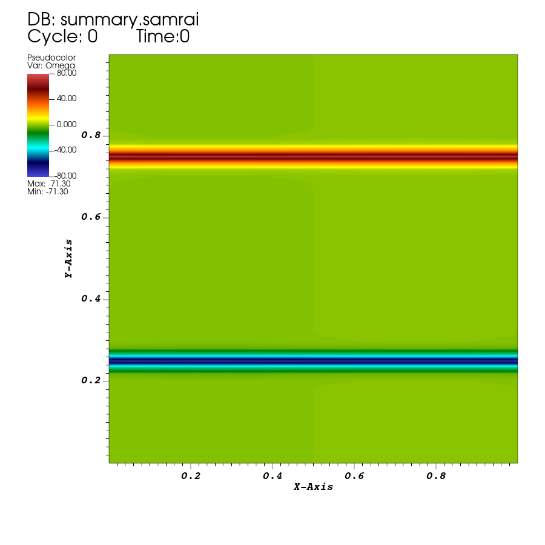
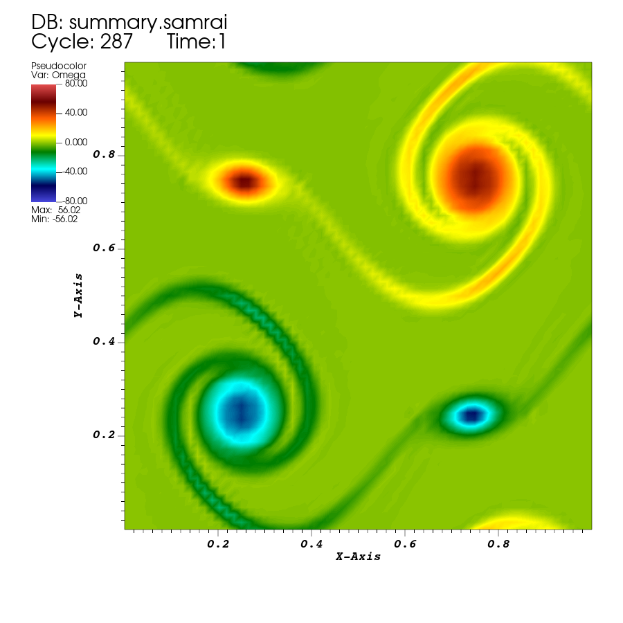
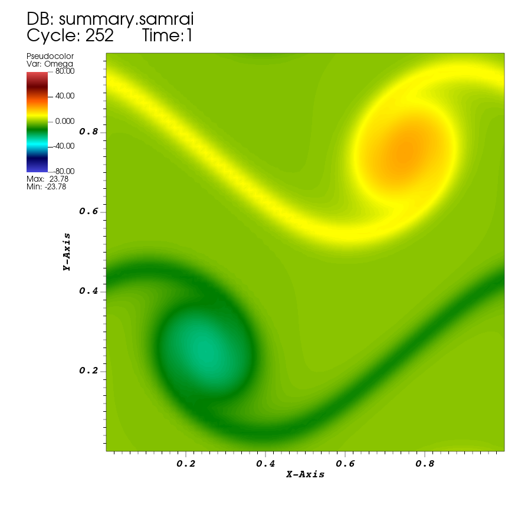

# Lesson 03: See what the flow is doing

## Introduction

Open the two runs from lesson 01 in VisIt, select fields and saved times, and export comparable images.

## Before you start

Finish both runs in [lesson 01](01-first-run.md). Use VisIt with its SAMRAI reader available.

Open `examples/navier_stokes/ex1/first-flow/viz_INS2d/dumps.visit` under `EXAMPLES_BUILD`, the example repository's build directory.

## The input and program

### Select fields and output settings

Open the supplied [fluid application](../examples/navier_stokes/ex1/example.cpp) and [input](../examples/navier_stokes/ex1/input2d). Follow these excerpts in place; no C++ change is needed. The run copy from tutorial 01 uses these entries within `Main`:

```text
viz_writer = "VisIt"
viz_dump_interval = 10
viz_dump_dirname = "viz_INS2d"
```

The writer name selects the output system, the interval selects how often to save completed steps, and the directory name locates the saved files relative to the run directory. The fields are selected separately. At the top of the input, find:

```text
OUTPUT_U = TRUE
OUTPUT_P = TRUE
OUTPUT_OMEGA = TRUE
```

Inside the selected `INSStaggeredHierarchyIntegrator` block, those constants feed:

```text
output_U = OUTPUT_U
output_P = OUTPUT_P
output_Omega = OUTPUT_OMEGA
```

These flags request velocity `U`, pressure `P`, and vorticity `Omega`. A directory and save interval alone do not select which quantities the integrator makes available to the writer.

### Connect the writer to the integrator

Near the beginning of `main`, the application reads:

```cpp
const bool dump_viz_data = app_initializer->dumpVizData();
const int viz_dump_interval = app_initializer->getVizDumpInterval();
const bool uses_visit = dump_viz_data && app_initializer->getVisItDataWriter();
```

`dump_viz_data` records whether visualization output is enabled, and `viz_dump_interval` supplies the loop's saving interval. `uses_visit` also checks that a VisIt writer is available. Later, before hierarchy initialization, find:

```cpp
Pointer<VisItDataWriter<NDIM>> visit_data_writer = app_initializer->getVisItDataWriter();
if (uses_visit)
{
    time_integrator->registerVisItDataWriter(visit_data_writer);
}
```

The initializer supplies the configured writer. Registration lets the integrator connect its requested plot quantities to that writer. It establishes the output arrangement; this call does not save a frame.

### Prepare and save a state

After hierarchy initialization and before the time loop, the application obtains the step and physical time:

```cpp
int iteration_num = time_integrator->getIntegratorStep();
double loop_time = time_integrator->getIntegratorTime();
```

Inside the following visualization block it calls:

```cpp
time_integrator->setupPlotData();
visit_data_writer->writePlotData(patch_hierarchy, iteration_num, loop_time);
```

`setupPlotData()` prepares the integrator's plotting data, including requested derived quantities. `writePlotData` receives the hierarchy to save, a step number identifying the state, and its physical time. This initial write explains why a frame exists at time `0`.

Inside the time loop, after advancement, the application increments the step counter and tests:

```cpp
iteration_num += 1;
const bool last_step = !time_integrator->stepsRemaining();
```

The output condition is:

```cpp
if (dump_viz_data && uses_visit && (iteration_num % viz_dump_interval == 0 || last_step))
```

The body of this `if` repeats the preparation and writing calls above. `%` gives the remainder after division: an interval of ten saves every tenth completed step. The `last_step` condition also saves the endpoint. The `.visit` list identifies the saved states; their physical times come from `loop_time`. Moving VisIt's slider loads these stored states rather than advancing the solver. A frame number therefore need not equal a physical time.

### Choose what to display

For this two-dimensional example, `Omega` is the out-of-plane vorticity,

$$\omega=\frac{\partial u_y}{\partial x}-\frac{\partial u_x}{\partial y}.$$

The `Omega` plot displays a signed scalar already saved by IBAMR. Use the same color limits when comparing frames or runs. The `speed` expression below instead asks VisIt to compute a scalar from saved `U`; editing that expression changes the view without changing the simulation. The coordinates and fields follow the example's numerical scales, without an assigned dimensional length or time unit.

## Opening the saved example

This lesson works with the completed runs from tutorial 01.

### Draw the fluid output

1. Start VisIt. Click **Open** in the main controls, select the baseline `dumps.visit`, and open it.
2. Under **Plots**, choose **Add → Pseudocolor → Omega**. Click **Draw**. If a grid-level plot was added automatically, hide or delete it for this first view.
3. Use the time slider to select the first saved state. Check the displayed physical time is `0`.
4. Double-click the Pseudocolor plot to open its attributes. Enable explicit minimum and maximum limits, set them to `-80` and `80`, choose `hot_desaturated` as the color table, and apply.
5. Move to the last state. Check the displayed time is `1`, then return to the first state and use the animation controls to play the sequence.

### Look at speed

Speed is the magnitude of velocity, $|\mathbf u|=\sqrt{u_x^2+u_y^2}$. To give it a clear scalar name, open **Controls → Expressions**, create a scalar expression called `speed`, and enter:

```text
magnitude(<U>)
```

Apply the expression. Hide the `Omega` plot and add **Pseudocolor → speed**, then **Draw**. Let this speed plot choose its own limits: the signed vorticity range is inappropriate for speed.

Compare the speed and vorticity views at $t=1$. The fastest fluid and the strongest local rotation need not occur in the same places. For flow direction, a vector plot of `U` would add information that speed alone cannot provide.

### Open the comparison run

Return to `Omega`. Open `examples/navier_stokes/ex1/first-flow-viscous/viz_INS2d/dumps.visit` under the build directory, make a Pseudocolor plot of `Omega`, and select its final physical time `1`. Set the same color table and limits `-80` and `80`. Save an image of each run at that time before switching between them.

### Save a figure

With the desired plot and time visible, choose **File → Set save options**, select PNG and the corresponding run directory under the build directory, then use **File → Save window**. Keep the legend and time visible. Name the image so that you can identify the run and time, for example `first-flow-Omega-t1.png`.

The figures shown here were exported at 900 × 900 pixels. Keep the input, log, and visualization files with the saved images in the build directory so the results can be revisited.

If `Omega` is absent, check that you opened the fluid `dumps.visit` from the intended run. If you only see a grid outline, add and draw the Pseudocolor plot.

## Results



*IBAMR result at $t=0$, with vorticity limits $[-80,80]$. Two narrow bands mark the initial shear layers.*



*The same run at $t=1$, using the same limits. The bands have rolled into rotating regions. This deliberately coarse teaching grid also leaves visible small-scale numerical texture; the picture is not an accuracy assessment.*



*IBAMR result with `MU = 0.001` at $t=1$, with the same vorticity limits. The structures are broader and their peak vorticity is weaker than in the baseline.*

In the reference output, the maximum absolute saved vorticity at $t=1$ was approximately `56.02` for `MU = 0.0001` and `23.78` for `MU = 0.001`. These are VisIt MinMax queries on the saved field, not analytic predictions. Larger viscosity smooths velocity gradients. The numbers support the observation for this grid and short run; they do not establish a converged result.

Before saving the comparison, check that both plots show physical time `1`, variable `Omega`, and color limits `-80` to `80`. These settings let the images show differences between the runs consistently.

## Before moving on

This lesson opened a saved time sequence in VisIt, plotted vorticity and speed, and compared two runs at the same physical time with consistent display settings. You should have saved comparison images for the baseline and higher-viscosity runs at $t=1$, with the input, log, and complete visualization output retained in each run directory.

[Tutorial 04](04-elastic-loop.md) will add an elastic rubber band to the fluid simulation. You will view the fluid and structure outputs together at matching times.
