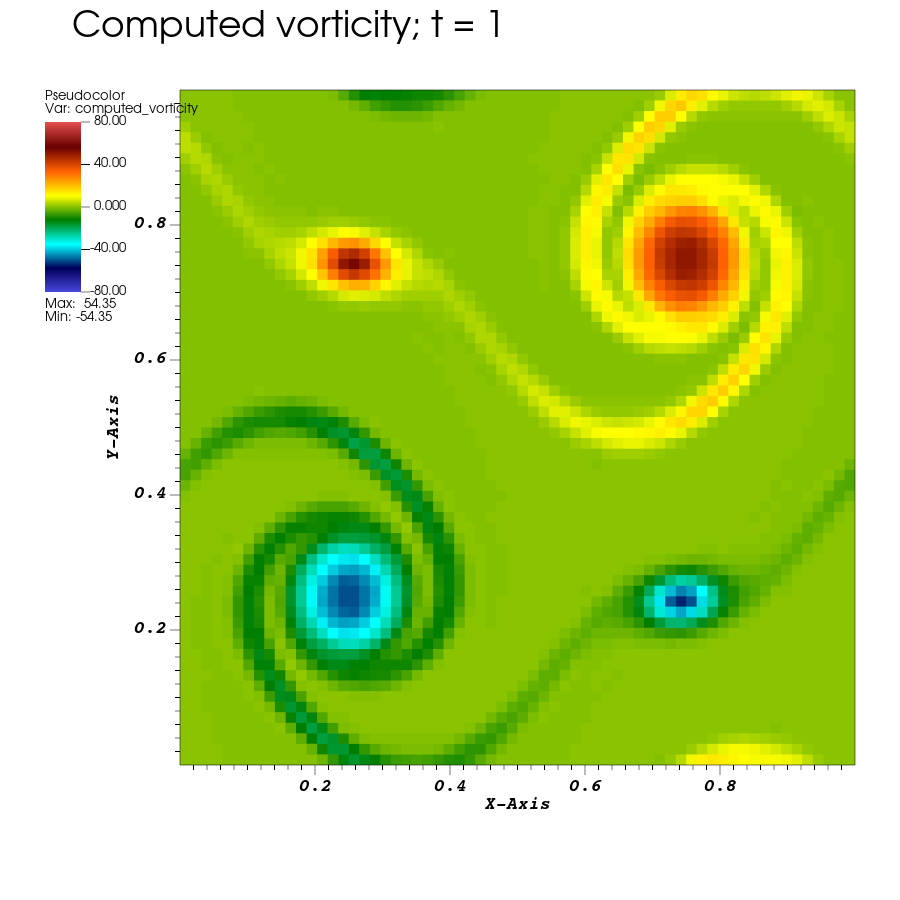

# Tutorial 03: Compute kinetic energy

## Introduction

Follow the setup and time loop of the fluid application you have already run and visualized. Then compute kinetic energy by looping over grid levels, patches, and side indices, consult the side-operations documentation, and use `dot` to perform the same calculation. An optional extension computes and saves vorticity from the velocity field.

## Before you start

Complete [tutorial 02](02-first-visualization.md), using the baseline and higher-viscosity runs from tutorial 01. Keep `EXAMPLES_SRC` and `EXAMPLES_BUILD` set in your terminal. Source changes go in `examples/navier_stokes/ex1` under the source directory; the new executable and run files go in the corresponding build directory.

Line numbers below refer to the supplied repository files before the edits in this tutorial. Use the named function or input block to find the same location after adding code.

## Start with the existing result

Use the completed fluid run from tutorial 01 as the starting example. Before editing its source, change to its run directory:

```bash
cd "$EXAMPLES_BUILD/examples/navier_stokes/ex1/first-flow"
```

Show the end of the application log:

```bash
tail -n 15 INS2d.log
```

Inspect the fluid visualization list:

```bash
head -n 4 viz_INS2d/dumps.visit
```

You already have the simulated velocity field and its saved time sequence. This tutorial adds a measurement of that velocity to the program. The energy calculation must be implemented before you can build and run the new executable; the original fluid application remains available throughout.

## Follow the existing fluid application

The flow you ran in tutorial 01 and viewed in tutorial 02 now provides a concrete example for reading the program. Follow its model settings, initialization, and time advance before adding the measurement.

### The starting model

In the supplied `input2d`, find `L` near the top:

**Read:** [`input2d`, line 4](../examples/navier_stokes/ex1/input2d#L4).

```text
L = 1.0
```

The tutorial 01 run uses `N = 64` cells per direction. Find the domain geometry block:

**Read:** [`input2d`, lines 122–127](../examples/navier_stokes/ex1/input2d#L122-L127).

```text
CartesianGeometry {
   domain_boxes = [ (0,0),(N - 1,N - 1) ]
   x_lo = 0,0
   x_up = L,L
   periodic_dimension = 1,1
}
```

`x_lo` and `x_up` set the physical bounds. With `L = 1.0`, the domain is the square $0\leq x,y\leq1$. `domain_boxes` gives the grid-index bounds, here `N` cells in each direction. The two entries in `periodic_dimension` enable periodicity in $x$ and $y$: material leaving one side re-enters through the opposite side. These settings give periodic boundaries rather than walls, an inlet, or an outlet.

The horizontal velocity changes direction across thin layers near $y=0.25$ and $y=0.75$. A small vertical disturbance starts their motion away from a perfectly straight arrangement. Find this block in the supplied `input2d`:

**Read:** [`input2d`, lines 38–43](../examples/navier_stokes/ex1/input2d#L38-L43).

```text
VelocityInitialConditions {
   rho = 80.0
   delta = 0.05
   function_0 = "X1 < 0.5 ? tanh(rho*(X1-0.25)) : tanh(rho*(0.75-X1))"
   function_1 = "delta*sin(2.0*pi*(X0+0.25))"
}
```

`X0` and `X1` mean $x$ and $y$. `function_0` is horizontal velocity and `function_1` is vertical velocity. The expression before `?` selects the first horizontal formula below the middle of the square and the second above it. The local `rho = 80.0` controls layer sharpness; it is distinct from the top-level fluid density `RHO = 1.0`.

Read the complete [fluid application](../examples/navier_stokes/ex1/example.cpp) alongside its [input file](../examples/navier_stokes/ex1/input2d). The excerpts below come from that existing application. Read them in place; they omit surrounding setup and are not standalone programs. This source-reading activity does not require editing or rebuilding anything.

### Follow a viscosity value into the solver

The input selects `SOLVER_TYPE = "STAGGERED"`. The application uses the common `INSHierarchyIntegrator` interface, with `INSStaggeredHierarchyIntegrator` as its selected implementation. This implementation stores pressure at cell centers and velocity components at cell faces. This layout supports the discrete pressure and incompressibility calculation. The collocated alternative stores both velocity and pressure at cell centers; its input block is present but is not selected in this run.

Inside the `STAGGERED` branch, find:

**Read:** [`example.cpp`, lines 95–97](../examples/navier_stokes/ex1/example.cpp#L95-L97).

```cpp
time_integrator = new INSStaggeredHierarchyIntegrator(
    "INSStaggeredHierarchyIntegrator",
    app_initializer->getComponentDatabase("INSStaggeredHierarchyIntegrator"));
```

The first argument names this solver object. The second supplies its input database. Inside that input block, `mu = MU` connects the top-level value to the solver's viscosity setting. The application chooses which database to pass into this constructor, so the input-block name must match the string in the lookup. The solver object then reads the entries it understands from that block. The path is therefore `MU` → the block's `mu` entry → the constructed fluid integrator. Top-level names such as `MU` are conveniences chosen by this input file; a solver does not automatically read every top-level setting.

The constructor configures the integrator before the hierarchy exists. It does not yet allocate a velocity field or advance a time step. Those operations happen during initialization and advancement below.

The relevant top-level assignments are:

**Read:** [`input2d`, lines 3–20](../examples/navier_stokes/ex1/input2d#L3-L20).

```text
RHO = 1.0
CFL_MAX = 0.3
DT_MAX = 0.5/NFINEST
CONVECTIVE_TS_TYPE = "ADAMS_BASHFORTH"
```

Inside `INSStaggeredHierarchyIntegrator`, find the corresponding entries:

**Read:** [`input2d`, lines 73–84](../examples/navier_stokes/ex1/input2d#L73-L84) in `INSStaggeredHierarchyIntegrator` (selected entries).

```text
mu = MU
rho = RHO
cfl = CFL_MAX
dt_max = DT_MAX
convective_time_stepping_type = CONVECTIVE_TS_TYPE
```

The selected block receives `mu = MU`, `rho = RHO`, and the time settings. `CFL_MAX = 0.3` limits how far flow moves relative to a cell during a step, while `DT_MAX = 0.5/NFINEST` gives an upper bound on step size. The integrator chooses the actual step, so output every ten steps does not necessarily mean equally spaced physical times. The input selects `ADAMS_BASHFORTH` for the convection term. The viscous term uses the default `TRAPEZOIDAL_RULE` (Crank–Nicolson), since this input does not specify `viscous_time_stepping_type`.

The default is defined in IBAMR’s `INSHierarchyIntegrator.h` (installed under `$IBAMR_ROOT/include/ibamr`):

**Library header:** `$IBAMR_ROOT/include/ibamr/INSHierarchyIntegrator.h`, line 494 in v0.19.0 ([versioned source](https://github.com/IBAMR/IBAMR/blob/v0.19.0/include/ibamr/INSHierarchyIntegrator.h#L494)).

```cpp
TimeSteppingType d_viscous_time_stepping_type = TRAPEZOIDAL_RULE;
```

### Supply the initial field, then initialize it

Find the initial-condition setup:

**Read:** [`example.cpp`, lines 130–132](../examples/navier_stokes/ex1/example.cpp#L130-L132).

```cpp
Pointer<CartGridFunction> u_init = new muParserCartGridFunction(
    "u_init", app_initializer->getComponentDatabase("VelocityInitialConditions"), grid_geometry);
time_integrator->registerVelocityInitialConditions(u_init);
```

The expression object receives the velocity database and domain geometry. The registration call tells the integrator which object will supply initial velocity. The three constructor arguments name the provider, supply its expression database, and supply the physical grid geometry. `function_0` and `function_1` are interpreted as components of the requested velocity field. The provider can evaluate those expressions when the integrator asks it to initialize a patch.

Registration connects a provider to a solver; it does not itself advance time. The later `initializePatchHierarchy` call builds the initial hierarchy and initializes its data using the registered setup.

This separation lets the fluid solver request velocity data without knowing whether the application obtains it from expressions or custom C++. For an initial field that needs more than prescribed expressions, the extension is a custom `IBTK::CartGridFunction`, providing `setDataOnPatch`. `setDataOnPatch` receives the destination data index, variable, patch, requested time, and initialization flag, along with an optional level pointer. Its job is to fill the requested patch data in the variable's layout. The same `registerVelocityInitialConditions` call connects the replacement. The polymer force in [tutorial 15](15-complex-fluids.md) uses another force provider, `CFINSForcing`, registered with the coupled integrator.

### Build the grid and advance its data

The solver works over a `PatchHierarchy`: grid cells grouped into rectangular patches and refinement levels. The tutorial 01 run uses `N = 64` and `MAX_LEVELS = 1` to give a single level with 64 cells per direction. Later, smaller cells can cover selected regions without refining the whole domain. The application's `advanceHierarchy` call advances all the data it manages; you do not write a separate loop over cells in the input file.

The geometry and hierarchy are connected explicitly:

**Read:** [`example.cpp`, lines 110–112](../examples/navier_stokes/ex1/example.cpp#L110-L112).

```cpp
Pointer<CartesianGridGeometry<NDIM>> grid_geometry = new CartesianGridGeometry<NDIM>(
    "CartesianGeometry", app_initializer->getComponentDatabase("CartesianGeometry"));
Pointer<PatchHierarchy<NDIM>> patch_hierarchy = new PatchHierarchy<NDIM>("PatchHierarchy", grid_geometry);
```

The geometry reads physical bounds and periodic directions from its database. The hierarchy receives that geometry and will hold the levels, patches, and numerical data created during initialization. Constructing these objects establishes their relationship; the later initialization call builds the actual grid and fills the initial fields.

Follow the remaining grid helpers in [`example.cpp`, lines 113–125](../examples/navier_stokes/ex1/example.cpp#L113-L125):

| Object | What this application asks it to do |
| --- | --- |
| `CartesianGridGeometry` | Describe the physical bounds and periodic directions |
| `PatchHierarchy` | Hold the grid levels, their patches, and associated data |
| `StandardTagAndInitialize` | Connect initialization/refinement requests to the integrator |
| `BergerRigoutsos` | Group cells marked for refinement into rectangular boxes |
| `LoadBalancer` | Distribute patch work among processes |
| `GriddingAlgorithm` | Assemble the hierarchy using those helpers and the grid input |

`StandardTagAndInitialize` receives `time_integrator`, which lets grid creation ask the solver how to initialize data and identify cells for refinement. The `GriddingAlgorithm` then receives the input block and the three helpers:

**Read:** [`example.cpp`, lines 120–125](../examples/navier_stokes/ex1/example.cpp#L120-L125).

```cpp
Pointer<GriddingAlgorithm<NDIM>> gridding_algorithm =
    new GriddingAlgorithm<NDIM>("GriddingAlgorithm",
                                app_initializer->getComponentDatabase("GriddingAlgorithm"),
                                error_detector,
                                box_generator,
                                load_balancer);
```

The arguments keep separate responsibilities together: `error_detector` connects the solver's requests, `box_generator` forms rectangular patch boxes, and `load_balancer` assigns the work. The application supplies these objects once; grid construction uses them as needed.

The application connects the hierarchy and gridding algorithm with:

**Read:** [`example.cpp`, line 175](../examples/navier_stokes/ex1/example.cpp#L175).

```cpp
time_integrator->initializePatchHierarchy(patch_hierarchy, gridding_algorithm);
```

At this call the gridding algorithm creates patches and the integrator initializes their data using providers such as `u_init`. This is the point at which the configured model becomes a stored numerical state on a grid.

Our one-level run still uses this infrastructure, but creates no finer levels. `REF_RATIO` only affects finer levels when they exist. The same application setup can therefore support a uniform teaching grid and a later locally refined run.

`periodic_dimension = 1,1` specifies the two periodic directions. The application recognizes this geometry and does not register physical-boundary coefficient objects for these directions. A later cylinder tutorial introduces actual inlet/outlet coefficients and their meanings.

Now find these lines inside the time loop:

**Read:** [`example.cpp`, lines 199–209](../examples/navier_stokes/ex1/example.cpp#L199-L209).

```cpp
iteration_num = time_integrator->getIntegratorStep();
loop_time = time_integrator->getIntegratorTime();
dt = time_integrator->getMaximumTimeStepSize();
time_integrator->advanceHierarchy(dt);
loop_time += dt;
```

The first two calls read the current step and physical time. The application then asks for an allowed time step and passes it to `advanceHierarchy`. That call performs the integrator's time advance, including its configured numerical operations and solver calls. The local `loop_time` is updated for the application's reporting and output. Adding a number to that local variable alone would not update the fluid state.

The application's `while` condition checks the end time and `stepsRemaining()`. The numerical work stays inside the integrator, while this outer loop handles progress messages and decides when to save data. For an IB application, an IB hierarchy integrator will occupy this coordinating role and receive both a fluid integrator and a structure strategy.

Trace `END_TIME` at [`input2d`, line 17](../examples/navier_stokes/ex1/input2d#L17) through `INSStaggeredHierarchyIntegrator.end_time` at [`input2d`, line 76](../examples/navier_stokes/ex1/input2d#L76), then locate `getEndTime()` in [`example.cpp`, line 195](../examples/navier_stokes/ex1/example.cpp#L195). This shows where the application reads the integrator's stopping time; `advanceHierarchy(dt)` performs the actual update of the fields.

### The time integrator and its linear solver

`advanceHierarchy(dt)` coordinates the time step. Inside that work, the staggered fluid integrator prepares an algebraic system for velocity and pressure and asks its Stokes solver to solve it. Here “Stokes” names the coupled velocity–pressure solve within the time step; the overall simulation still includes the configured convection term.

The time integrator and linear solver therefore have different jobs. The integrator assembles the terms for the requested step and applies the time-stepping scheme. The linear solver finds fields satisfying the resulting discrete equations. Solver iterations and residual norms in the log describe that algebraic solve, while the outer step number and simulation time track advancement of the fluid. A residual norm measures the remaining mismatch in the algebraic equations. The [v0.19.0 solve call and log output](https://github.com/IBAMR/IBAMR/blob/v0.19.0/src/navier_stokes/INSStaggeredHierarchyIntegrator.cpp#L1295-L1307) show this separation.

## The input and program

Read the supplied [fluid application](../examples/navier_stokes/ex1/example.cpp) as the starting point. In this tutorial you will create a source copy and add a complete diagnostic function to it.

### The quantity to compute

For the constant-density, two-dimensional case, compute

$$
E(t)=\frac{\rho}{2}\int_\Omega\left(u_x^2+u_y^2\right)\,dA.
$$

This is kinetic energy per unit depth. The density comes from the same input entry used by the fluid solver:

**Read:** [`input2d`, line 3](../examples/navier_stokes/ex1/input2d#L3).

```text
RHO = 1.0
```

The first implementation reads the velocity values directly and accumulates their contributions. This activity uses the staggered solver described above.

### Create a version of the example to edit

In the source directory, copy the application's source:

```bash
cd "$EXAMPLES_SRC/examples/navier_stokes/ex1"
cp example.cpp kinetic_energy.cpp
```

Make the following changes in `kinetic_energy.cpp`. Add these headers beside the existing includes, before `app_namespaces.h`:

**Edit `kinetic_energy.cpp`:** Add headers before `app_namespaces.h`. Original location: [`example.cpp`, lines 36–37](../examples/navier_stokes/ex1/example.cpp#L36-L37).

```cpp
#include <Patch.h>
#include <PatchLevel.h>
#include <SideData.h>
#include <SideIterator.h>
#include <ibtk/HierarchyMathOps.h>
#include <iomanip>
```

The patch and side-data headers provide the types used in the loops. `HierarchyMathOps` supplies integration weights, and `<iomanip>` supplies the output precision setting.

Add this declaration beside the existing function prototypes, before `main`:

**Edit `kinetic_energy.cpp`:** Add the prototype beside `output_data`. Original location: [`example.cpp`, lines 39–44](../examples/navier_stokes/ex1/example.cpp#L39-L44).

```cpp
double compute_kinetic_energy_manual(Pointer<PatchHierarchy<NDIM>> patch_hierarchy,
                                     Pointer<INSHierarchyIntegrator> ins_integrator,
                                     double rho);
```

The function receives the hierarchy containing the grid, the fluid integrator identifying its velocity state, and the constant density. It returns one number, the total kinetic energy; it does not modify the velocity. Passing the integrator lets the function find its data through the public interface rather than assume a fixed data index.

### Retrieve the patch data and accumulate energy

Add the complete function at the end of the file, after the existing `output_data` function:

**Edit `kinetic_energy.cpp`:** Append the function after `output_data`. Original location: [`example.cpp`, lines 251–276](../examples/navier_stokes/ex1/example.cpp#L251-L276).

```cpp
double
compute_kinetic_energy_manual(Pointer<PatchHierarchy<NDIM>> patch_hierarchy,
                              Pointer<INSHierarchyIntegrator> ins_integrator,
                              const double rho)
{
    auto* var_db = VariableDatabase<NDIM>::getDatabase();
    const int u_idx = var_db->mapVariableAndContextToIndex(
        ins_integrator->getVelocityVariable(), ins_integrator->getCurrentContext());
    const int wgt_idx = ins_integrator->getHierarchyMathOps()->getSideWeightPatchDescriptorIndex();

    double local_energy = 0.0;
    for (int ln = 0; ln <= patch_hierarchy->getFinestLevelNumber(); ++ln)
    {
        Pointer<PatchLevel<NDIM>> level = patch_hierarchy->getPatchLevel(ln);
        for (PatchLevel<NDIM>::Iterator p(level); p; p++)
        {
            Pointer<Patch<NDIM>> patch = level->getPatch(p());
            Pointer<SideData<NDIM, double>> u_data = patch->getPatchData(u_idx);
            Pointer<SideData<NDIM, double>> weights = patch->getPatchData(wgt_idx);

            for (int axis = 0; axis < NDIM; ++axis)
            {
                for (SideIterator<NDIM> s(patch->getBox(), axis); s; s++)
                {
                    const SideIndex<NDIM>& side = s();
                    const double u = (*u_data)(side);
                    const double weight = (*weights)(side);
                    local_energy += 0.5 * rho * u * u * weight;
                }
            }
        }
    }
    return IBTK_MPI::sumReduction(local_energy);
}
```

IBAMR uses a `Variable` to identify a quantity, such as velocity, and a `VariableContext` to identify which stored version of that quantity to use. Here, `getVelocityVariable()` retrieves the variable for the fluid velocity and `getCurrentContext()` selects the current data. `VariableDatabase` maps this pair to `u_idx`, which is a patch data index that each patch uses to locate its velocity data.

The next lookup obtains `wgt_idx`, the data index for the side-centered integration weights maintained by `HierarchyMathOps`. These weights include the integration volumes and account for shared patch boundaries and coarse/fine coverage.

Coarse cells covered by finer cells have zero integration weight, so the sum counts the represented fluid volume once. This remains important when the same function is used on a refined hierarchy, even though the present example has one level.

The outer loop selects each level with `getPatchLevel(ln)`. `PatchLevel::Iterator` then visits the patches owned by this MPI process. On each patch, `getPatchData(u_idx)` retrieves the velocity arrays, and `getPatchData(wgt_idx)` retrieves the weights. `SideData<NDIM, double>` identifies their storage layout and numerical type.

The `axis` loop selects a velocity component: axis `0` visits locations storing $u_x$, and axis `1` visits those storing $u_y$. `SideIterator` enumerates the side indices associated with the patch's interior box for that component. `s()` returns a `SideIndex` containing a grid location and axis. `(*u_data)(side)` reads the velocity there.

At each index, add `rho*u*u*weight/2` to `local_energy`. Summing over axes supplies the squared components in the energy formula. The weight already includes the volume contribution, so do not multiply by cell area again or include the ghost region. This calculation reads the current state without changing it and needs no spatial derivatives or additional ghost-cell fill.

The loops accumulate this process's contribution. `IBTK_MPI::sumReduction` adds contributions from all processes and returns the global energy. Every process must call this function.

### Call the function after initialization and each step

In `main`, immediately after the line that gets `input_db`, read the density:

**Edit `kinetic_energy.cpp`:** In `main`, add after the `input_db` declaration. Original location: [`example.cpp`, line 69](../examples/navier_stokes/ex1/example.cpp#L69).

```cpp
const double rho = input_db->getDouble("RHO");
```

After the declaration of `solver_type`, before the solver-selection `if` statement, add this check for the layout used by the function:

**Edit `kinetic_energy.cpp`:** In `main`, insert after the `solver_type` declaration and before its `if`. Original location: [`example.cpp`, lines 91–93](../examples/navier_stokes/ex1/example.cpp#L91-L93).

```cpp
if (solver_type != "STAGGERED")
{
    TBOX_ERROR("The kinetic-energy example requires SOLVER_TYPE = STAGGERED.\n");
}
```

Find `// Main time step loop.`. Immediately before that comment, add:

**Edit `kinetic_energy.cpp`:** In `main`, add before `// Main time step loop.`. Original location: [`example.cpp`, line 194](../examples/navier_stokes/ex1/example.cpp#L194).

```cpp
const double initial_manual_energy = compute_kinetic_energy_manual(patch_hierarchy, time_integrator, rho);
pout << "KINETIC_ENERGY_MANUAL " << loop_time << " " << std::setprecision(17) << initial_manual_energy << "\n";
```

The hierarchy and initial velocity have been initialized at this point. Inside the time loop, immediately after `loop_time += dt;`, add:

**Edit `kinetic_energy.cpp`:** In `main`, add after `loop_time += dt;`. Original location: [`example.cpp`, line 209](../examples/navier_stokes/ex1/example.cpp#L209).

```cpp
const double manual_energy = compute_kinetic_energy_manual(patch_hierarchy, time_integrator, rho);
pout << "KINETIC_ENERGY_MANUAL " << loop_time << " " << manual_energy << "\n";
```

The preceding `advanceHierarchy(dt)` call has completed the step, so the current context holds updated velocity. Each output line contains a label, physical time, and global energy. SAMRAI's `pout` prints on the primary process while the calculation runs on all processes.

## Running the example

Append this block to `examples/navier_stokes/ex1/CMakeLists.txt` in the source directory:

**Edit:** append to `CMakeLists.txt` after its existing target ([`CMakeLists.txt`, lines 1–3](../examples/navier_stokes/ex1/CMakeLists.txt#L1-L3)).

```cmake
add_executable(navier_stokes-ex1-energy-2d kinetic_energy.cpp)
target_link_libraries(navier_stokes-ex1-energy-2d PRIVATE IBAMR::IBAMR2d)
set_target_properties(navier_stokes-ex1-energy-2d PROPERTIES OUTPUT_NAME main2d_energy)
```

`add_executable` creates a separate target from the source copy, so the original fluid application remains available. `target_link_libraries` supplies the same installed 2D IBAMR interface as before. `OUTPUT_NAME` names the new executable `main2d_energy`; use the target name for building and the output name for running. Regenerate the example repository’s build configuration to register the new target:

```bash
cmake -S "$EXAMPLES_SRC" -B "$EXAMPLES_BUILD"
```

Compile the application:

```bash
cmake --build "$EXAMPLES_BUILD" --target navier_stokes-ex1-energy-2d --parallel 4
```

Create a fresh run directory under the example's build directory and copy the baseline input from tutorial 01:

```bash
cd "$EXAMPLES_BUILD/examples/navier_stokes/ex1"
mkdir first-flow-energy
cp first-flow/input2d first-flow-energy/
cd first-flow-energy
```

Run the simulation:

```bash
../main2d_energy input2d
```

## Results

Extract the energy lines from IBAMR's `INS2d.log` into a two-column file containing time and energy.

```bash
awk '/^KINETIC_ENERGY_MANUAL / { print $2, $3 }' INS2d.log > kinetic_energy_manual.curve
```

Show the beginning of `kinetic_energy_manual.curve`:

```bash
head -n 3 kinetic_energy_manual.curve
```

Show the end of `kinetic_energy_manual.curve`:

```bash
tail -n 3 kinetic_energy_manual.curve
```

Check that the first row is at time `0` and the last at time `1`. Keep this file with the run's input, log, and visualization output. To collect the higher-viscosity case, repeat these commands in a fresh `first-flow-viscous-energy` run directory, copying its input from `first-flow-viscous/input2d`.

The checked runs give these reference values:

| Run input | Energy at time `0` | Energy at time `1` |
| --- | --- | --- |
| Baseline, `MU = 0.0001` | `0.475918774876` | `0.457566778945` |
| Comparison, `MU = 0.001` | `0.475918774876` | `0.396848493426` |

Both runs start with the same velocity and density, so their initial energies match. These values provide a check on the function and the selected input; they are results for this grid and run, rather than a numerical-accuracy benchmark.

## Further exploration: use a hierarchy operation

Continue with the same source file to compare your manual calculation with the library operation.

### Look at the side-operations documentation

The [IBAMR API documentation](https://ibamr.github.io/IBAMR-docs/ibamr/) describes class methods, their arguments, and default values. For this calculation, open the [`HierarchyDataOpsReal` class reference](https://ibamr.github.io/IBAMR-docs/ibamr/classSAMRAI_1_1math_1_1HierarchyDataOpsReal.html). It defines the common operations that `HierarchySideDataOpsReal` implements for side-centered data, including methods for computing useful measurements. In particular, read the [`dot` method description](https://ibamr.github.io/IBAMR-docs/ibamr/classSAMRAI_1_1math_1_1HierarchyDataOpsReal.html#a3c304a331cc9e8ad1894850e1c948ba0). We can use this method as an alternative to looping over patches manually. Match the documented arguments to the values we already have:

| Argument | Used here | Meaning |
| --- | --- | --- |
| `data1_id` | `u_idx` | First field's data index |
| `data2_id` | `u_idx` | Second field's data index; using velocity twice gives its square |
| `vol_id` | `wgt_idx` | Integration weights; the default `-1` would leave the sum unweighted |
| `local_only` | Default `false` | Combine contributions across MPI processes |

Use these method descriptions to check which data indices an operation expects and whether it already performs the parallel reduction.

### Use dot to compute the same energy

Add the side-operations header before `app_namespaces.h`:

**Edit `kinetic_energy.cpp`:** Add the header before `app_namespaces.h`. Original location: [`example.cpp`, lines 36–37](../examples/navier_stokes/ex1/example.cpp#L36-L37).

```cpp
#include <HierarchySideDataOpsReal.h>
```

Add this declaration beside the manual function's prototype:

**Edit `kinetic_energy.cpp`:** Add the prototype beside the manual-energy prototype. Original location: [`example.cpp`, lines 39–44](../examples/navier_stokes/ex1/example.cpp#L39-L44).

```cpp
double compute_kinetic_energy(Pointer<PatchHierarchy<NDIM>> patch_hierarchy,
                              Pointer<INSHierarchyIntegrator> ins_integrator,
                              double rho);
```

Keep the manual function for comparison and add this second function at the end of the file:

**Edit `kinetic_energy.cpp`:** Append the function after the manual-energy function. Original location: [`example.cpp`, lines 251–276](../examples/navier_stokes/ex1/example.cpp#L251-L276).

```cpp
double
compute_kinetic_energy(Pointer<PatchHierarchy<NDIM>> patch_hierarchy,
                       Pointer<INSHierarchyIntegrator> ins_integrator,
                       const double rho)
{
    auto* var_db = VariableDatabase<NDIM>::getDatabase();
    const auto u_var = ins_integrator->getVelocityVariable();
    const auto current_ctx = ins_integrator->getCurrentContext();
    const int u_idx = var_db->mapVariableAndContextToIndex(u_var, current_ctx);

    const int wgt_idx = ins_integrator->getHierarchyMathOps()->getSideWeightPatchDescriptorIndex();
    HierarchySideDataOpsReal<NDIM, double> side_ops(
        patch_hierarchy, 0, patch_hierarchy->getFinestLevelNumber());
    return 0.5 * rho * side_ops.dot(u_idx, u_idx, wgt_idx);
}
```

The velocity and weight lookups identify the same data used in the manual function. `side_ops` is configured to operate from level `0` through the current finest level. `dot(u_idx, u_idx, wgt_idx)` multiplies velocity by itself, applies the weights, and sums across components, patches, and levels. Multiplying by `rho/2` gives the energy.

`dot` also performs the MPI reduction because `local_only` defaults to `false`. Its result is already global; do not apply another `sumReduction`. The manual version shows the individual data-access and accumulation steps that this hierarchy operation handles.

#### Compare the two implementations

Immediately after the initial manual-energy output line, add:

**Edit `kinetic_energy.cpp`:** Add after the initial manual-energy output, before the time-loop comment. Original location: [`example.cpp`, line 194](../examples/navier_stokes/ex1/example.cpp#L194).

```cpp
const double initial_energy = compute_kinetic_energy(patch_hierarchy, time_integrator, rho);
pout << "KINETIC_ENERGY " << loop_time << " " << std::setprecision(17) << initial_energy << "\n";
```

Inside the time loop, immediately after the manual-energy output line, add:

**Edit `kinetic_energy.cpp`:** Add after the manual-energy output inside the time loop. Original location: [`example.cpp`, line 209](../examples/navier_stokes/ex1/example.cpp#L209).

```cpp
const double energy = compute_kinetic_energy(patch_hierarchy, time_integrator, rho);
pout << "KINETIC_ENERGY " << loop_time << " " << std::setprecision(17) << energy << "\n";
```

Rebuild the same target:

```bash
cmake --build "$EXAMPLES_BUILD" --target navier_stokes-ex1-energy-2d --parallel 4
```

Prepare the run directory and copy the input files:

```bash
cd "$EXAMPLES_BUILD/examples/navier_stokes/ex1"
mkdir first-flow-energy-dot
cp first-flow/input2d first-flow-energy-dot/
cd first-flow-energy-dot
```

Run the simulation:

```bash
../main2d_energy input2d
```

Inspect the matching entries in the log:

```bash
grep '^KINETIC_ENERGY' INS2d.log | head -n 6
```

Each time now has a `KINETIC_ENERGY_MANUAL` line from the loops and a `KINETIC_ENERGY` line from `dot`. Compare values at matching times. Small differences in the last digits can occur because the sums are accumulated in a different order.


## Further exploration: compute and save vorticity

The energy calculation reads velocity and produces one number. Now use the same completed velocity field to compute a field that you can plot. In two dimensions, the out-of-plane vorticity is

$$
\omega = \frac{\partial u_y}{\partial x}-\frac{\partial u_x}{\partial y}.
$$

You will save this result as `computed_vorticity`. This extension uses the staggered solver and periodic boundaries of the current example.

### Register the result and working velocity

**Edit `kinetic_energy.cpp`:** Add these headers before `app_namespaces.h`. Original location: [`example.cpp`, lines 36–37](../examples/navier_stokes/ex1/example.cpp#L36-L37). Keep the headers added for the manual and `dot` calculations.

```cpp
#include <ibtk/HierarchyGhostCellInterpolation.h>
#include <CellVariable.h>
```

**Edit `kinetic_energy.cpp`:** Add this prototype beside the energy prototypes, before `main`. Original location: [`example.cpp`, lines 39–44](../examples/navier_stokes/ex1/example.cpp#L39-L44).

```cpp
void compute_vorticity(Pointer<PatchHierarchy<NDIM>> patch_hierarchy,
                       Pointer<INSHierarchyIntegrator> ins_integrator,
                       Pointer<CellVariable<NDIM, double>> vorticity_var,
                       int vorticity_idx,
                       int velocity_work_idx,
                       double data_time);
```

**Edit `kinetic_energy.cpp`:** Insert the following after the VisIt writer setup and before `initializePatchHierarchy`. Original location: [`example.cpp`, lines 168–175](../examples/navier_stokes/ex1/example.cpp#L168-L175).

```cpp
if (grid_geometry->getPeriodicShift().min() <= 0)
    TBOX_ERROR("This vorticity example requires periodic boundaries.\n");
auto* var_db = VariableDatabase<NDIM>::getDatabase();
Pointer<CellVariable<NDIM, double>> vorticity_var =
    new CellVariable<NDIM, double>("computed_vorticity");
int vorticity_idx;
time_integrator->registerVariable(
    vorticity_idx, vorticity_var, IntVector<NDIM>(0),
    time_integrator->getCurrentContext(), false);
const int velocity_work_idx = var_db->registerVariableAndContext(
    time_integrator->getVelocityVariable(),
    var_db->getContext("VORTICITY_WORK"), IntVector<NDIM>(1));
if (uses_visit)
    visit_data_writer->registerPlotQuantity("computed_vorticity", "SCALAR", vorticity_idx);
```

The vorticity result is a scalar stored at cell centers. Registering it with the time integrator's current context makes the integrator allocate its patch arrays when the hierarchy is initialized, including on new levels after regridding. The zero ghost width means the result needs only interior cell values. The final `false` excludes this derived field from restart storage; the application recomputes it from velocity.

The working velocity uses the existing velocity variable with a separate context, `VORTICITY_WORK`. It has its own data index and one layer of ghost values around each patch. Registering that index describes the storage; the function below allocates and releases the actual working arrays.

These contexts serve different purposes. The current context holds the completed solution; the integrator uses its new context for the state being advanced and scratch storage for temporary calculations. Our named working context identifies a separate copy for postprocessing.

The writer registration gives the output its VisIt name, `computed_vorticity`. The periodic-boundary check matches the ghost-fill recipe below, which does not supply a physical boundary-condition object.

### Read the completed velocity

**Edit `kinetic_energy.cpp`:** Append `compute_vorticity` after the two energy functions. The following blocks form one function: enter them in order, keeping the function open until the last block.

Start with its arguments and velocity lookup:

```cpp
void
compute_vorticity(Pointer<PatchHierarchy<NDIM>> patch_hierarchy,
                  Pointer<INSHierarchyIntegrator> ins_integrator,
                  Pointer<CellVariable<NDIM, double>> vorticity_var,
                  const int vorticity_idx,
                  const int velocity_work_idx,
                  const double data_time)
{
    static_assert(NDIM == 2, "This vorticity function is for two dimensions.");
    auto* var_db = VariableDatabase<NDIM>::getDatabase();
    const Pointer<SideVariable<NDIM, double>> velocity_var = ins_integrator->getVelocityVariable();
    const int velocity_idx = var_db->mapVariableAndContextToIndex(
        velocity_var, ins_integrator->getCurrentContext());
```

As in the energy calculation, the variable and current context identify the data index. Here the explicitly typed `SideVariable` also selects the side-centered-velocity overload of `curl`.

### Allocate and copy the working data

Continue the same function:

```cpp
    for (int ln = 0; ln <= patch_hierarchy->getFinestLevelNumber(); ++ln)
        patch_hierarchy->getPatchLevel(ln)->allocatePatchData(velocity_work_idx, data_time);

    HierarchySideDataOpsReal<NDIM, double> side_ops(
        patch_hierarchy, 0, patch_hierarchy->getFinestLevelNumber());
    side_ops.copyData(velocity_work_idx, velocity_idx, true);
```

Allocate the working velocity on every level at the requested physical time. `copyData` copies the current velocity into those arrays; its final `true` limits the copy to patch interiors.

A derivative near a patch edge needs neighboring values. These extra entries are the ghost cells and we are responsible for filling them. We first copy velocity into separate working arrays because the subsequent coarse/fine synchronization can change data on coarse levels. All such changes should apply to the working copy.

### Fill the ghost cells

Continue with a ghost-fill transaction:

```cpp
    using Transaction = HierarchyGhostCellInterpolation::InterpolationTransactionComponent;
    Transaction transaction(velocity_work_idx, "CONSERVATIVE_LINEAR_REFINE", false,
                            "CONSERVATIVE_COARSEN", "NONE", false, nullptr);
    HierarchyGhostCellInterpolation ghost_fill;
    ghost_fill.initializeOperatorState(transaction, patch_hierarchy);
    ghost_fill.fillData(data_time);
```

The [`HierarchyGhostCellInterpolation` documentation](https://ibamr.github.io/IBAMR-docs/ibamr/classIBTK_1_1HierarchyGhostCellInterpolation.html) describes these transactions. This one fills and synchronizes `velocity_work_idx` in place.

| Setting | Purpose here |
| --- | --- |
| `CONSERVATIVE_LINEAR_REFINE` | Interpolate coarse-grid values where fine-grid ghost values are needed |
| First `false` | Disable the separate quadratic coarse/fine interpolation option |
| `CONSERVATIVE_COARSEN` | Synchronize working values from finer levels to coarser ones |
| `NONE` | Apply no physical-boundary extrapolation |
| Second `false` | Leave the consistent-type-2 option disabled |
| `nullptr` | Supply no physical Robin boundary coefficients; this example is periodic |

`initializeOperatorState` prepares transfers for the current patch hierarchy. `fillData(data_time)` performs the neighboring-patch and periodic exchanges and the selected coarse/fine transfers. This supplies the neighboring velocity values needed by the derivative stencil.

### Compute the curl and release temporary storage

Continue with the mathematical operation:

```cpp
    ins_integrator->getHierarchyMathOps()->curl(
        vorticity_idx, vorticity_var, velocity_work_idx, velocity_var, nullptr, data_time);
```

Open the [`HierarchyMathOps` documentation](https://ibamr.github.io/IBAMR-docs/ibamr/classIBTK_1_1HierarchyMathOps.html) and find the `curl` overload with a `CellVariable` destination and a `SideVariable` source. Its first pair of arguments identifies the vorticity output; the next pair identifies the working velocity. For two-dimensional side-centered velocity, it computes the scalar curl at cell centers.

The `nullptr` argument means no additional ghost-fill operation is requested inside `curl`: we have already filled the working data. The final argument is the physical evaluation time.

Finish the function:

```cpp
    ghost_fill.deallocateOperatorState();
    for (int ln = 0; ln <= patch_hierarchy->getFinestLevelNumber(); ++ln)
        patch_hierarchy->getPatchLevel(ln)->deallocatePatchData(velocity_work_idx);
}
```

Release the communication schedules, then the temporary velocity arrays. The registered vorticity result remains available for the visualization writer.

This function constructs its transfers using the current hierarchy on each call, so it also works after regridding. The integrator maintains its own `HierarchyMathOps` as the hierarchy changes. An application that instead keeps a ghost-fill object between calls must update its schedules with `reinitializeOperatorState` after regridding.

### Call the function before writing output

**Edit `kinetic_energy.cpp`:** Immediately after the initial `iteration_num` and `loop_time` declarations, and before the initial visualization block, add this call. Original location: [`example.cpp`, lines 185–187](../examples/navier_stokes/ex1/example.cpp#L185-L187).

```cpp
compute_vorticity(patch_hierarchy, time_integrator, vorticity_var,
                  vorticity_idx, velocity_work_idx, loop_time);
```

This fills the result before the time-zero frame is written.

**Edit `kinetic_energy.cpp`:** Add the same call inside the time loop after `loop_time += dt` and the energy calculations, before the visualization output block. Original location: [`example.cpp`, line 209](../examples/navier_stokes/ex1/example.cpp#L209).

```cpp
compute_vorticity(patch_hierarchy, time_integrator, vorticity_var,
                  vorticity_idx, velocity_work_idx, loop_time);
```

At this point `advanceHierarchy` has completed and the current context contains the updated velocity. The diagnostic is recomputed after each step, so any saved visualization frame has vorticity at the same time as its velocity.

### Build, run, and plot the new field

Rebuild the application:

```bash
cmake --build "$EXAMPLES_BUILD" --target navier_stokes-ex1-energy-2d --parallel 4
```

Prepare a fresh run with the baseline input:

```bash
cd "$EXAMPLES_BUILD/examples/navier_stokes/ex1"
mkdir first-flow-vorticity
cp first-flow/input2d first-flow-vorticity/
cd first-flow-vorticity
```

**Edit the run copy of `input2d`:** Set `OUTPUT_OMEGA = FALSE` near the top of the file. Original location: [`input2d`, line 30](../examples/navier_stokes/ex1/input2d#L30). This turns off the application's built-in vorticity output. Your separately registered `computed_vorticity` is still written.

Run the extended application:

```bash
../main2d_energy input2d
```

In VisIt, open `first-flow-vorticity/viz_INS2d/dumps.visit` in this example's build directory. Add a **Pseudocolor** plot of `computed_vorticity` and click **Draw**. Set the color limits to `-80` and `80` so that the colors retain the same meaning as you move through the saved times. Animate from time `0` to `1` and save a view of the field in the run directory.

The computed field at time `1`:



You have now added a computed field to the application: reading a completed solution, preparing neighboring values, applying a hierarchy operation, and registering the result for visualization.

## Before moving on

This tutorial followed the fluid application from input settings through initialization and time advancement, computed kinetic energy by looping over levels, patches, and side indices, then used the documented `dot` operation to perform the same weighted calculation. You should have the modified `kinetic_energy.cpp`, the rebuilt `main2d_energy` executable, a `kinetic_energy_manual.curve` file, and a comparison run's `INS2d.log` containing both manual and `dot` results at matching times. Keep these results with their run inputs and visualization output.

If you completed the vorticity extension, you should also have a `first-flow-vorticity` run with `computed_vorticity` available in VisIt.

In [tutorial 04](04-elastic-loop.md), you will add an elastic rubber band to the fluid simulation and view the fluid and structure outputs together at matching times.
