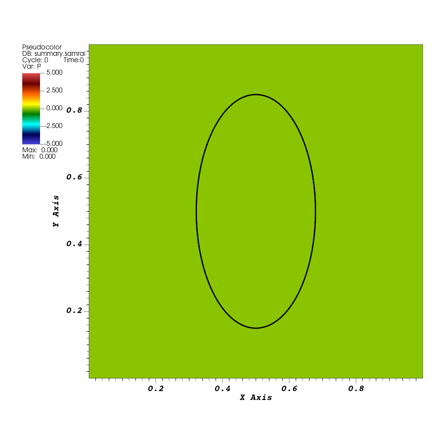

# Lesson 04: Put an elastic rubber band in the fluid

## Introduction

Run an elastic rubber band immersed in a fluid, inspect the files that define it, and view its motion over a fluid plot. The rubber band is modeled as a closed chain of springs. This is the first coupled fluid–structure example in the guide.

## Before you start

Complete [tutorial 03](03-kinetic-energy.md). Keep `EXAMPLES_SRC`, `EXAMPLES_BUILD`, and `IBAMR_ROOT` set in your terminal. This lesson uses `examples/IB/explicit/ex1` in this repository. Its `example.cpp` is the starting application from IBAMR; the supplied input is already shortened for this tutorial.

## Running the example

Compile the rubber-band application using the build configured in tutorial 00:

```bash
cmake --build "$EXAMPLES_BUILD" --target IB-ex1 --parallel 4
```

`IB-ex1` is its build target. Building it compiles and links the application to produce `main2d` under `examples/IB/explicit/ex1` in the build directory. This executable is separate from the fluid-only `main2d` under `examples/navier_stokes/ex1`; each comes from its own application source. If the target is already up to date, the build leaves the executable ready to use.

Create a fresh run directory and copy all three required input files into it:

```bash
cd "$EXAMPLES_BUILD/examples/IB/explicit/ex1"
mkdir elastic-loop
cp "$EXAMPLES_SRC/examples/IB/explicit/ex1/input2d" elastic-loop/
cp "$EXAMPLES_SRC/examples/IB/explicit/ex1/curve2d_64.vertex" elastic-loop/
cp "$EXAMPLES_SRC/examples/IB/explicit/ex1/curve2d_64.spring" elastic-loop/
cd elastic-loop
../main2d input2d
```

The application reads the structure files from the run directory. The `.vertex` file supplies point positions, and the `.spring` file supplies connections and spring parameters. If `elastic-loop` already exists, use a fresh run-directory name.

Let the run finish. Its last time-step messages should report simulation time `0.1`, set by `END_TIME = 0.1` in the supplied input.

Check the outputs in the run directory:

```bash
tail -n 15 IB2d.log
head -n 3 viz_IB2d/dumps.visit
head -n 3 viz_IB2d/lag_data.visit
```

## Results

There are now two visualization sequences:

| File | Contents |
| --- | --- |
| `viz_IB2d/dumps.visit` | Fluid velocity, pressure, and other requested fluid fields |
| `viz_IB2d/lag_data.visit` | Structure points and their connections |

`VisIt` enables the fluid writer and `Silo` enables the structure writer. The application writes both sequences together; the supplied input produces 21 matching states from time `0` to `0.1`. Keep the entire `viz_IB2d` directory, since the two `.visit` files refer to the numbered data directories within it.

### View the rubber band and fluid together

Use a fresh VisIt window or remove the plots from tutorial 02. Work with the two databases in the `elastic-loop/viz_IB2d` run directory.

1. Open `dumps.visit`. Add **Pseudocolor → P** and **Draw**. Set the color table to `hot_desaturated` and explicit limits to `-5` and `5`.
2. Open `lag_data.visit` as an additional source. Keep the pressure plot from `dumps.visit`, and add **Mesh → curve2d_64_mesh** from `lag_data.visit`. Set the mesh color to black and increase the line width if needed, then **Draw**. The structure should appear inside the fluid plot.
3. Open **Controls → Database correlations** and create a new correlation named `loop_time`. Choose the **Time** method and add both `dumps.visit` and `lag_data.visit` to its **Correlated sources** list. Create the correlation, then select `loop_time` as the **Active time slider**.
4. Select the first state, at time `0`, then advance to the final state, at time `0.1`. The correlation moves both datasets together. Keep this common time slider selected when playing the sequence.

A correlation connects the two saved time sequences; opening both files alone does not ensure that moving one file's slider updates the other. See the [VisIt database-correlation documentation](https://visit-sphinx-github-user-manual.readthedocs.io/en/3.4rc/using_visit/MultipleDatabaseAndWindows/Database_correlations.html) for the controls. In this case both writers saved the same times, so their states match directly.



*IBAMR output at time `0`: the black line shows the initial rubber band. The saved initial pressure is zero. Pressure display limits are `[-5,5]`.*


*The same run at time `0.1`, with matching fluid and structure times and the same pressure limits. The rubber band is wider and shorter, with higher pressure inside it. This is a short transient run.*

The rubber-band overlay shows the current point connections. To inspect the individual points, you can select the structure mesh named `curve2d_64_vertices`. Keep `curve2d_64_mesh` for the continuous rubber-band view used here.

### Measure the deformation and save the overlay

Use the rubber band's width and height to measure the change visible in the images. In VisIt, select the **Mesh** plot for `curve2d_64_mesh`, then open **Controls → Query** and choose **Spatial Extents**. Use **Actual data** if the query offers that choice, then run the query. It returns the minimum and maximum coordinates of the selected structure mesh, as described in the [VisIt query documentation](https://visit-sphinx-github-user-manual.readthedocs.io/en/v3.4.0/using_visit/Quantitative/Query.html).

At the first state, record $x_{\min}$, $x_{\max}$, $y_{\min}$, and $y_{\max}$. Calculate the width $W$, height $H$, and aspect ratio $H/W$:

$$
W=x_{\max}-x_{\min},\qquad
H=y_{\max}-y_{\min},\qquad
\text{aspect ratio}=\frac{H}{W}.
$$

Advance the correlated time slider to the final state and repeat the query with the structure plot still selected. The checked output gives:

| Simulation time | Width $W$ | Height $H$ | Aspect ratio $H/W$ |
| --- | --- | --- | --- |
| `0` | `0.3571` | `0.7000` | `1.9600` |
| `0.1` | `0.4044` | `0.5797` | `1.4336` |

The decreasing ratio measures the change from a tall band toward a shape with more similar width and height. Save your measurements in a text file alongside the run's input and log. Select the structure plot for this query: selecting the fluid plot would measure the fluid domain instead of the rubber band.

Save an image at time `0` and another at time `0.1` in the run directory under the build directory. Use the same view, pressure limits `[-5,5]`, and black rubber-band overlay for both. Give the files descriptive names such as `band-pressure-t0.png` and `band-pressure-t0.1.png`. Keep the pressure legend and simulation time visible, with `loop_time` selected as the common time slider.

If the rubber band does not appear, check that the Mesh plot uses `lag_data.visit` and `curve2d_64_mesh`, while the pressure plot still uses `dumps.visit`. If the application cannot find the structure files, check that both `curve2d_64.vertex` and `curve2d_64.spring` were copied alongside the run's `input2d`.

## The input and program

Read the [input](../examples/IB/explicit/ex1/input2d) and structure files alongside the application.

The fluid geometry uses the same periodic setup introduced in [tutorial 03](03-kinetic-energy.md). The new input pieces are `IBStandardInitializer`, which selects and configures the rubber-band data; `IBMethod`, which configures its coupling to the grid; and `IBHierarchyIntegrator`, which coordinates the coupled time advance. We will follow these as we read the structure files and application setup.

The rubber band is an immersed curve, with fluid on both sides. Its points and spring connections are supplied in separate files.

### Point positions: the vertex file

Open `curve2d_64.vertex`. Its first three lines are:

```text
304
6.7857142857142860e-01 5.0000000000000000e-01
6.7853328871213048e-01 5.0723341542964395e-01
```

The first line gives the number of points: 304. Each following line contains one point's initial `x y` coordinates. The point indices are implicit and start at zero, so these coordinate lines define points `0` and `1`. The `64` in the filename identifies the supplied geometry prepared for this fluid-grid resolution; it is not the number of structure points.

These coordinates form an ellipse centered at `(0.5, 0.5)`, with approximate bounds `0.3214` to `0.6786` horizontally and `0.15` to `0.85` vertically. The initial mesh plot above shows those positions.

### Connections: the spring file

Open `curve2d_64.spring`. Its first three lines are:

```text
304
     0      1 1.9353241079974475e+02 0.0000000000000000e+00
     1      2 1.9353241079974475e+02 0.0000000000000000e+00
```

The first line counts spring connections. Each subsequent record has four columns:

| Column | Meaning in this file |
| --- | --- |
| First point index | One endpoint of the spring |
| Second point index | The other endpoint |
| Spring stiffness | Coefficient used by the spring force calculation, subject to an input override |
| Resting length | Length at which that spring exerts zero force |

The last record is:

```text
   303      0 1.9353241079974475e+02 0.0000000000000000e+00
```

It connects the final point back to point `0`, closing the rubber band. The point coordinates and the connections are separate: changing a coordinate moves a point's starting position, while changing a connection changes which points interact.

### How the files change in 3D

The first line of a `.vertex` file still gives the number of points. Each following line contains three coordinates, `x y z`, instead of `x y`; point indices still follow the order of the coordinate records, starting at zero.

The four-column spring format shown above is unchanged: two point indices, stiffness, and resting length. A spring refers to its endpoints by index, so it does not need a third coordinate column. Its length and direction are calculated from the endpoints' three-dimensional positions. The connections must describe the intended 3D structure, and the application must be compiled in 3D with matching input arrays, as discussed in tutorial 00.

### How it works: spring forces and input overrides

For this example, the force exerted on point $i$ by a spring connecting it to point $j$ is

$$
\mathbf F_{i\leftarrow j}
=\kappa_{ij}(\ell_{ij}-\ell_{0,ij})
\frac{\mathbf X_j-\mathbf X_i}{\ell_{ij}},
\qquad \ell_{ij}=|\mathbf X_j-\mathbf X_i|.
$$

Here $\mathbf X_i$ and $\mathbf X_j$ are current point positions, $\ell_{ij}$ is their separation, $\ell_{0,ij}$ is the spring's resting length, and $\kappa_{ij}$ is its stiffness. The force on $j$ is equal and opposite. A stretched spring pulls its endpoints toward one another. Each point receives contributions from its neighboring springs.

The resting lengths in this file are zero. The initial ellipse is therefore under tension; its starting distances are not the springs' resting lengths. The structure forces act on the fluid, and the resulting fluid velocity moves the points. The saved frames show the initially stretched rubber band becoming wider and shorter. This short run does not establish an equilibrium shape or exact conservation of enclosed area.

The input can replace coefficients supplied by the spring file. Find the following `IBStandardInitializer` block; the top-level constants used here are `PI = 3.14159265358979`, `K = 1.0`, and the existing grid settings in the input:

```text
IBStandardInitializer {
   max_levels = MAX_LEVELS
   structure_names = "curve2d_64"

   beta = 0.35
   alpha = 0.25^2/beta

   A = PI*alpha*beta
   R = sqrt(A/PI)
   perim = 2*PI*R

   dx = L/NFINEST
   dx_64 = L/64
   num_node_circum = (dx_64/dx)*ceil(perim/(dx_64/3)/4)*4
   ds = 2.0*PI*R/num_node_circum

   curve2d_64 {
      level_number = MAX_LEVELS - 1
      uniform_spring_stiffness = K/ds
   }
}
```

`structure_names` selects the shared basename of the vertex and spring files. The nested `curve2d_64` block configures that structure, with zero-based `level_number = 0` in this one-level case. `uniform_spring_stiffness = K/ds` overrides the stiffness column for every spring in this structure. Here `ds` is the reference spacing used to scale the spring coefficient; the resulting stiffness is approximately `193.5324`, matching the supplied file for `K = 1`. It is a structural coefficient, separate from fluid viscosity `MU`.

The calculations involving `alpha` and `beta` determine the reference spacing and stiffness override in this input. The initializer still reads the point coordinates from `.vertex`: editing `alpha` or `beta` here does not regenerate the ellipse. Leave the geometry and coefficients unchanged in this lesson. [Tutorial 05](05-input-change.md) will use this input mechanism to make a controlled model change.

Open the complete [rubber-band application](../examples/IB/explicit/ex1/example.cpp) in the source directory. The following excerpts are parts of that application to read in place; you do not need to add or change code for this lesson.

### Add the IB method and coupled integrator

In the fluid-only example, `time_integrator` referred directly to the fluid integrator. Here, `navier_stokes_integrator` retains that fluid role, while `time_integrator` refers to the coupled driver. The patch hierarchy and gridding helpers are constructed as in tutorial 03, with this coupled driver passed to `StandardTagAndInitialize`.

The application then creates the IB strategy and the integrator that coordinates the coupled simulation:

```cpp
Pointer<IBMethod> ib_method_ops = new IBMethod("IBMethod", app_initializer->getComponentDatabase("IBMethod"));
Pointer<IBHierarchyIntegrator> time_integrator =
    new IBExplicitHierarchyIntegrator("IBHierarchyIntegrator",
                                      app_initializer->getComponentDatabase("IBHierarchyIntegrator"),
                                      ib_method_ops,
                                      navier_stokes_integrator);
```

The `IBMethod` constructor receives its object name and the `IBMethod` input database. The `IBExplicitHierarchyIntegrator` constructor receives its own name and database, followed by the IB method and fluid integrator it will coordinate. These are existing objects passed into the driver, rather than a second fluid solver created inside the application.

`IBMethod` manages the structure points and their exchange with the fluid grid. `IBExplicitHierarchyIntegrator` receives both this IB strategy and the fluid integrator, so its `advanceHierarchy(dt)` call coordinates their work. The fluid integrator still handles the fluid equations. The name `Explicit` describes the IB coupling; it does not mean that every fluid term uses explicit time stepping.

The input selects the spreading/interpolation kernel through:

```text
DELTA_FUNCTION = "IB_4"

IBMethod {
   delta_fcn = DELTA_FUNCTION
   enable_logging = ENABLE_LOGGING
}
```

`IB_4` selects the four-point IB kernel used to transfer forces and velocities between structure points and nearby fluid-grid locations. The structure points are free to move between grid locations; they do not have to coincide with cell centers or faces.

### Register the initializer and force generator

Find:

```cpp
Pointer<IBStandardInitializer> ib_initializer = new IBStandardInitializer(
    "IBStandardInitializer", app_initializer->getComponentDatabase("IBStandardInitializer"));
ib_method_ops->registerLInitStrategy(ib_initializer);
Pointer<IBStandardForceGen> ib_force_fcn = new IBStandardForceGen();
ib_method_ops->registerIBLagrangianForceFunction(ib_force_fcn);
```

The initializer receives its name and the `IBStandardInitializer` input database. The registration call connects it to `IBMethod` and starts the initializer's setup, including reading the vertex and spring files and applying the input overrides. The selected structure name therefore determines which files must be present in the run directory. Later, hierarchy initialization uses that prepared information to place the structure data on the hierarchy.

`IBStandardForceGen` is created separately from the initializer because supplying starting data and evaluating forces during motion are different jobs. Registering this generator selects the force provider; it does not calculate a force at that line. During advancement, `IBMethod` asks this registered generator to evaluate forces from the current structure state and initialized spring parameters. These four-column records use the default spring-force function, with index `0`, so the standard generator applies the spring law above. A later programming lesson will use its `registerSpringForceFunction` interface to supply a different spring law while retaining the surrounding fluid and IB setup.

This separation lets one application choose geometry and structural forces while reusing the fluid solver and the IB coupling. To follow the data path, trace `structure_names` to the initializer, the spring parameters to the force generator, and those two registration calls to `ib_method_ops`.

### Set the coupled step bound

The new `IBHierarchyIntegrator` input block supplies settings to that coupled integrator. Its `dt_max = DT` entry uses this stiffness-dependent step bound:

```text
K = 1.0
DT = (1.0/K)*1.6e-2*DX_FINEST
```

`DX_FINEST` is the finest fluid-grid spacing already calculated in the input. This example reduces its step bound as `K` increases. The same `K` enters the spring-stiffness override `K/ds`, linking the structure setting to the coupled run's time step.

### Configure the two output writers

The new output setting is the addition of the structure writer to `Main.viz_writer`:

```text
viz_writer = "VisIt","Silo"
```

The application obtains and registers separate fluid and structure writers. Find these lines in `example.cpp`:

```cpp
Pointer<VisItDataWriter<NDIM>> visit_data_writer = app_initializer->getVisItDataWriter();
Pointer<LSiloDataWriter> silo_data_writer = app_initializer->getLSiloDataWriter();
```

Within the following `uses_visit` block:

```cpp
ib_initializer->registerLSiloDataWriter(silo_data_writer);
time_integrator->registerVisItDataWriter(visit_data_writer);
ib_method_ops->registerLSiloDataWriter(silo_data_writer);
```

The initializer registers the structure representation with the Silo writer, and the IB method connects that writer to the evolving structure data. The coupled integrator connects the fluid output to the VisIt writer. These registrations happen before hierarchy initialization, so both output systems are ready when the initial state is saved.

After initialization, the application saves an initial state and then writes at the configured intervals and final step, following the pattern in tutorial 02. Each write uses:

```cpp
time_integrator->setupPlotData();
visit_data_writer->writePlotData(patch_hierarchy, iteration_num, loop_time);
silo_data_writer->writePlotData(iteration_num, loop_time);
```

Both writers receive the same step and physical time. That is why `dumps.visit` and `lag_data.visit` contain matching times while providing different meshes and fields.

### Initialize once, then advance the coupled state

After registering the model providers and output writers, the application calls:

```cpp
time_integrator->initializePatchHierarchy(patch_hierarchy, gridding_algorithm);
```

The hierarchy and gridding arguments have the roles introduced in tutorial 03. Calling through the IB integrator now initializes both the fluid fields and the immersed structure. The structure's point positions and spring information are available for the subsequent coupled advance.

The application then releases the temporary initialization objects:

```cpp
ib_method_ops->freeLInitStrategy();
ib_initializer.setNull();
app_initializer.setNull();
```

The simulation retains its initialized state and force generator. These calls release setup resources after their work is complete; they do not remove the moving structure. In particular, the force generator is still needed each time the structure force is evaluated.

Inside the time loop, locate the familiar calls:

```cpp
dt = time_integrator->getMaximumTimeStepSize();
time_integrator->advanceHierarchy(dt);
loop_time += dt;
```

The allowed step is now obtained from the coupled integrator. Its advance coordinates structural force evaluation and spreading, the fluid advance, and velocity interpolation used to move the points. The fluid equations still belong to `navier_stokes_integrator`; the outer application asks the coupled driver to advance the combined state. As before, updating the local `loop_time` only updates the time used for reporting and output.

## Before moving on

This lesson ran a coupled IB simulation, read the point and spring files, and followed how the initializer, force generator, IB method, and fluid solver are connected. You should have a built rubber-band executable, a complete `elastic-loop` run with both visualization sequences, saved initial and later images with the fluid and structure matched in time, and width, height, and aspect-ratio measurements for both states.

[Tutorial 05](05-input-change.md) will change a model parameter through the rubber band's input file and compare a second run with this baseline. You will follow the active input coefficient and keep the outputs separate for a comparison at the same physical time.
