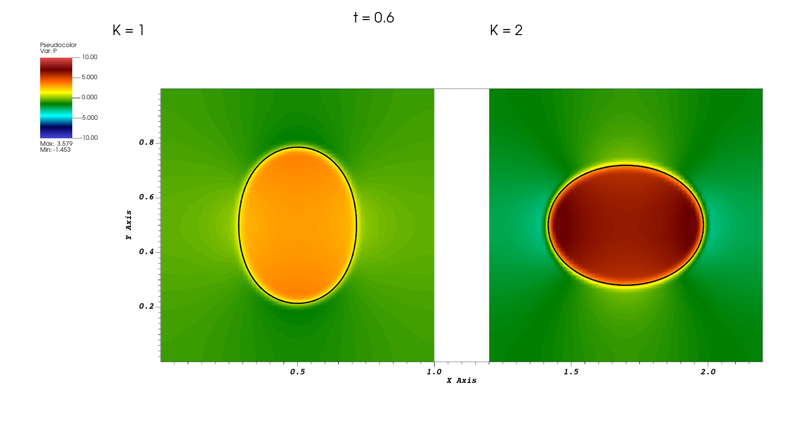

# Tutorial 05: Change the model through its input

## Introduction

Make the elastic rubber band stiffer by changing one input parameter. Run the same executable with the new input and compare the simulations at the same physical time. Then follow the changed value into the spring-force calculation.

## Before you start

Complete [tutorial 04](04-elastic-loop.md), including its `elastic-loop` run and fluid–structure overlay. Keep `EXAMPLES_SRC` and `EXAMPLES_BUILD` set in your terminal. This tutorial reuses `examples/IB/explicit/ex1` and its existing `main2d` executable. No new source file or build target is needed.

## Running the example

### Copy the baseline into a new run directory

Copy just the input and structure files from tutorial 04. Keep its output as the baseline:

```bash
cd "$EXAMPLES_BUILD/examples/IB/explicit/ex1"
mkdir elastic-loop-stiff
cp elastic-loop/input2d elastic-loop-stiff/
cp elastic-loop/curve2d_64.vertex elastic-loop-stiff/
cp elastic-loop/curve2d_64.spring elastic-loop-stiff/
```

If that new directory already exists, choose a fresh name and use it consistently below. Open `elastic-loop-stiff/input2d` and change only

**Read:** [`input2d`, line 8](../examples/IB/explicit/ex1/input2d#L8).

```text
K   = 1.0
```

to

**Replacement in:** `elastic-loop-stiff/input2d`, top-level `K` ([`input2d`, line 8](../examples/IB/explicit/ex1/input2d#L8) in the supplied file).

```text
K   = 2.0
```

Save the file. Check the difference from the baseline:

```bash
diff -u elastic-loop/input2d elastic-loop-stiff/input2d
```

The only changed assignment should be `K`. `diff` returns status `1` when it finds differences; here that is the expected result. The unchanged expressions recalculate the stiffness and time-step bound from the new value.

### Run the existing executable

No compilation or CMake configuration is needed for this input change. Change to the new run directory:

```bash
cd "$EXAMPLES_BUILD/examples/IB/explicit/ex1/elastic-loop-stiff"
```

Run the simulation:

```bash
../main2d input2d
```

Confirm that the final reported simulation time is `0.6`. The program writes a new `IB2d.log` and `viz_IB2d` here, leaving the baseline output in `elastic-loop`.

The log records the input database used by this run. Open `IB2d.log` and find `K`, `uniform_spring_stiffness`, and the integrators' `dt_max` entries. They should correspond to `K = 2`, stiffness approximately `387.065` in the printed database, and a time-step bound of `0.000125`. These values check that the intended input reached the initialized model.

## Results

### Compare both runs in one window

Use one VisIt window for both pressure-and-rubber-band overlays. Keep the baseline on the left and move the stiffer case to the right.

1. Start with the baseline overlay from tutorial 04: a **Pseudocolor** plot of `P` from `elastic-loop/viz_IB2d/dumps.visit` and a black **Mesh** plot of `curve2d_64_mesh` from `elastic-loop/viz_IB2d/lag_data.visit`.
2. Open `elastic-loop-stiff/viz_IB2d/dumps.visit` and add another **Pseudocolor** plot of `P`. Open `elastic-loop-stiff/viz_IB2d/lag_data.visit` and add another black **Mesh** plot of `curve2d_64_mesh`. There should now be four plots in the plot list.
3. Set both pressure plots to `hot_desaturated` with minimum `-10` and maximum `10`. These shared limits replace tutorial 04's single-run limits.
4. Uncheck **Apply operators to all plots**. Select only the stiffer case's pressure plot. Choose **Operators → Transforms → Transform**, then open its attributes by double-clicking **Transform** in the plot list. Enable **Translate** and set `X = 1.2`, `Y = 0`, `Z = 0`, with rotation and scaling disabled. Click **Apply**.
5. Apply the same **Transform** settings to the stiffer case's mesh plot. Click **Draw**, then reset the view to include both domains.

The [Transform operator](https://visit-sphinx-github-user-manual.readthedocs.io/en/v3.3.2/using_visit/Operators/OperatorTypes/Transform_operator.html) changes the displayed coordinates. The baseline occupies `0 <= x <= 1` and the shifted case `1.2 <= x <= 2.2`. Translating both pressure and structure keeps their overlay aligned; the simulation data and pressure values are unchanged.

### Match the physical times

A database correlation lets one slider control several databases. Its type determines which saved frames are shown together:

| Type | How it matches frames |
| --- | --- |
| **Padded index** | Matches frame numbers: first with first, second with second, and so on. Repeats the final frame of a shorter sequence after it ends. |
| **Stretched index** | Spreads a shorter sequence across the longer one, repeating frames throughout so their beginnings and ends line up. Uses sequence position rather than physical time. |
| **Time** | Uses the physical times stored in the databases. Suitable when simulations use different time steps or output intervals. |
| **Cycle** | Uses the stored simulation cycle numbers, usually time-step numbers. Equal cycles can represent different physical times when step sizes differ. |

Use **Time** here because we want to compare the bands at the same physical time, even though the stiffer case takes more steps.

Following tutorial 04's database-correlation steps, create one [**Time** correlation](https://visit-sphinx-github-user-manual.readthedocs.io/en/v3.3.1/using_visit/MultipleDatabaseAndWindows/Database_correlations.html) containing all four databases and name it `stiffness_time`. Select that correlation in the time controls and move to its final state. Select each plot and query **Time** to confirm that all four show `0.6`.

The baseline has 121 saved states and the stiffer case has 241, because `Main.viz_dump_interval = 20` counts steps and the stiffer case takes smaller steps. Their individual final zero-based state indices are `120` and `240`. A Time correlation aligns physical times rather than matching these indices. Between shared saved times, it can reuse a frame from the less frequently saved baseline; use times saved by both runs for exact comparisons.



*Left: `K = 1.0`. Right: `K = 2.0`, translated by `1.2` in the x direction. Both show actual IBAMR output at time `0.6` with pressure limits `[-10,10]`.*

### Measure and save the comparison

Select the structure mesh plot and use **Controls → Query → Spatial Extents**, as in tutorial 04. At time `0.6`, record the width, height, and height/width ratio for each run. The translation adds `1.2` to the right-hand plot’s x bounds; subtracting its minimum from its maximum gives the same width as before translation. Both runs start with the same shape because their vertex files are unchanged.

The checked runs give these values at time `0.6`:

| Run | Width | Height | Height/width |
| --- | --- | --- | --- |
| Baseline, `K = 1.0` | `0.4307` | `0.5718` | `1.3275` |
| Stiffer band, `K = 2.0` | `0.5677` | `0.4386` | `0.7726` |

Both start with height/width approximately `1.9600`. At time `0.6`, the baseline band is taller than it is wide, while the stiffer band is wider than it is tall. Play the two sequences to see how the stiffness changes the timing of the motion.

Save the measurements alongside each run’s input and log, including `K` and physical time. Save the combined view as `band-stiffness-comparison-t0.6.png`. Use **Controls → Annotation** to label the left and right cases with their `K` values and show the physical time. Since the pressure limits are shared, one pressure legend is sufficient; hide the second in that pressure plot’s attributes.

## The input and program

The application source and supplied input are in `examples/IB/explicit/ex1` under `EXAMPLES_SRC`.

### Follow the active stiffness setting

Open the baseline run's `input2d` under `EXAMPLES_BUILD/examples/IB/explicit/ex1/elastic-loop`. Find the top-level parameter:

**Read:** [`input2d`, line 8](../examples/IB/explicit/ex1/input2d#L8).

```text
K   = 1.0
```

Inside `IBStandardInitializer`, find the structure's settings:

**Read:** [`input2d`, lines 112–115](../examples/IB/explicit/ex1/input2d#L112-L115).

```text
curve2d_64 {
   level_number = MAX_LEVELS - 1
   uniform_spring_stiffness = K/ds
}
```

`K` controls the spring stiffness through this expression. The reference spacing `ds` is calculated in the enclosing initializer block, as explained in tutorial 04. With the point spacing unchanged, the spring coefficient is

$$
\kappa=\frac{K}{ds}.
$$

Doubling `K` therefore doubles the coefficient assigned to every spring. The `.spring` file also contains stiffness values, but `uniform_spring_stiffness` replaces them when the initializer reads the file. For this run, editing the stiffness column in `.spring` would therefore have no effect. Keep the vertex and spring files unchanged: we want the same initial shape and connections in both runs.

### How the program uses the coefficient

Follow the setup in the supplied [application](../examples/IB/explicit/ex1/example.cpp). The relevant connection is:

**Read:** [`example.cpp`, lines 146–148](../examples/IB/explicit/ex1/example.cpp#L146-L148).

```cpp
Pointer<IBStandardInitializer> ib_initializer = new IBStandardInitializer(
    "IBStandardInitializer", app_initializer->getComponentDatabase("IBStandardInitializer"));
ib_method_ops->registerLInitStrategy(ib_initializer);
```

The constructor receives the initializer's input block. Registering the initializer with `IBMethod` starts its setup, including reading the structure files. For each spring, the initializer reads the file's parameters and replaces the stiffness with the input override. This happens when a new run starts; the executable does not contain a hard-coded value of `K`.

The force generator registered just below these lines uses those initialized parameters during advancement. To see how stiffness enters its calculation, the default spring function is defined in the installed header `$IBAMR_ROOT/include/ibamr/IBSpringForceFunctions.h`:

**Library header:** `$IBAMR_ROOT/include/ibamr/IBSpringForceFunctions.h`, lines 103–107 in v0.19.0 ([versioned source](https://github.com/IBAMR/IBAMR/blob/v0.19.0/include/ibamr/IBSpringForceFunctions.h#L103)).

```cpp
inline double
default_spring_force(double R, const double* params, int /*lag_mastr_idx*/, int /*lag_slave_idx*/)
{
    return params[0] * (R - params[1]);
}
```

Note this is an existing library function. `R` is the current distance between the spring's endpoints. `params[0]` is the stiffness after input overrides, and `params[1]` is the resting length. The final two arguments identify the endpoints; this default law does not use their indices.

The returned number is the spring tension. `IBStandardForceGen` combines it with the direction between the points to apply equal and opposite forces, using the law introduced in tutorial 04. Doubling the stiffness doubles the tension for a given pair of point positions. Once the simulations evolve, their positions differ, so their forces need not remain in a two-to-one ratio.

For more detail, see the [`IBStandardInitializer` documentation](https://ibamr.github.io/IBAMR-docs/ibamr/classIBAMR_1_1IBStandardInitializer.html) for structure input options and the [`IBStandardForceGen` documentation](https://ibamr.github.io/IBAMR-docs/ibamr/classIBAMR_1_1IBStandardForceGen.html) for force evaluation and `registerSpringForceFunction`. Changing the coefficient of this existing law is an input edit. [Tutorial 10](10-your-rubber-band-application.md) keeps this spring law and replaces the geometry files with C++ initialization callbacks. [Tutorial 13](13-cooks-membrane.md) modifies a structural surface-force callback in a different application.

### Check which other settings depend on K

The same input uses `K` in its time-step bound:

**Read:** [`input2d`, line 29](../examples/IB/explicit/ex1/input2d#L29).

```text
DT = (1.0/K)*1.6e-2*DX_FINEST
```

Both `IBHierarchyIntegrator` and the selected `INSStaggeredHierarchyIntegrator` receive it through:

**Read:** [`input2d`, line 85](../examples/IB/explicit/ex1/input2d#L85) in `IBHierarchyIntegrator` and [`input2d`, line 154](../examples/IB/explicit/ex1/input2d#L154) in `INSStaggeredHierarchyIntegrator`.

```text
dt_max = DT
```

For the existing grid, `DX_FINEST = 1/64`. Changing `K` from `1.0` to `2.0` changes `DT` from `0.00025` to `0.000125`. Keep this expression: it supplies the smaller step chosen by this example for a stiffer structure. This is an example-specific step bound, not a general stability formula for other models.

Keep the final time independent of `K`:

**Read:** [`input2d`, line 21](../examples/IB/explicit/ex1/input2d#L21).

```text
END_TIME = 0.6
```

This is already the value in the supplied tutorial input. It makes both simulations stop at the same physical time even though they take different numbers of steps. No other input changes are required.

## Before moving on

This tutorial changed spring stiffness through the input, traced the override into the force calculation, and compared separate runs at the same physical time. You should have the original `elastic-loop` run, a new `elastic-loop-stiff` run using the same executable, a side-by-side comparison image, and shape measurements retained with the inputs and logs.

[Tutorial 06](06-refinement.md) will use this rubber-band model to introduce finer fluid cells and matching structure-point spacing. You will inspect the grid and compare a measurement while keeping the physical model fixed.
