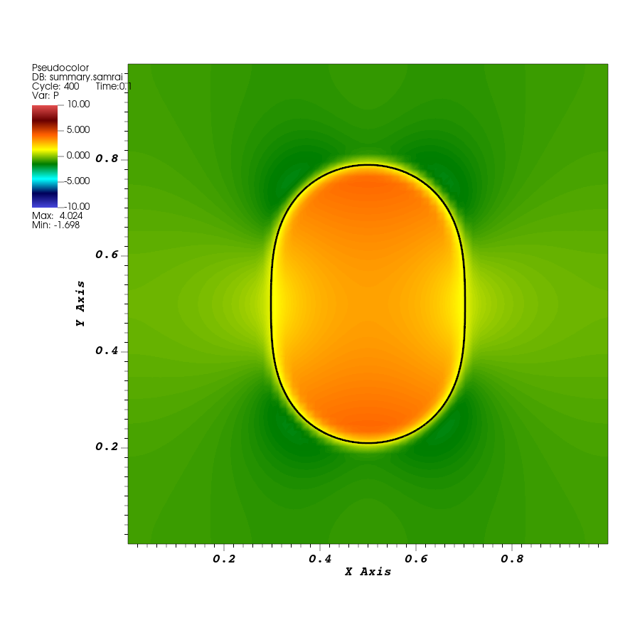
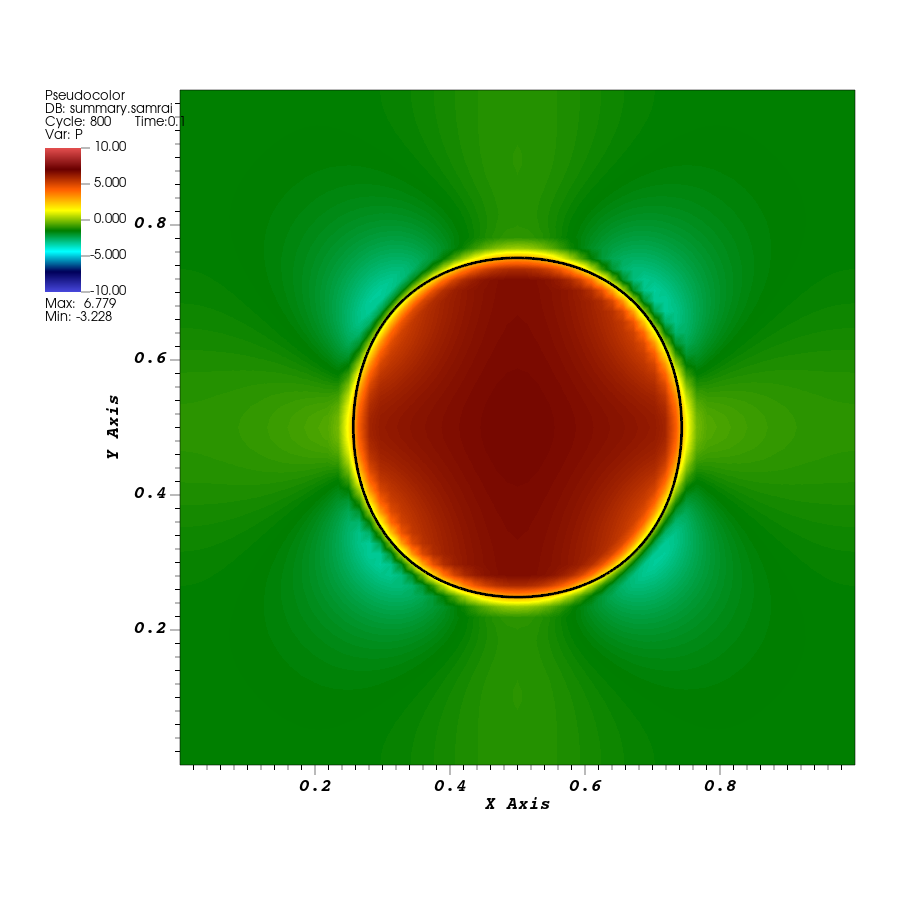

# Lesson 05: Change the model through its input

## Introduction

Make the elastic rubber band stiffer by changing one input parameter. Run the same executable with the new input and compare the simulations at the same physical time. Then follow the changed value into the spring-force calculation.

## Before you start

Complete [tutorial 04](04-elastic-loop.md), including its `elastic-loop` run and fluid–structure overlay. Keep `EXAMPLES_SRC` and `EXAMPLES_BUILD` set in your terminal. This lesson reuses `examples/IB/explicit/ex1` and its existing `main2d` executable. No new source file or build target is needed.

## Running the example

### Copy the baseline into a new run directory

Copy just the input and structure files from tutorial 04. Keep its output as the baseline:

```bash
cd "$EXAMPLES_BUILD/examples/IB/explicit/ex1"
mkdir elastic-loop-stiff
cp elastic-loop/input2d elastic-loop-stiff/
cp elastic-loop/curve2d_64.vertex elastic-loop-stiff/
cp elastic-loop/curve2d_64.spring elastic-loop-stiff/
```

If that new directory already exists, choose a fresh name and use it consistently below. Open `elastic-loop-stiff/input2d` and change only

```text
K   = 1.0
```

to

```text
K   = 2.0
```

Save the file. Check the difference from the baseline:

```bash
diff -u elastic-loop/input2d elastic-loop-stiff/input2d
```

The only changed assignment should be `K`. `diff` returns status `1` when it finds differences; here that is the expected result. The unchanged expressions recalculate the stiffness and time-step bound from the new value.

### Run the existing executable

No compilation or CMake configuration is needed for this input change. Run from the new directory:

```bash
cd "$EXAMPLES_BUILD/examples/IB/explicit/ex1/elastic-loop-stiff"
../main2d input2d > stdout.log 2>&1
tail -n 15 stdout.log
```

Confirm that the final reported simulation time is `0.1`. The program writes a new `IB2d.log` and `viz_IB2d` here, leaving the baseline output in `elastic-loop`.

The log records the input database used by this run. Open `IB2d.log` and find `K`, `uniform_spring_stiffness`, and the integrators' `dt_max` entries. They should correspond to `K = 2`, stiffness approximately `387.065` in the printed database, and a time-step bound of `0.000125`. These values check that the intended input reached the initialized model.

## Results

### Compare at the same physical time

Use the fluid-pressure and black rubber-band overlay from tutorial 04 for each run. The new sequences are `elastic-loop-stiff/viz_IB2d/dumps.visit` and `elastic-loop-stiff/viz_IB2d/lag_data.visit` under the example's build directory.

For the new run, create a **Time** database correlation for its fluid and structure files, using a distinct name such as `stiff_time`. Follow tutorial 04's correlation steps. Set the pressure limits to `-10` and `10` and use `hot_desaturated` for **both** runs. These shared limits replace the limits used for tutorial 04's single-run view.

Select physical time `0.1` in each run. The baseline has 21 saved states and the stiffer case has 41, because `Main.viz_dump_interval = 20` counts steps and the stiffer case takes smaller steps. Their final zero-based state indices are `20` and `40`. Comparing the same slider index would compare different physical times. Read the displayed time when switching between runs.



*Baseline, `K = 1.0`, at time `0.1`. Pressure limits are `[-10,10]`; the black mesh shows the rubber band.*



*Stiffer rubber band, `K = 2.0`, at the same time and with the same view and pressure limits. Both figures use actual IBAMR output.*

### Measure and save the comparison

Select the structure mesh plot and use **Controls → Query → Spatial Extents**, as in tutorial 04. At time `0.1`, record the width, height, and height/width ratio for each run. The initial bounds should match because the vertex files are unchanged.

The checked runs give these values at time `0.1`:

| Run | Width | Height | Height/width |
| --- | --- | --- | --- |
| Baseline, `K = 1.0` | `0.4044` | `0.5797` | `1.4336` |
| Stiffer band, `K = 2.0` | `0.4865` | `0.5026` | `1.0332` |

Both start with height/width approximately `1.9600`. At time `0.1`, the stiffer band has a ratio closer to one: its width and height are more similar. The pressure field also differs, as shown on the shared color scale. These are transient shapes at the selected time.

Save the measurements alongside each run's input and log, including `K` and physical time. Save a PNG of each final overlay using the same view, color table, and limits. Use names such as `band-K1-pressure-t0.1.png` and `band-K2-pressure-t0.1.png`.

## The input and program

### Follow the active stiffness setting

Open the baseline run's `input2d` under `EXAMPLES_BUILD/examples/IB/explicit/ex1/elastic-loop`. Find the top-level parameter:

```text
K   = 1.0
```

Inside `IBStandardInitializer`, find the structure's settings:

```text
curve2d_64 {
   level_number = MAX_LEVELS - 1
   uniform_spring_stiffness = K/ds
}
```

`K` controls the spring stiffness through this expression. The reference spacing `ds` is calculated in the enclosing initializer block, as explained in tutorial 04. With the point spacing unchanged, the spring coefficient is

$$
\kappa=\frac{K}{ds}.
$$

Doubling `K` therefore doubles the coefficient assigned to every spring. The `.spring` file also contains stiffness values, but `uniform_spring_stiffness` replaces them when the initializer reads the file. For this run, editing the stiffness column in `.spring` would therefore have no effect. Keep the vertex and spring files unchanged: we want the same initial shape and connections in both runs.

### How the program uses the coefficient

Follow the setup in the supplied [application](../examples/IB/explicit/ex1/example.cpp). The relevant connection is:

```cpp
Pointer<IBStandardInitializer> ib_initializer = new IBStandardInitializer(
    "IBStandardInitializer", app_initializer->getComponentDatabase("IBStandardInitializer"));
ib_method_ops->registerLInitStrategy(ib_initializer);
```

The constructor receives the initializer's input block. Registering the initializer with `IBMethod` starts its setup, including reading the structure files. For each spring, the initializer reads the file's parameters and replaces the stiffness with the input override. This happens when a new run starts; the executable does not contain a hard-coded value of `K`.

The force generator registered just below these lines uses those initialized parameters during advancement. To see how stiffness enters its calculation, the default spring function is defined in the installed header `$IBAMR_ROOT/include/ibamr/IBSpringForceFunctions.h`:

```cpp
inline double
default_spring_force(double R, const double* params, int /*lag_mastr_idx*/, int /*lag_slave_idx*/)
{
    return params[0] * (R - params[1]);
}
```

Note this is an existing library function. `R` is the current distance between the spring's endpoints. `params[0]` is the stiffness after input overrides, and `params[1]` is the resting length. The final two arguments identify the endpoints; this default law does not use their indices.

The returned number is the spring tension. `IBStandardForceGen` combines it with the direction between the points to apply equal and opposite forces, using the law introduced in tutorial 04. Doubling the stiffness doubles the tension for a given pair of point positions. Once the simulations evolve, their positions differ, so their forces need not remain in a two-to-one ratio.

For more detail, see the [`IBStandardInitializer` documentation](https://ibamr.github.io/IBAMR-docs/ibamr/classIBAMR_1_1IBStandardInitializer.html) for structure input options and the [`IBStandardForceGen` documentation](https://ibamr.github.io/IBAMR-docs/ibamr/classIBAMR_1_1IBStandardForceGen.html) for force evaluation and `registerSpringForceFunction`. Changing the coefficient of this existing law is an input edit. Supplying a different C++ force law would require a source change and a rebuild; a later tutorial will do that.

### Check which other settings depend on K

The same input uses `K` in its time-step bound:

```text
DT = (1.0/K)*1.6e-2*DX_FINEST
```

Both `IBHierarchyIntegrator` and the selected `INSStaggeredHierarchyIntegrator` receive it through:

```text
dt_max = DT
```

For the existing grid, `DX_FINEST = 1/64`. Changing `K` from `1.0` to `2.0` changes `DT` from `0.00025` to `0.000125`. Keep this expression: it supplies the smaller step chosen by this example for a stiffer structure. This is an example-specific step bound, not a general stability formula for other models.

Keep the final time independent of `K`:

```text
END_TIME = 0.1
```

This is already the value in the supplied tutorial input. It makes both simulations stop at the same physical time even though they take different numbers of steps. No other input changes are required.

## Before moving on

This lesson changed spring stiffness through the input, traced the override into the force calculation, and compared separate runs at the same physical time. You should have the original `elastic-loop` run, a new `elastic-loop-stiff` run using the same executable, and comparison images and shape measurements retained with their respective inputs and logs.

[Tutorial 06](06-refinement.md) will use this rubber-band model to introduce finer fluid cells and matching structure-point spacing. You will inspect the grid and compare a measurement while keeping the physical model fixed.
