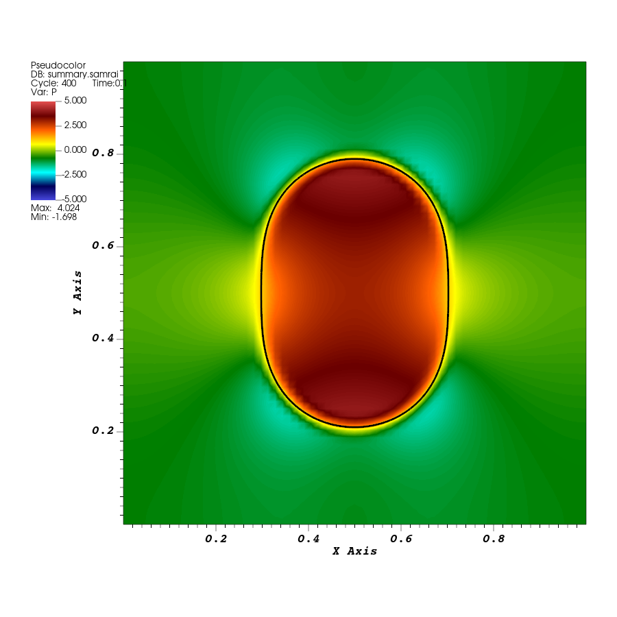
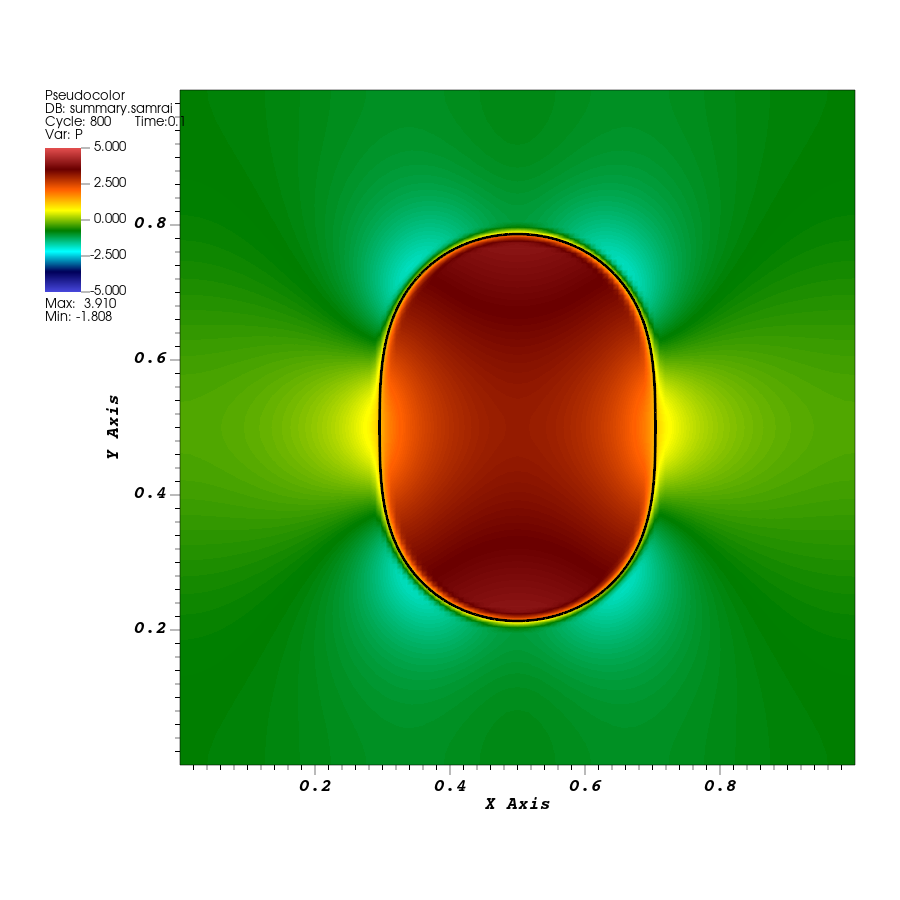
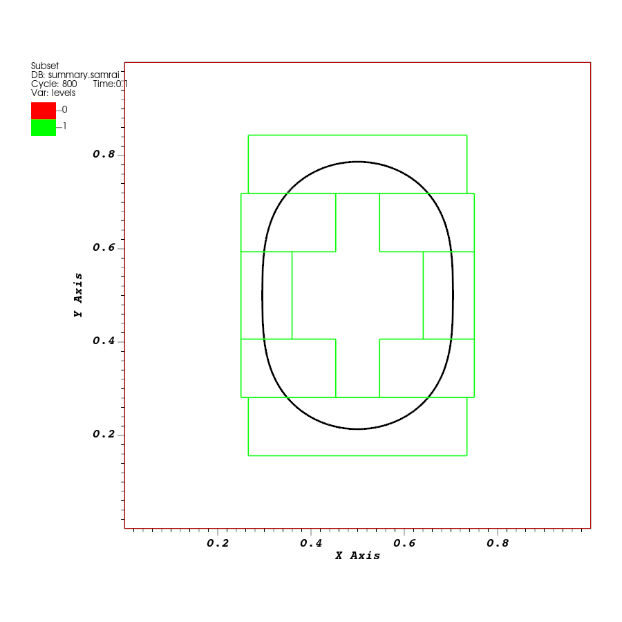

# Lesson 06: Use finer cells near the rubber band

## Introduction

Run the rubber band with a finer fluid grid near its moving points. View the grid levels and compare the band with the original run. Then follow how the input and IB method select the refined region.

## Before you start

Complete [tutorial 05](05-input-change.md). Use the original `elastic-loop` run from tutorial 04 as this lesson's baseline, with `K = 1.0`, rather than the stiffer case. Keep `EXAMPLES_SRC` and `EXAMPLES_BUILD` set. This lesson uses the same application and executable; no rebuild is needed.

## Running the example

### Prepare the finer-grid run

The repository supplies `curve2d_128.vertex` and `curve2d_128.spring` for this activity. They describe the same initial ellipse with more structure points.

Create a fresh directory under the example's build directory, copy the baseline input, and copy the finer structure files from the source directory:

```bash
cd "$EXAMPLES_BUILD/examples/IB/explicit/ex1"
mkdir elastic-loop-refined
cp elastic-loop/input2d elastic-loop-refined/
cp "$EXAMPLES_SRC/examples/IB/explicit/ex1/curve2d_128.vertex" elastic-loop-refined/
cp "$EXAMPLES_SRC/examples/IB/explicit/ex1/curve2d_128.spring" elastic-loop-refined/
```

If that directory already exists, choose a fresh name and use it consistently. Edit `elastic-loop-refined/input2d`. Change these two top-level assignments:

| Setting | Baseline | Refined run |
| --- | --- | --- |
| `MAX_LEVELS` | `1` | `2` |
| `REF_RATIO` | `4` | `2` |

Keep `N = 64`. Inside `IBStandardInitializer`, change the structure name:

```text
structure_names = "curve2d_128"
```

Rename its nested structure block to match, keeping its entries:

```text
curve2d_128 {
   level_number = MAX_LEVELS - 1
   uniform_spring_stiffness = K/ds
}
```

Both names must change from `curve2d_64` to `curve2d_128`: the first selects the files, and the nested block configures that structure. Keep `K = 1.0`, `END_TIME = 0.1`, and the remaining input unchanged. The existing formulas calculate the new point-spacing scale, spring coefficients, and time-step bound.

### Run the existing application

From the new run directory:

```bash
cd "$EXAMPLES_BUILD/examples/IB/explicit/ex1/elastic-loop-refined"
../main2d input2d > stdout.log 2>&1
tail -n 15 stdout.log
```

Confirm that the run reaches physical time `0.1`. Open `IB2d.log` and check the input database: `max_levels` should be `2`, `num_node_circum` should be `608`, and the structure's `level_number` should be `1`. The log also reports regridding during the run.

The new fluid and structure sequences are in this run's `viz_IB2d/dumps.visit` and `viz_IB2d/lag_data.visit`. Keep both sequences and their complete data directories.

## Results

### View the refined solution

Use the pressure/structure overlay from tutorial 04, with these changes:

1. Open the refined run's `dumps.visit`. If VisIt adds a **Subset → levels** plot automatically, hide it for the pressure view. Add **Pseudocolor → P**, use `hot_desaturated`, and set pressure limits to `-5` and `5`.
2. Open the same run's `lag_data.visit` and add the black **Mesh → curve2d_128_mesh** plot. The mesh name changes with the structure name.
3. Create a **Time** correlation for these two databases, named `refined_time`, and select it as the active time slider.
4. Select physical time `0.1`. Use the same pressure limits and view when opening the baseline for comparison.

The refined run has 41 saved states, compared with the baseline's 21. Its time-step bound is smaller, while `Main.viz_dump_interval = 20` still counts steps. Their final zero-based state indices are `40` and `20`; compare physical times rather than equal slider indices.



*Original one-level run at time `0.1`, using `curve2d_64` and pressure limits `[-5,5]`.*



*Two-level run at the same time and with the same pressure limits, using `curve2d_128`.*

### See where the finer grid is placed

Keep the refined structure mesh visible and hide the pressure plot. Select the fluid database and show its **Subset → levels** plot, or add it if it is absent. Open the Subset plot attributes, enable **Wireframe**, apply, and draw. Keep `refined_time` selected so the grid and structure stay at the same time.

The level outlines show where the finer region lies around the rubber band. Move between the first and last saved states to see the grid change as the points move. The [VisIt Subset plot documentation](https://visit-sphinx-github-user-manual.readthedocs.io/en/v3.3.0d/using_visit/Plots/PlotTypes/SubsetPlot.html) describes the wireframe display.



*Actual grid-level outlines and the structure at time `0.1`. The plot shows the extent of the refinement levels; it does not draw every fluid cell.*

To see individual cells, add **Mesh → amr_mesh** from the fluid database. This is a different mesh from `curve2d_128_mesh`: one is the fluid grid and the other is the immersed structure. Hide the fluid mesh again when comparing pressure images.

### Compare a shape measurement

Use **Spatial Extents** on the structure plot, as in tutorial 04. Record width, height, and height/width for the original and refined runs at time `0.1`. Both use `K = 1`; this comparison changes the fluid and structure resolutions together.

The checked runs give these values at time `0.1`:

| Run | Width | Height | Height/width |
| --- | --- | --- | --- |
| Original, one level | `0.4044` | `0.5797` | `1.4336` |
| Refined, two levels | `0.4088` | `0.5731` | `1.4020` |

The overall motion is similar, while the refined band is slightly wider and shorter at this time. Its height/width ratio is about 2.2% lower. This gives a practical indication of the result's sensitivity to resolution; two runs alone do not establish a converged value.

Save your measurements with the inputs and logs. Save a grid-level image and the two pressure/structure images with their physical times in the filenames.

## The input and program

### Levels, patches, and cell width

The coarsest grid still covers the full domain with `N = 64` cells per direction. The additional level covers selected regions with smaller cells. Each level consists of rectangular patches. This arrangement is called adaptive mesh refinement, or AMR.

The existing input expressions calculate the finest resolution:

```text
NFINEST = (REF_RATIO^(MAX_LEVELS - 1))*N
DX_FINEST = L/NFINEST
```

With `MAX_LEVELS = 2` and `REF_RATIO = 2`, level `0` has cell width `1/64`, and level `1` has cell width `1/128`. `MAX_LEVELS` counts levels; level numbers start at zero.

Inside `GriddingAlgorithm`, the existing entries connect these constants to grid construction:

```text
max_levels = MAX_LEVELS
ratio_to_coarser {
   level_1 = REF_RATIO,REF_RATIO
   level_2 = REF_RATIO,REF_RATIO
   level_3 = REF_RATIO,REF_RATIO
   level_4 = REF_RATIO,REF_RATIO
   level_5 = REF_RATIO,REF_RATIO
}
```

The two entries in `level_1` give the refinement ratio in the two coordinate directions. The input lists ratios for more levels, but `max_levels = 2` permits only levels `0` and `1`. The finer level does not have to cover the whole domain; the tagging process below decides which regions need it.

### Match the structure spacing to the fluid grid

The new vertex and spring files each begin with `608`, compared with `304` in the original files. Every second point in `curve2d_128.vertex` matches a point in the original file. The new file inserts additional points along the same ellipse; it does not change the intended initial geometry.

The initializer's existing setting

```text
level_number = MAX_LEVELS - 1
```

places this structure on level `1`, the finest permitted level. Its reference-spacing calculation uses the finer `dx = L/NFINEST`. For this input, doubling the number of points halves `ds`, while the existing override remains:

```text
uniform_spring_stiffness = K/ds
```

The individual spring coefficient therefore doubles even though `K` stays at `1`. This scales the shorter spring segments consistently with the original model. In tutorial 05, `K` changed while point spacing stayed fixed; here `K` stays fixed while the spacing changes. The two activities make different changes.

The zero resting lengths and closed-chain connections are retained. Using only a finer fluid grid with the old structure file would leave the point spacing unchanged, and the initializer's calculated `ds` would no longer match the supplied point count. That is why the run needs both the new files and the matching structure names.

The time-step expression also follows the finest grid spacing:

```text
DT = (1.0/K)*1.6e-2*DX_FINEST
```

It gives `0.000125` for this run, half the original bound. This comparison refines the fluid grid, structure spacing, and step bound together.

### Follow the refinement request through the application

Open the supplied [application](../examples/IB/explicit/ex1/example.cpp). The grid helpers were introduced in tutorial 03. Here, focus on the object that connects refinement decisions to the coupled integrator:

```cpp
Pointer<StandardTagAndInitialize<NDIM>> error_detector =
    new StandardTagAndInitialize<NDIM>("StandardTagAndInitialize",
                                       time_integrator,
                                       app_initializer->getComponentDatabase("StandardTagAndInitialize"));
```

The constructor receives its name, the coupled `time_integrator`, and its input database. The database selects:

```text
StandardTagAndInitialize {
   tagging_method = "GRADIENT_DETECTOR"
}
```

This selects the integrator's cell-tagging interface. A tag marks a cell that should be covered by finer cells. Despite the interface's name, a tag need not come from a velocity gradient. This IB integrator also delegates tagging to its IB method, which uses structure-point locations.

At initial grid construction, the initializer identifies cells needed for the structure. During later regridding, `IBMethod` uses `LDataManager` to identify cells associated with points on finer levels. The gridding algorithm then uses `BergerRigoutsos` to group tagged regions into rectangular boxes and the load balancer to assign patches. The application's existing `initializePatchHierarchy` and `advanceHierarchy` calls arrange this work; you do not add a new time loop or a C++ refinement function for this activity.

The input still has:

```text
VORTICITY_TAGGING = FALSE
```

The selected fluid integrator receives it through `using_vorticity_tagging = VORTICITY_TAGGING`. This disables that fluid-based tagging criterion, while the IB method's structure-based tagging remains active. Allowing more levels and deciding where to place them are separate parts of the setup.

For the interfaces involved, see the [`IBMethod` documentation](https://ibamr.github.io/IBAMR-docs/ibamr/classIBAMR_1_1IBMethod.html), especially `applyGradientDetector`, and the [`IBHierarchyIntegrator` documentation](https://ibamr.github.io/IBAMR-docs/ibamr/classIBAMR_1_1IBHierarchyIntegrator.html). The code walkthrough explains the existing refinement path; no source edits are required.

### Rebuild the grid as the structure moves

The top-level input contains:

```text
REGRID_CFL_INTERVAL = 0.5
```

Inside `IBHierarchyIntegrator`, it is supplied as:

```text
regrid_cfl_interval = REGRID_CFL_INTERVAL
```

In this version, that entry sets a threshold on accumulated fluid CFL numbers since the previous regrid. The integrator uses this as a motion estimate for deciding when the grid should be rebuilt. It is not a physical-time interval or a fixed number of steps. When regridding occurs, the points' current locations determine where finer patches are needed.

Regridding can change patch boundaries and the data storage attached to those patches. The integrator resets the associated data-transfer operations for the new hierarchy. Neighboring patch data and coarse/fine interpolation supply the extra values needed near patch edges, called ghost cells. These exchanges are handled by the solver here; a later data-processing example will show how to request a ghost fill for a custom calculation.

If you later apply the kinetic-energy calculation from tutorial 03 to a refined fluid hierarchy, retain its hierarchy integration weights. Coarse cells covered by fine cells must not contribute a second copy of the same fluid region.

## Before moving on

This lesson added a finer grid level, supplied matching structure files, inspected the level outlines, and traced how structure-based tagging places finer patches. You should have separate baseline and refined runs, pressure/structure images at matching times, a grid-level image, and shape measurements retained with the input and logs.

Tutorial 07 will introduce target forces that hold an object near prescribed positions. It will also explain the inlet, outlet, and other physical boundary settings in that example.
