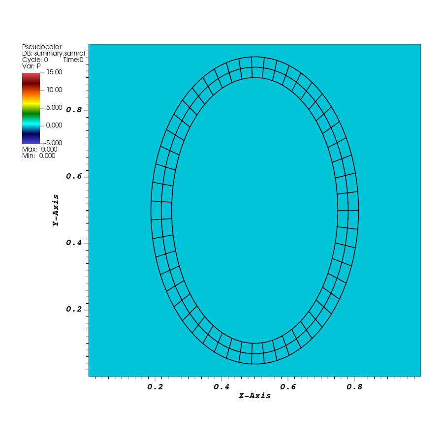
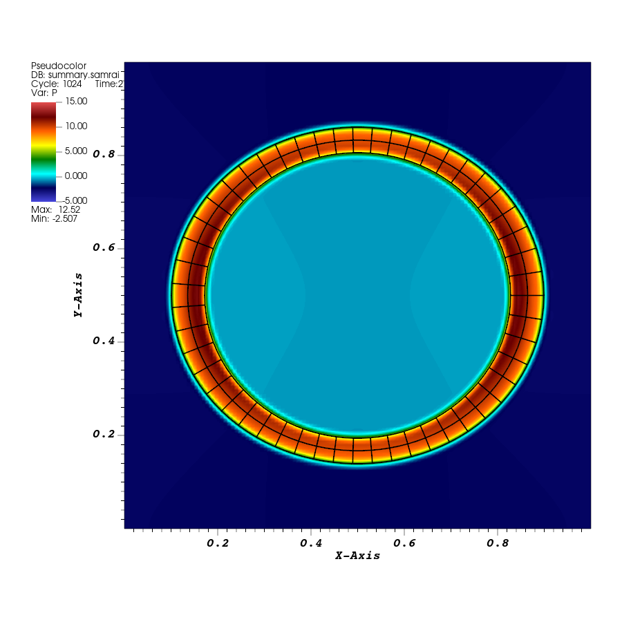

# Tutorial 07: Run a finite-element elastic ring

## Introduction

Run an elastic ring represented by a finite-element mesh and view its motion with the surrounding fluid. The ring has elements through its thickness, so its force comes from a stress law defined over the material. We will follow how the application builds the mesh, supplies its initial shape, and connects that stress law to IBAMR.

## Before you start

Complete [tutorial 06](06-refinement.md). This example uses libMesh for the finite-element calculations and ExodusII for structure output. Your IBAMR installation needs both features; the repository checks for them during configuration. Use the build setup from [tutorial 00](00-orientation.md).

## Running the example

### Build the finite-element application

Configure the repository and build the new target:

```bash
cmake -S "$EXAMPLES_SRC" -B "$EXAMPLES_BUILD"
cmake --build "$EXAMPLES_BUILD" --target IBFE-ex1 --parallel 4
```

This produces `examples/IBFE/explicit/ex1/main2d` in the build directory.

### Run the elastic ring

The application generates its structure mesh in C++. Copy the input into a run directory:

```bash
cd "$EXAMPLES_BUILD/examples/IBFE/explicit/ex1"
mkdir elastic-ring
cp "$EXAMPLES_SRC/examples/IBFE/explicit/ex1/input2d" elastic-ring/
cd elastic-ring
../main2d input2d
```

The input sets `END_TIME = 2.0` and `DT = 0.25*DX`. With `N = 128` on one level, `DX = 1/128` and the run reaches time `2.0` after 1,024 steps.

## Results

### Display the ring in physical coordinates

This example writes two kinds of visualization output:

| File in the run directory | Contents |
| --- | --- |
| `viz_IB2d/dumps.visit` | Fluid fields on the Cartesian grid |
| `viz_IB2d/output.ex2` | Finite-element mesh and fields, including the current coordinates `X_0` and `X_1` |

The ExodusII mesh stores the rectangle used to describe the material. Its saved coordinate fields place that material in the fluid domain. Use VisIt's **Displace** operator to display the ring:

1. Open `viz_IB2d/output.ex2` and add **Mesh → Mesh**.
2. Under **Controls → Expressions**, create a vector expression named `ring_displacement` with this definition:

   ```text
   {<X_0>, <X_1>, 0} - coord(<Mesh>)
   ```

3. Apply the expression. Make sure that `Apply operators to all plots` is deselected in the main VisIt interface. Select the Mesh plot and add **Operators → Transforms → Displace**. In its attributes, select `ring_displacement` as the displacement variable and set the multiplier to `1`. Apply and **Draw**.
4. Select time `0`. The mesh should now form a tall ring centered in the unit square.

The expression subtracts the stored mesh coordinates from the current physical coordinates. Displace adds that difference to the mesh, placing each node at `(X_0,X_1)`. The [VisIt Displace documentation](https://visit-sphinx-github-user-manual.readthedocs.io/en/develop/using_visit/Operators/OperatorTypes/Displace_operator.html) describes this operation.

### Add the fluid pressure

Open `viz_IB2d/dumps.visit` and add **Pseudocolor → P**. Set the color table to `hot_desaturated` and limits to `-5` and `15`. Use a black color for the ring's Mesh plot.

Create a **Time** database correlation named `ring_time` for `dumps.visit` and `output.ex2`, following [tutorial 04](04-elastic-loop.md), and select it as the active time slider. The Displace operator should appear only under the finite-element Mesh plot. Draw both plots and use the unit-square view.



*Time `0`. The black lines show element boundaries through the ring's thickness. Initial saved fluid pressure is zero; the pressure display limits are `[-5,15]`.*

Advance to the last saved state, at time `2.0`, then play the sequence.



*Time `2.0`, with the same view and pressure limits. The ring is wider than it is tall at this point in the oscillation.*

Both databases contain 65 states. To measure the visible change, select the displaced Mesh plot and query **Spatial Extents**, using **Actual data** so the query includes the Displace operator. Calculate width and height from the returned coordinate bounds, as in tutorial 04, then divide height by width. The checked run gives:

| Time | Width | Height | Height/width |
| --- | --- | --- | --- |
| `0` | `0.6250` | `0.9246` | `1.4793` |
| `0.625` | `0.8665` | `0.6588` | `0.7603` |
| `1.28125` | `0.7054` | `0.8163` | `1.1572` |
| `1.90625` | `0.8022` | `0.7169` | `0.8936` |
| `2` | `0.7984` | `0.7216` | `0.9037` |

The ring starts tall, becomes wide near time `0.625`, and swings back to a tall shape near `1.28125`. By `1.90625` it is wide again, with a smaller excursion than on the first swing.

Save the initial and final pressure/mesh images and your measurements. These will provide the baseline for the geometry change in tutorial 08.

## From IB to IBFE

Recall the incompressible fluid equations from [Tutorial 00](00-orientation.md). The fluid velocity $\mathbf u$ and pressure $p$ satisfy

$$
\rho\left(\partial_t\mathbf u+\mathbf u\cdot\nabla\mathbf u\right)
=-\nabla p+\mu\nabla^2\mathbf u+\mathbf f,
\qquad \nabla\cdot\mathbf u=0.
$$

Here $\rho$ is density, $\mu$ is fluid viscosity, and $\mathbf f$ is the structural force per fluid volume. The IB coupling moves the material point $\mathbf X(s,t)$ by interpolating velocity from the fluid domain $\Omega$.

$$
\partial_t\mathbf X(s,t)=
\int_\Omega \mathbf u(\mathbf x,t)\,
\delta(\mathbf x-\mathbf X(s,t))\,d\mathbf x.
$$

For the classical rubber band, the structure is a curve $\Gamma_0$ in material coordinates. The spring forces at its points are the discrete counterpart of a force density $\mathbf G_\Gamma$ along the curve. The spreading integral uses reference length $d\ell_s$.

$$
\mathbf f(\mathbf x,t)=
\int_{\Gamma_0}\mathbf G_\Gamma(s,t)\,
\delta(\mathbf x-\mathbf X(s,t))\,d\ell_s.
$$

The IBFE ring is a volumetric body. In this two-dimensional example, the finite elements fill the area between the inner and outer edges. Deformation produces a first Piola–Kirchhoff elastic stress $\mathbf P^e$ throughout that material.

Let $B_0$ denote the reference body and $\mathbf N$ its outward normal. In strong form, the stress produces an interior force density $\mathbf G$ and a force density $\mathbf T$ on the body's boundary,

$$
\mathbf G=\nabla_s\cdot\mathbf P^e
\quad\text{in }B_0,
\qquad
\mathbf T=-\mathbf P^e\mathbf N
\quad\text{on }\partial B_0.
$$

Both contributions enter the force on the fluid through the spreading integrals,

$$
\begin{aligned}
\mathbf f(\mathbf x,t)
&=\int_{B_0}\mathbf G(s,t)\,
\delta(\mathbf x-\mathbf X(s,t))\,dV_s\\
&\quad+\int_{\partial B_0}\mathbf T(s,t)\,
\delta(\mathbf x-\mathbf X(s,t))\,dA_s.
\end{aligned}
$$

Here $dV_s$ is a reference volume element and $dA_s$ is a reference boundary element. In this two-dimensional example they correspond to area and length, respectively. The fluid equations and velocity interpolation above complete the coupled system.

IBAMR computes the interior force in a weak sense. Multiplying $\mathbf G=\nabla_s\cdot\mathbf P^e$ by a finite-element test function $\mathbf v$ and integrating by parts gives

$$
\begin{aligned}
\int_{B_0}\mathbf G\cdot\mathbf v\,dV_s
&=-\int_{B_0}\mathbf P^e:\nabla_s\mathbf v\,dV_s\\
&\quad+\int_{\partial B_0}(\mathbf P^e\mathbf N)\cdot\mathbf v\,dA_s.
\end{aligned}
$$

The finite-element method uses its basis functions as test functions and assembles the force by integrating the stress against their gradients, together with the boundary term. This moves the spatial derivative from the stress to the test function.

The example selects the partitioned implementation with `SPLIT_FORCES = TRUE`. IBAMR assembles the interior force through this weak form and spreads the boundary contribution $\mathbf T$ separately. The application supplies the stress callback, and IBAMR evaluates the required volume and boundary integrals. [Griffith and Luo, §2.1.2](https://pmc.ncbi.nlm.nih.gov/articles/PMC5650596/)

## The input and program

Read the supplied [application](../examples/IBFE/explicit/ex1/example.cpp) and [input](../examples/IBFE/explicit/ex1/input2d) alongside the following excerpts. The fluid solver, hierarchy helpers, and time loop have the roles introduced in tutorials 03–06. Here, `IBFEMethod` supplies the finite-element structure representation and coupling.

### Build the material mesh

The input includes:

```text
MFAC = 4.0
ELEM_TYPE = "QUAD9"
CONVERGENCE_STUDY = FALSE
```

`MFAC` sets a target element-spacing scale relative to the finest fluid cells. The application reads it and calculates:

```cpp
const double dx = input_db->getDouble("DX");
const double MFAC = input_db->getDouble("MFAC");
const double ds = MFAC * dx;
```

With these settings, `ds = 4/128 = 0.03125`. The source uses it to select the numbers of elements along and across a rectangular strip. Find these constants in the mesh-building section:

```cpp
const double R = 0.25;
const double w = 0.0625;
```

The rectangle has length `2*pi*R` and width `w`. With `CONVERGENCE_STUDY = FALSE`, the `n_x` and `n_y` expressions use `ceil(2.0*M_PI*R/ds)` and `ceil(w/ds)`, giving 51 by 2 elements. The mesh-generation call is:

```cpp
MeshTools::Generation::build_square(
    mesh, n_x, n_y, 0.0, 2.0 * M_PI * R, 0.0, w, Utility::string_to_enum<ElemType>(elem_type));
```

The arguments supply the mesh, element counts, coordinate limits in each direction, and element type. `QUAD9` selects a quadrilateral with nine nodes: four corners, four edge midpoints, and a center. Those nodes support a quadratic approximation of the fields within each element. The mesh contains 102 elements through which IBAMR evaluates the structural stress.

The rectangle's coordinates, called `s` in the mapping function, label the material. The two short ends will meet when the rectangle wraps into a ring. The application connects them with a libMesh periodic constraint:

```cpp
VectorValue<double> boundary_translation(2.0 * M_PI * R, 0.0, 0.0);
PeriodicBoundary pbc(boundary_translation);
pbc.myboundary = 3;
pbc.pairedboundary = 1;
```

The translation connects the left and right edges of this generated rectangle. This constraint joins the material seam; the fluid's periodic domain is configured separately through the familiar `CartesianGeometry.periodic_dimension = 1,1`.

### Map the rectangle into the initial ring

Near the top of `example.cpp`, `ModelData` defines:

```cpp
static const double R = 0.25;
static const double w = 0.0625;
static const double gamma = 0.15;
static const double mu = 1.0;
```

These values belong to the structural model. The coordinate mapping uses `R` and `gamma`:

```cpp
void
coordinate_mapping_function(libMesh::Point& X, const libMesh::Point& s, void* /*ctx*/)
{
    X(0) = (R + s(1)) * cos(s(0) / R) + 0.5;
    X(1) = (R + gamma + s(1)) * sin(s(0) / R) + 0.5;
    return;
}
```

The input `s` is a point in the rectangular material mesh. The output `X` is its initial physical position. `s(0)/R` runs through angles from zero to `2*pi`; `s(1)` runs through the thickness from zero to `w`. Adding `0.5` centers the ring at `(0.5,0.5)`. The `gamma` term increases its vertical radius, giving the stretched shape in the first image.

There are two coordinate descriptions to follow: the material coordinates `s` stay attached to the mesh, while the physical positions `X(s,t)` evolve with the fluid. The mapping initializes those physical positions. This is also why the saved `X_0` and `X_1` fields are needed to display the physical structure in VisIt.

Tutorial 08 will change `gamma` and rebuild the application. For now, use this mapping to identify how the initial shape is supplied.

### Supply the stress law

The structural model supplies a first Piola–Kirchhoff stress tensor, written $\mathbf P$. It expresses the material force response using the material coordinates. The deformation gradient

$$
\mathbf F=\frac{\partial\mathbf X}{\partial\mathbf s}
$$

describes how small material directions map into the current physical configuration. In this example, the stress function receives that gradient as `FF` and fills the result `PP`:

```cpp
void
PK1_stress_function(TensorValue<double>& PP,
                    const TensorValue<double>& FF,
                    const libMesh::Point& /*X*/,
                    const libMesh::Point& /*s*/,
                    Elem* const /*elem*/,
                    const std::vector<const std::vector<double>*>& /*var_data*/,
                    const std::vector<const std::vector<VectorValue<double>>*>& /*grad_var_data*/,
                    double /*time*/,
                    void* /*ctx*/)
{
    PP = (mu / w) * FF;
    if (smooth_case)
    {
        PP(0, 1) = 0.0;
        PP(1, 1) = 0.0;
    }
    return;
}
```

The input selects `SMOOTH_CASE = FALSE`, which selects the **neo-Hookean law** of the thick-ring benchmark.

The elastic strain energy per unit reference volume is

$$
W(\mathbf F)=\frac{\mu_s}{2w}\operatorname{tr}(\mathbf F^{\mathsf T}\mathbf F).
$$

Differentiating with respect to the deformation gradient gives the first Piola–Kirchhoff elastic stress

$$
\mathbf P^e=\frac{\partial W}{\partial\mathbf F}=\frac{\mu_s}{w}\mathbf F,
$$

where $\mu_s$ denotes the source's structural `mu = 1.0`. Note that this is different from the fluid viscosity, which is set by `MU = 1.0e-2`. Here `w = 0.0625`, so the structural multiplier is `mu/w = 16`. The coordinate map gives the ring an orthotropic response, with preferred directions along and across the ring. See [Griffith and Luo, §5.1.2, “Orthotropic shell”](https://pmc.ncbi.nlm.nih.gov/articles/PMC5650596/).

The other callback arguments provide the physical position, material position, element, additional requested field values and gradients, time, and an application context pointer. This particular law needs only `FF`; the commented argument names mark the unused inputs. A more detailed material model can use these inputs while retaining the surrounding solver setup.

IBAMR evaluates the stress at integration points within the elements and assembles the corresponding finite-element forces. The coupling then spreads those forces to the fluid grid and interpolates fluid velocity back to move the structure. This gives the ring an elastic response across its thickness, using the supplied stress law.

### Connect the finite-element model to the coupled solver

The application constructs its IB strategy with the mesh:

```cpp
Pointer<IBFEMethod> ib_method_ops =
    new IBFEMethod("IBFEMethod",
                   app_initializer->getComponentDatabase("IBFEMethod"),
                   &mesh,
                   app_initializer->getComponentDatabase("GriddingAlgorithm")->getInteger("max_levels"),
                   /*register_for_restart*/ true,
                   restart_read_dirname,
                   restart_restore_num);
```

The constructor receives its name, input settings, mesh pointer, permitted fluid-level count, and restart settings. Its database configures the coupling. The input sets `IB_DELTA_FUNCTION = "IB_4"` and `IB_POINT_DENSITY = 2.0`, then supplies them through:

```text
IB_delta_fcn = IB_DELTA_FUNCTION
IB_point_density = IB_POINT_DENSITY
```

The first selects the same four-point kernel used earlier. The second controls the approximate density of integration points used to exchange force and velocity with the fluid grid. These interaction points are placed within the elements, allowing the finite-element mesh and the fluid coupling to use different spacing scales.

As in the rubber-band application, the coupled driver receives the IB strategy and fluid integrator:

```cpp
Pointer<IBHierarchyIntegrator> time_integrator =
    new IBExplicitHierarchyIntegrator("IBHierarchyIntegrator",
                                      app_initializer->getComponentDatabase("IBHierarchyIntegrator"),
                                      ib_method_ops,
                                      navier_stokes_integrator);
```

Next, the application creates the finite-element systems and registers the model functions:

```cpp
ib_method_ops->initializeFEEquationSystems();
FEDataManager* fe_data_manager = ib_method_ops->getFEDataManager();
ib_method_ops->registerInitialCoordinateMappingFunction(coordinate_mapping_function);
ib_method_ops->registerPK1StressFunction(IBFEMethod::PK1StressFcnData(PK1_stress_function));
```

`initializeFEEquationSystems()` creates the libMesh systems that will store coordinates, velocities, and forces. `FEDataManager` connects their data and element operations to the fluid hierarchy. The coordinate registration supplies the initial map; the stress registration supplies the function called during force evaluation. `PK1StressFcnData` packages the function pointer and any additional data requests. Here, the default settings are sufficient for a law depending only on the deformation gradient.

For the public interfaces, see the [`IBFEMethod` documentation](https://ibamr.github.io/IBAMR-docs/ibamr/classIBAMR_1_1IBFEMethod.html), including `registerInitialCoordinateMappingFunction` and `registerPK1StressFunction`.

### Initialize the fields and advance them

Before initializing the finite-element fields, the application adds the material seam constraint to each system:

```cpp
EquationSystems* equation_systems = ib_method_ops->getFEDataManager()->getEquationSystems();
for (unsigned int k = 0; k < equation_systems->n_systems(); ++k)
{
    System& system = equation_systems->get_system(k);
    system.get_dof_map().add_periodic_boundary(pbc);
}
ib_method_ops->initializeFEData();
if (ib_post_processor) ib_post_processor->initializeFEData();
time_integrator->initializePatchHierarchy(patch_hierarchy, gridding_algorithm);
```

Each system's degree-of-freedom map identifies its stored unknowns and their constraints. The periodic constraint makes values on the paired material edges agree. `initializeFEData()` initializes the finite-element data, including the coordinates supplied by the registered mapping. The following calls initialize the postprocessor and fluid hierarchy.

The existing time loop calls `time_integrator->advanceHierarchy(dt)`. The coupled integrator coordinates the finite-element force calculation, fluid advancement, and structure motion through that call.

### Write fluid and finite-element output

The input selects two writers:

```text
viz_writer = "VisIt","ExodusII"
viz_dump_interval = 16
viz_dump_dirname = "viz_IB2d"
```

The VisIt writer saves the fluid hierarchy. The structure writer is constructed from the material mesh:

```cpp
std::unique_ptr<ExodusII_IO> exodus_io = uses_exodus ? std::make_unique<ExodusII_IO>(mesh) : nullptr;
```

At each saved state, the application writes the finite-element systems and physical time:

```cpp
exodus_io->write_timestep(
    exodus_filename, *equation_systems, iteration_num / viz_dump_interval + 1, loop_time);
```

`exodus_filename` comes from `AppInitializer`; here it is `viz_IB2d/output.ex2`. The systems contain the evolving `X_0` and `X_1` coordinates used in the Displace expression. The fluid writer receives the same `loop_time`, allowing the Time correlation to match the two outputs.

This application also registers a postprocessor that interpolates current fluid pressure onto the finite-element mesh under the name `p_f`. That field is fluid pressure sampled on the material; `P` in `dumps.visit` is the fluid-grid field used in the figures above.

## Further exploration: inspect the structure's volume history

The application writes `volume.curve`, with time in the first column and the integrated structure size in the second. In this two-dimensional example, that size is the area occupied by the ring material. Open its first and last rows:

```bash
head -n 3 "$EXAMPLES_BUILD/examples/IBFE/explicit/ex1/elastic-ring/volume.curve"
tail -n 3 "$EXAMPLES_BUILD/examples/IBFE/explicit/ex1/elastic-ring/volume.curve"
```

The checked run gives `0.139900272879` after the first step, at time `0.001953125`, and `0.139055052048` at the final time. The file starts after the first completed step. These values give another way to inspect the moving structure alongside its width and height.

In the source's final processing loop, `jacobian(FF, ...)` evaluates the coordinate gradient at element integration points. The code accumulates `abs(FF.det()) * JxW[qp]`, where `JxW` contains the material-mesh integration weights, then combines contributions across processes with `IBTK_MPI::sumReduction`. The determinant converts material-coordinate area into current physical area. This integral covers the ring material between its inner and outer boundaries.

## Before moving on

This tutorial ran a finite-element elastic ring, displayed its physical mesh with the fluid, and followed mesh creation, coordinate mapping, stress registration, and initialization. You should have the `elastic-ring` run, initial and final pressure/mesh images, width and height measurements, and the recorded `volume.curve` history.

[Tutorial 08](08-change-initial-stretch.md) will change the initial stretch in `coordinate_mapping_function`, rebuild the application, and compare its initial geometry and motion with this baseline.
