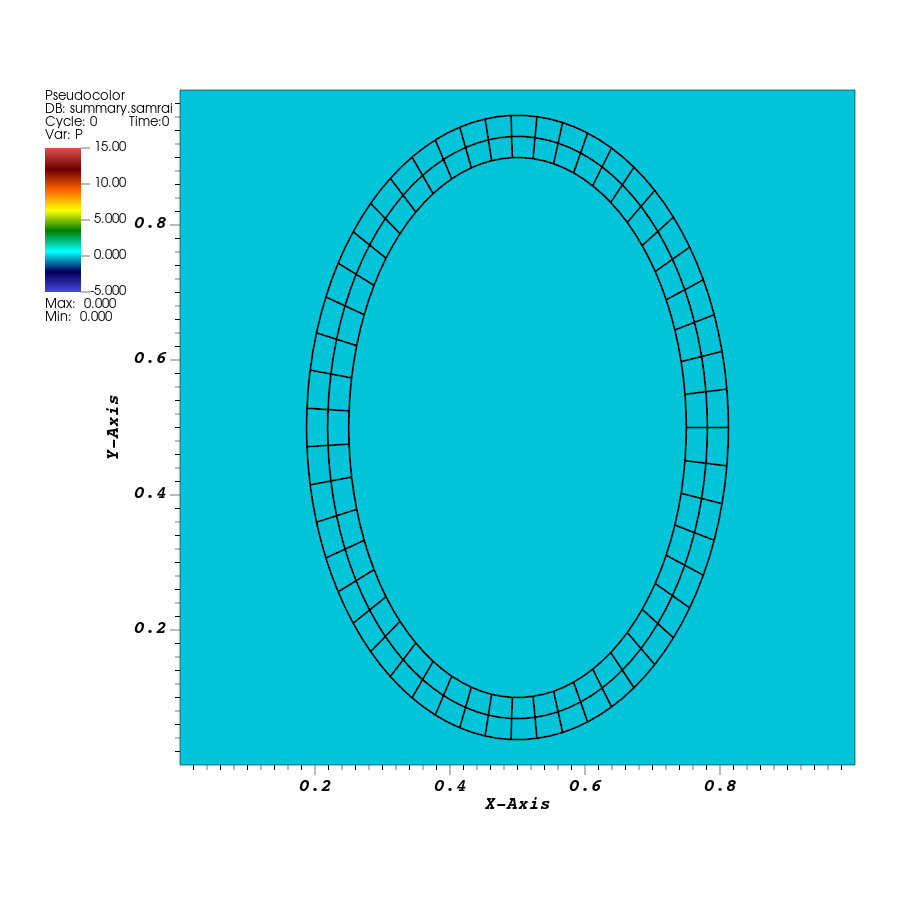
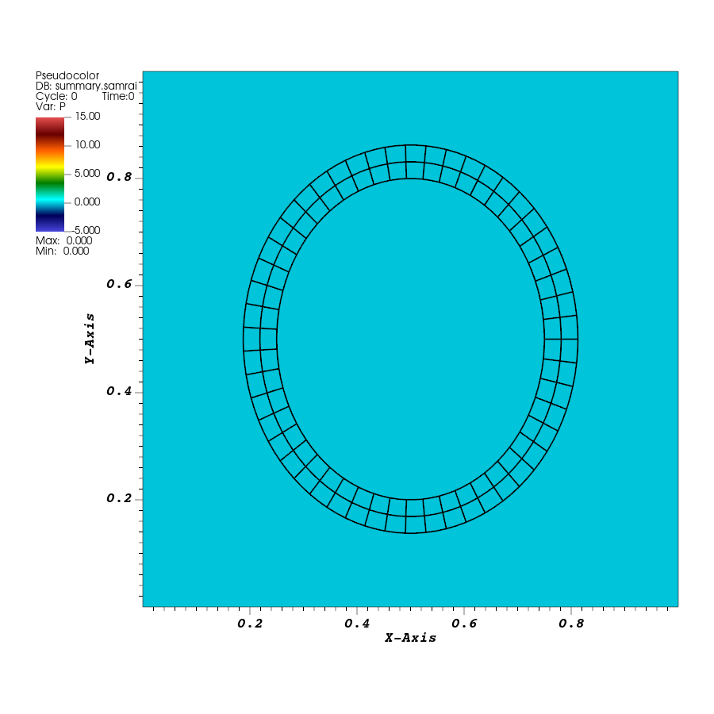
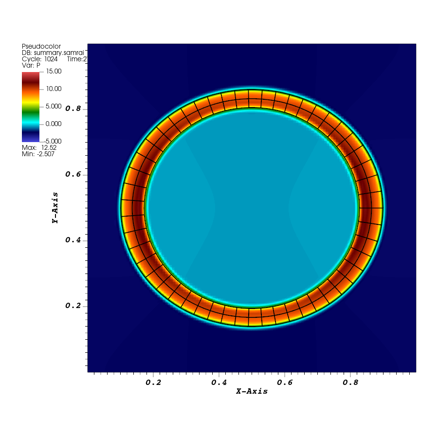
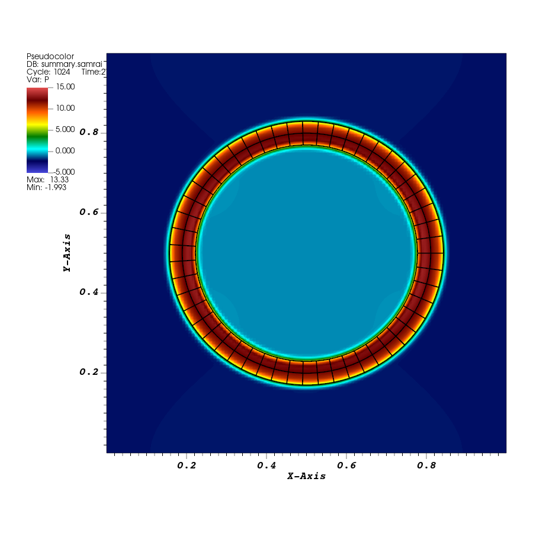

# Tutorial 08: Change the ring's initial stretch

## Introduction

Change the finite-element ring's starting shape by editing its coordinate mapping in C++. Rebuild the application, run it with the same input, and compare the two rings as they move through the fluid.

## Before you start

Complete [tutorial 07](07-finite-element-ring.md), including its `elastic-ring` run to time `2.0`. That run is the baseline. This tutorial uses the same `examples/IBFE/explicit/ex1` application and its `IBFE-ex1` build target.

Line numbers below refer to the supplied repository files before the edits in this tutorial. Use the named function or input block to find the same location after adding code.

## Running the example

### Edit the stretch parameter

Open `examples/IBFE/explicit/ex1/example.cpp` under `EXAMPLES_SRC`. Near the beginning, find `gamma` inside `namespace ModelData`:

**Read:** [`example.cpp`, line 58](../examples/IBFE/explicit/ex1/example.cpp#L58).

```cpp
static const double gamma = 0.15;
```

Change it to:

**Replace in:** `example.cpp`, `ModelData::gamma` ([`example.cpp`, line 58](../examples/IBFE/explicit/ex1/example.cpp#L58) before editing).

```cpp
static const double gamma = 0.05;
```

This reduces the initial vertical stretch. The parameter is compiled into the application, so rebuild the existing target:

```bash
cmake --build "$EXAMPLES_BUILD" --target IBFE-ex1 --parallel 4
```
Note that whenever the source code is modified, the executable needs to be rebuilt. This is not true when modifying the input file, which is parsed during the executable's run.

### Run with the modified geometry

Create a new run directory and copy the baseline input:

```bash
cd "$EXAMPLES_BUILD/examples/IBFE/explicit/ex1"
mkdir elastic-ring-gamma005
cp elastic-ring/input2d elastic-ring-gamma005/
cd elastic-ring-gamma005
../main2d input2d
```

The executable generates the new initial geometry using the edited mapping. The input gives `END_TIME = 2.0` and visualization every 16 steps. Confirm that the run reaches time `2`.

## Results

### Compare the initial shapes

Use the pressure and displaced-mesh view from tutorial 07 for the new run's `viz_IB2d/dumps.visit` and `viz_IB2d/output.ex2`. Set the pressure limits to `-5` and `15`, the mesh to black, and the view to the full unit square.

Create a Time correlation for the new pair of databases, named `gamma005_time`. The saved `X_0` and `X_1` fields work with the same `ring_displacement` expression and Displace multiplier of `1` used in tutorial 07. Select time `0`.



*Baseline, `gamma = 0.15`, at time `0`.*



*Modified mapping, `gamma = 0.05`, at time `0`. The ring has the same initial width and a smaller initial height.*

### Compare the motion at matching times

Play each sequence, then select time `2.0` for the final comparison. Each run has 65 saved states, with time `2.0` at state `64`.



*Baseline, `gamma = 0.15`, at time `2.0`.*



*Modified mapping, `gamma = 0.05`, at time `2.0`, with the same pressure scale and view.*

Query **Spatial Extents** on the displaced Mesh plot, using **Actual data**. Record width, height, and height/width at the initial and final times. The checked runs give:

| Initial stretch | Time | Width | Height | Height/width |
| --- | --- | --- | --- | --- |
| `gamma = 0.15` | `0` | `0.6250` | `0.9246` | `1.4793` |
| `gamma = 0.15` | `2` | `0.7984` | `0.7216` | `0.9037` |
| `gamma = 0.05` | `0` | `0.6250` | `0.7247` | `1.1594` |
| `gamma = 0.05` | `2` | `0.6862` | `0.6601` | `0.9620` |

The smaller initial stretch produces smaller shape excursions during the run. In the saved frames, its first wide and subsequent tall shapes occur near times 0.625 and 1.25. Both rings continue through damped oscillations, so the images at time 2.0 show their shapes at that stage of the motion.

Save the paired images and measurements with the corresponding runs.

## The input and program

### Follow gamma through the coordinate mapping

The source groups the structural parameters in `ModelData`:

**Read:** [`example.cpp`, lines 56–59](../examples/IBFE/explicit/ex1/example.cpp#L56-L59) in `ModelData`. The excerpt shows `gamma` after your edit.

```cpp
static const double R = 0.25;
static const double w = 0.0625;
static const double gamma = 0.15;
static const double mu = 1.0;
```

`R` and `w` describe the material strip, `gamma` sets the added vertical stretch, and `mu` is the structural elastic coefficient. Your edit changes `gamma` to `0.05`.

The mapping writes the initial physical coordinates:

**Read:** [`example.cpp`, lines 65–66](../examples/IBFE/explicit/ex1/example.cpp#L65-L66).

```cpp
X(0) = (R + s(1)) * cos(s(0) / R) + 0.5;
X(1) = (R + gamma + s(1)) * sin(s(0) / R) + 0.5;
```

For a material point with angle $\theta=s(0)/R$, changing `gamma` by $\Delta\gamma$ moves its initial vertical position by

$$
\Delta X_1=\Delta\gamma\sin\theta.
$$

The top of the ring moves down and the bottom moves up when `gamma` decreases. The center stays at `(0.5,0.5)`. The horizontal coordinate has the same formula in both runs, which accounts for their equal initial widths.

At the outer edge, `s(1) = w`. The mapping gives horizontal radius `R+w = 0.3125` and vertical radius `R+gamma+w`. Thus the baseline's outer vertical radius is `0.4625`, while the edited value is `0.3625`. The sampled mesh coordinates give the heights reported above.

### Apply the mapping during initialization

The application registers the mapping with `IBFEMethod`:

**Read:** [`example.cpp`, line 244](../examples/IBFE/explicit/ex1/example.cpp#L244).

```cpp
ib_method_ops->registerInitialCoordinateMappingFunction(coordinate_mapping_function);
```

This passes the function to the finite-element method. Later, the call

**Read:** [`example.cpp`, line 351](../examples/IBFE/explicit/ex1/example.cpp#L351).

```cpp
ib_method_ops->initializeFEData();
```

uses it to initialize the stored physical coordinates from each node's material coordinates. The rectangular material mesh and its periodic seam supply the same material-coordinate description in both runs. The edited mapping places that material into a different starting shape.

Once initialization is complete, `advanceHierarchy(dt)` evolves those coordinates through coupling with the fluid. This is why the stretch change is visible in the first saved state and affects the subsequent motion.

### Connect the changed shape to the elastic stress

The stress callback uses

**Read:** [`example.cpp`, line 83](../examples/IBFE/explicit/ex1/example.cpp#L83).

```cpp
PP = (mu / w) * FF;
```

Here `FF` is the deformation gradient of the current coordinates with respect to the material coordinates. Changing the initial map changes this gradient, so it also changes the initial stress. For example, differentiating the mapping's vertical coordinate gives

$$
\frac{\partial X_1}{\partial s_0}
=\frac{R+\gamma+s_1}{R}\cos(s_0/R).
$$

The value of `gamma` therefore enters the stress through `FF`. `PK1_stress_function` evaluates the neo-Hookean law described in tutorial 07. Its structural parameters are `mu = 1.0` and `w = 0.0625`, giving `mu/w = 16`. Fluid viscosity comes from the input's `MU = 1.0e-2`.

The model functions have separate jobs. The coordinate mapping supplies the starting configuration, and the stress callback calculates the response of the material as that configuration evolves. Editing the initial shape changes the loading within the body through the deformation gradient.

## Further exploration: compare the material area

The mapping changes the ring's material area along with its height. Use the first and final rows of `volume.curve` to inspect that change:

```bash
head -n 1 "$EXAMPLES_BUILD/examples/IBFE/explicit/ex1/elastic-ring/volume.curve"
head -n 1 "$EXAMPLES_BUILD/examples/IBFE/explicit/ex1/elastic-ring-gamma005/volume.curve"
tail -n 1 "$EXAMPLES_BUILD/examples/IBFE/explicit/ex1/elastic-ring/volume.curve"
tail -n 1 "$EXAMPLES_BUILD/examples/IBFE/explicit/ex1/elastic-ring-gamma005/volume.curve"
```

The first rows are written after the first completed step, at time `0.001953125`. In this two-dimensional model, the volume integral records the area occupied by the ring material. The checked values are:

| Initial stretch | Area after the first step | Area at time 2.0 |
| --- | --- | --- |
| `gamma = 0.15` | `0.139900272879` | `0.139055052048` |
| `gamma = 0.05` | `0.120263964273` | `0.119286979518` |

The difference between the first rows comes from the two starting geometries. The change within each run records how its computed material area evolves. Save these values alongside the shape measurements.

## Before moving on

This tutorial changed a C++ parameter, rebuilt the finite-element application, and traced the effect from the initial coordinate map through the deformation gradient and stress calculation. You should have the modified `example.cpp` with `gamma = 0.05`, the rebuilt `main2d`, separate `elastic-ring` and `elastic-ring-gamma005` runs, and paired images and measurements.

In [tutorial 09](09-target-forces-and-boundaries.md), you will impose a stationary cylinder with target forces and follow how the application supplies physical boundary conditions at the edges of the fluid domain.
