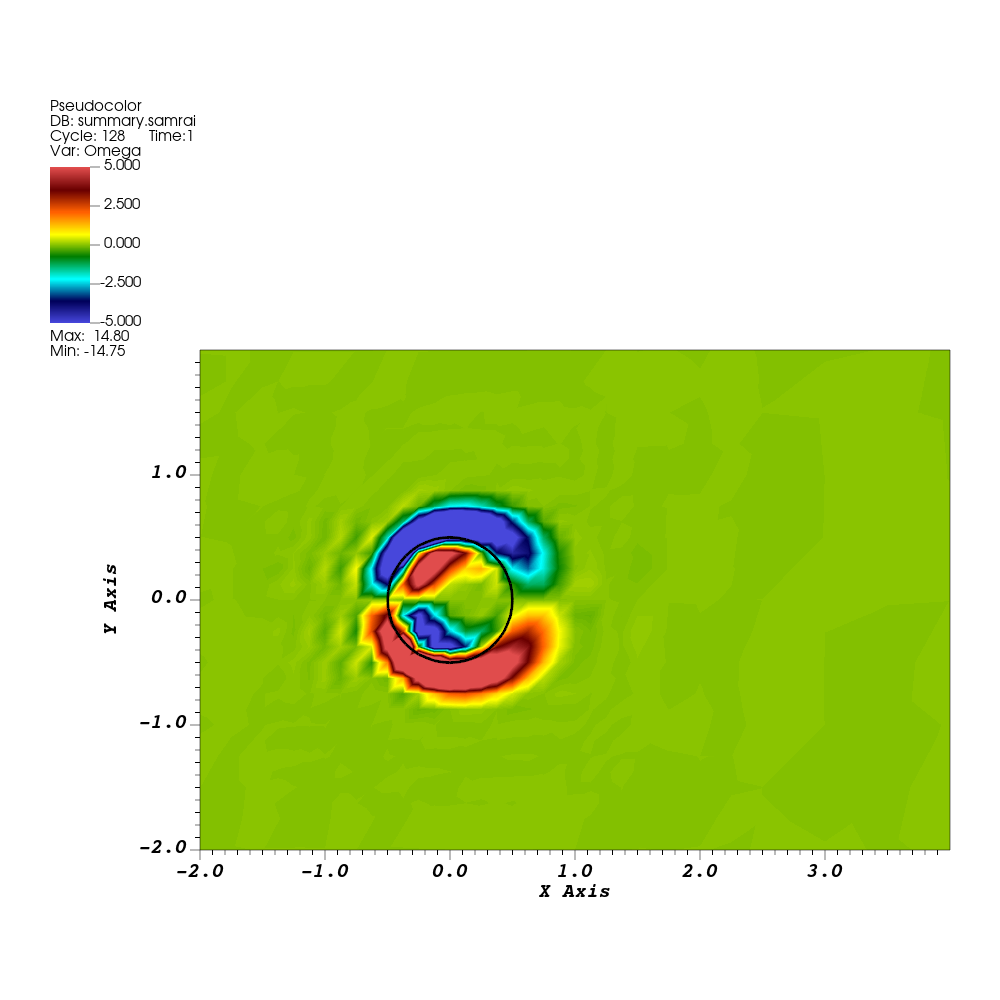

# Tutorial 09: Hold a cylinder in a flow

## Introduction

In tutorials 07–08, an elastic ring moved in response to its internal stress and the surrounding fluid. Here, prescribe a stationary cylinder by tethering its immersed boundary points to fixed locations with very stiff springs. View the resulting flow, then follow how the application supplies these forces and the conditions at the edges of the fluid domain. Finally, change the Reynolds number through the input and relate it to the units used in the simulation.

## Before you start

This tutorial uses `examples/IB/explicit/ex2` with the existing build setup. It returns to the point-and-spring representation from [tutorial 04](04-elastic-loop.md), using the grid hierarchy introduced in [tutorial 06](06-refinement.md).

## Running the example

### Build the cylinder application

Compile the cylinder example using its existing build target:

```bash
cmake --build "$EXAMPLES_BUILD" --target IB-ex2-2d --parallel 4
```

The executable is `examples/IB/explicit/ex2/main2d` in the build directory.

### Prepare and run the cylinder

Copy the supplied input and both structure files into a fresh run directory:

```bash
cd "$EXAMPLES_BUILD/examples/IB/explicit/ex2"
mkdir cylinder
cp "$EXAMPLES_SRC/examples/IB/explicit/ex2/input2d.cylinder" cylinder/
cp "$EXAMPLES_SRC/examples/IB/explicit/ex2/cylinder2d_128.vertex" cylinder/
cp "$EXAMPLES_SRC/examples/IB/explicit/ex2/cylinder2d_128.spring" cylinder/
cd cylinder
../main2d input2d.cylinder > stdout.log 2>&1
tail -n 15 stdout.log
```

The supplied input sets `END_TIME = 1.0`. The last completed step should report simulation time `1`.

## Results

### View the cylinder and fluid

The run produces `IB2d.log`, `viz_IB2d/dumps.visit` for the fluid, and `viz_IB2d/lag_data.visit` for the cylinder.

1. Open this run's `dumps.visit` in VisIt. Hide any automatically added grid-level plot. Add **Pseudocolor → Omega**, choose `hot_desaturated`, and set limits to `-5` and `5`.
2. Open the same run's `lag_data.visit`. Add a black **Mesh → cylinder2d_128_mesh** overlay. This Silo mesh stores the point positions directly, so drawing the Mesh plot places the cylinder in its physical location. The ExodusII mesh in tutorial 07 instead needed a Displace operator to show its current coordinates.
3. Create a **Time** database correlation named `cylinder_time` for the two databases, following [tutorial 04](04-elastic-loop.md). Select it as the active time slider and draw the plots.
4. Move from time `0` to the final time `1`. Zoom around the cylinder; for the reference view, use horizontal bounds `-2` to `4` and vertical bounds `-2` to `2` in **View → 2D**.


*Baseline at time `1`, with vorticity limits `[-5,5]` and a black cylinder mesh. The view shows the region near the cylinder, rather than the whole domain.*

The saved sequence shows the early flow around the held structure. Values beyond the chosen color limits use the end colors; the baseline saved vorticity at time `1` ranges approximately from `-13.68` to `13.72`. At this stage, the flow is still developing.

### Check how closely the cylinder remains stationary

The goal is to hold each cylinder point at its prescribed location. The extent query checks the small position errors permitted by the finite target stiffness.

Select the cylinder Mesh plot and query **Spatial Extents**, as in tutorial 04. Compare the bounds at times `0` and `1` as a simple check of how closely the cylinder retains its prescribed position and shape. Initially, the bounds are `[-0.5,0.5]` in both directions. At time `1`, the checked baseline bounds are approximately `[-0.49843,0.49953]` horizontally and `[-0.50105,0.50103]` vertically. The differences reflect the finite stiffness used to approximate the stationary constraint.

Save the vorticity/mesh overlay at time `1` in the run directory, keeping the legend and physical time visible. You can also hide the cylinder overlay and plot fluid pressure `P` or the speed expression from tutorial 02.

## The input and program

Read the supplied [application](../examples/IB/explicit/ex2/example.cpp) and [input](../examples/IB/explicit/ex2/input2d.cylinder) alongside these excerpts. The hierarchy and output setup are familiar from the preceding tutorials. For the structure, this application uses `IBMethod` and `IBStandardForceGen` as in tutorial 04. The new pieces are the target parameters and physical-boundary objects.

### The cylinder and surrounding domain

The input sets:

```text
R = 0.5
Re = 200.0
MU = 2.0*R/Re
RHO = 1.0
L = 16.0
N = 16
MAX_LEVELS = 4
REF_RATIO = 2
```

`R` is the nominal cylinder radius. The inlet ramps toward a horizontal speed of `1`. With `RHO = 1.0` and diameter `2*R = 1.0`, the assignment `MU = 2.0*R/Re` gives viscosity `0.005` and a reference Reynolds number of `200`. The Reynolds-number comparison below explains how these quantities relate.

The supplied vertex coordinates describe the radius-`0.5` circle centered at the origin. Changing `R` in the input alone would not regenerate those coordinates. The filename `cylinder2d_128` identifies the data supplied for an effective finest resolution of 128 cells across length `L`; its vertex file contains 48 points.

Unlike the earlier periodic square, this input uses:

```text
CartesianGeometry {
   domain_boxes = [ (0,0),(2*N - 1,N - 1) ]
   x_lo = -0.5*L,-0.5*L
   x_up =  1.5*L, 0.5*L
   periodic_dimension = 0,0
}
```

The physical domain is `-8 <= x <= 24`, `-8 <= y <= 8`. Its coarse grid has `2*N` by `N` cells. Both periodic flags are zero, so the application must supply physical boundary conditions. Refinement follows the hierarchy machinery from tutorial 06; this example also enables fluid-based tagging with `VORTICITY_TAGGING = TRUE` and `using_vorticity_tagging = VORTICITY_TAGGING` in the fluid-integrator block.

### Impose prescribed motion with target points

Find the initializer settings:

```text
IBStandardInitializer {
   max_levels = MAX_LEVELS
   structure_names = "cylinder2d_128"
   cylinder2d_128 {
      level_number = MAX_LEVELS - 1
      uniform_target_stiffness = K_s
      uniform_target_damping = E_s
   }
}
```

As before, the structure name selects the vertex and spring files. The new entries assign a target stiffness and damping coefficient to every point. The initializer uses each vertex's initial position as its target position.

For a point with position $\mathbf X_i$, velocity $\mathbf U_i$, and fixed target $\mathbf X_i^*$, the target contribution is

$$
\mathbf F_i^{\mathrm{target}}=K_s(\mathbf X_i^*-\mathbf X_i)-E_s\mathbf U_i.
$$

Target points are used to impose prescribed motion on immersed boundary points; here the prescribed motion is zero, so each target remains at its initial location. For the exact constraint $\mathbf X_i=\mathbf X_i^*$, a Lagrange multiplier would supply the force needed to hold each point in place. The stiff-spring term $K_s(\mathbf X_i^*-\mathbf X_i)$ approximates that multiplier through a penalty method: a small position error produces a large restoring force. `E_s` is a damping coefficient: the term $-E_s\mathbf U_i$ opposes the point's velocity and damps oscillations about its target. In practice, moderate values of `E_s` have been found to lessen the stiffness of the problem and typically allow larger time steps than the stiff target springs alone.

`IBStandardForceGen` adds these target forces to the forces from the neighboring-point springs in the supplied `.spring` file, and `IBMethod` spreads the combined force to the fluid. Increasing the target stiffness improves enforcement of the prescribed position, but can require smaller time steps for stable explicit advancement.

The input chooses the parameters together:

```text
NFINEST = (REF_RATIO^(MAX_LEVELS - 1))*N
DX_FINEST = L/NFINEST
DT = 6.25e-2*DX_FINEST
C_IB_4 = 3.0/8.0
C = C_IB_4
M_s = RHO/((C/DX_FINEST)^2)
tau_s = 4.0*DT
K_s = M_s*(log(0.5)/tau_s)^2
E_s = 2.0*sqrt(K_s*M_s)
```

Here `DX_FINEST = 0.125` and `DT = 0.0078125`. Both the IB and selected fluid integrator receive `dt_max = DT`. `M_s` is a grid-dependent effective mass used in this recipe for the penalty coefficients. `tau_s` supplies the decay scale in this parameter recipe. Keep these coupled expressions unchanged for this activity.

The existing application registers the providers in the same way as the rubber-band example:

```cpp
Pointer<IBStandardInitializer> ib_initializer = new IBStandardInitializer(
    "IBStandardInitializer", app_initializer->getComponentDatabase("IBStandardInitializer"));
ib_method_ops->registerLInitStrategy(ib_initializer);
Pointer<IBStandardForceGen> ib_force_fcn = new IBStandardForceGen();
ib_method_ops->registerIBLagrangianForceFunction(ib_force_fcn);
```

The database supplies the uniform coefficients. Registering the initializer reads and prepares the structure data, including each target position. `IBStandardForceGen` subsequently evaluates both the spring and target-point contributions as the coupled integrator advances.

### Read the boundary coefficients

For the fluid boundary-condition convention, see the documentation for [`INSHierarchyIntegrator::registerPhysicalBoundaryConditions()`](https://ibamr.github.io/IBAMR-docs/ibamr/classIBAMR_1_1INSHierarchyIntegrator.html#a3751b764c51e96a286d234b3d0e9023e). It explains how the coefficients select prescribed velocity or traction and gives the supported choices of `a` and `b`.

For the default `TRACTION` treatment used here, the fluid conditions select either a velocity component or the corresponding component of the traction:

$$
a_d u_d+b_d(\boldsymbol{\sigma}\mathbf n)_d=g_d,
\qquad
\boldsymbol{\sigma}=-p\mathbf I+\mu(\nabla\mathbf u+\nabla\mathbf u^T).
$$

Here $d$ identifies the velocity component and $\mathbf n$ is the outward unit normal. The fluid Cauchy stress $\boldsymbol{\sigma}$ combines pressure and viscous stress in the current configuration. It is distinct from the elastic first Piola–Kirchhoff stress $\mathbf P^e$ in tutorial 07, which describes the structure's response using reference coordinates.

The supported coefficient pairs are `(a,b) = (1,0)` for prescribed velocity and `(0,1)` for prescribed traction. The right-hand side `g` supplies the selected velocity or traction component.

These coefficients use SAMRAI's Robin boundary interface. For a scalar field, its usual form is

$$
a q+b\frac{\partial q}{\partial n}=g.
$$

In that scalar setting, `a` weights the value and `b` weights the outward derivative: `(a,b,g) = (1,0,Q)` prescribes `q = Q`, while `(0,1,H)` prescribes its outward derivative `H`. A general Robin condition combines them. Some descriptions call the right-hand side `c`; the IBAMR keys call it `g`. The fluid integrator interprets the supplied coefficients as velocity or traction conditions through its coordinated velocity and pressure boundary treatments.

There are two component databases: `VelocityBcCoefs_0` configures horizontal velocity, and `VelocityBcCoefs_1` configures vertical velocity. The final suffix on each **entry** instead identifies the domain face:

| Entry suffix | Face | Outward normal |
| --- | --- | --- |
| `0` | Left, `x = -8` | `(-1,0)` |
| `1` | Right, `x = 24` | `(1,0)` |
| `2` | Bottom, `y = -8` | `(0,-1)` |
| `3` | Top, `y = 8` | `(0,1)` |

For example, `VelocityBcCoefs_0.gcoef_function_1` belongs to the **horizontal component at the right face**. At the left face, an outward scalar derivative is `-partial(q)/partial(x)`; at the right it is `+partial(q)/partial(x)`.

The complete horizontal-component block is:

```text
VelocityBcCoefs_0 {
   t_half = 0.5
   tau = 0.125
   acoef_function_0 = "1.0"
   acoef_function_1 = "0.0"
   acoef_function_2 = "0.0"
   acoef_function_3 = "0.0"
   bcoef_function_0 = "0.0"
   bcoef_function_1 = "1.0"
   bcoef_function_2 = "1.0"
   bcoef_function_3 = "1.0"
   gcoef_function_0 = "(tanh((t-t_half)/tau)+tanh(t_half/tau))/(1+tanh(t_half/tau))"
   gcoef_function_1 = "0.0"
   gcoef_function_2 = "0.0"
   gcoef_function_3 = "0.0"
}
```

The left face prescribes horizontal velocity using a smooth ramp, which we call $U_{\mathrm{in}}(t)$. It starts at zero and approaches one; `t_half` places the ramp's center and `tau` controls its transition scale. These constants belong to this coefficient database. The expression provider evaluates `t` at the time requested by the solver.

The vertical-component block is:

```text
VelocityBcCoefs_1 {
   acoef_function_0 = "1.0"
   acoef_function_1 = "0.0"
   acoef_function_2 = "1.0"
   acoef_function_3 = "1.0"
   bcoef_function_0 = "0.0"
   bcoef_function_1 = "1.0"
   bcoef_function_2 = "0.0"
   bcoef_function_3 = "0.0"
   gcoef_function_0 = "cos(pi*X_1/16.0)*exp(-2.0*t)"
   gcoef_function_1 = "0.0"
   gcoef_function_2 = "0.0"
   gcoef_function_3 = "0.0"
}
```

`X_1` is the vertical coordinate and `pi` is supplied by the expression parser. At the inlet, the vertical velocity is a spatially varying disturbance that decays with time. Both top and bottom prescribe zero vertical velocity, preventing flow through those faces.

For the default `TRACTION` treatment selected by this staggered solver, the complete physical conditions are:

| Face | Conditions |
| --- | --- |
| Left | $u_x=U_{\mathrm{in}}(t)$, $u_y=\cos(\pi y/16)e^{-2t}$ |
| Right | $-p+2\mu\,\partial_x u_x=0$, $\mu(\partial_x u_y+\partial_y u_x)=0$ |
| Bottom and top | $u_y=0$, $\mu(\partial_y u_x+\partial_x u_y)=0$ |

The right face supplies zero normal and shear stress. The top and bottom combine no penetration with zero shear stress, allowing tangential flow; they are slip boundaries rather than no-slip walls. The zero-stress conditions are unchanged by reversing the outward normal at the lower face.

Internally, the staggered solver translates the normal-traction condition into its pressure boundary treatment and an accompanying normal-velocity treatment. The tangential stress condition includes the cross derivative of normal velocity. The equations here follow the v0.19.0 staggered implementation.

### Connect the expressions to the fluid solver

Find the boundary setup in `example.cpp`:

```cpp
for (unsigned int d = 0; d < NDIM; ++d)
{
    const std::string bc_coefs_name = "u_bc_coefs_" + std::to_string(d);
    const std::string bc_coefs_db_name = "VelocityBcCoefs_" + std::to_string(d);
    u_bc_coefs[d] = new muParserRobinBcCoefs(
        bc_coefs_name, app_initializer->getComponentDatabase(bc_coefs_db_name), grid_geometry);
}
navier_stokes_integrator->registerPhysicalBoundaryConditions(u_bc_coefs);
```

The application executes this loop inside its nonperiodic-domain branch. The vector `u_bc_coefs` has one coefficient provider per velocity component. For component `d`, the loop constructs its object name and database name, then passes that database and the domain geometry to `muParserRobinBcCoefs`.

Construction reads and parses the expressions. Registration gives the fluid integrator access to those providers. When boundary values are needed, the solver requests coefficient arrays through `setBcCoefs`, specifying the patch, boundary face, and time. The provider evaluates the stored expressions at those locations; the solver then applies its velocity/pressure boundary treatment.

The expression interface supports spatial dependence, time dependence, and conditional expressions. The expressions are read at startup, so input changes take effect on the next run without rebuilding.

### When expressions are not enough

A coefficient model that depends on separately computed application data may need C++. The replacement interface is `SAMRAI::solv::RobinBcCoefStrategy<NDIM>`. A custom provider implements two methods:

- `setBcCoefs(...)` fills the requested `a`, `b`, and `g` arrays for the supplied variable, patch, boundary box, and time. The model calculates the coefficients; the fluid solver decides how to use them.
- `numberOfExtensionsFillable()` reports how far it can supply coefficients beyond a patch edge in directions along the boundary. This lets the caller request only data the provider can fill.

The implementation path is to derive a class from that interface, supply those methods, construct one provider for each required component, and replace the corresponding `new muParserRobinBcCoefs(...)` calls above.

The [coefficient-strategy reference](https://ibamr.github.io/IBAMR-docs/ibamr/classSAMRAI_1_1solv_1_1RobinBcCoefStrategy.html) gives the complete method signatures. `IBTK::ExtendedRobinBcCoefStrategy` adds hooks for communicating a target data index and homogeneous-boundary mode when a model needs those solver interactions.

### Identify the force files

The application also writes `C_D.curve` and `C_L.curve`, one row per completed time step. These contain the drag and lift forces, respectively, calculated as the negative sum of the structure's force components:

```cpp
C_D_stream << loop_time << " " << -F[0] << endl;
C_L_stream.precision(12);
C_L_stream.setf(ios::fixed, ios::floatfield);
C_L_stream << loop_time << " " << -F[1] << endl;
```

`postprocess_data` obtains the structure's `F` data, sums the point contributions locally, and combines them with `IBTK_MPI::sumReduction`. The negative sign gives the reaction to the force applied to the fluid. The values are unnormalized forces in the example's numerical scales. Computing conventional drag and lift coefficients would also require division by the appropriate reference force.

## Further exploration: change the Reynolds number

### Choose consistent units

IBAMR computations are specified in units of your choosing. The input supplies numerical values; it is up to you to make sure that the geometry, time, velocity, density, viscosity, and other model parameters use a consistent set of units. IBAMR does not attach units to the numbers or convert between unit systems.

For example, you could interpret this input using centimeters, seconds, and grams:

| Quantity | Input value | Interpretation in this unit system |
| --- | --- | --- |
| Cylinder radius | `R = 0.5` | `0.5 cm` |
| Reference inlet speed | `1` | `1 cm/s` |
| Density | `RHO = 1.0` | `1 g/cm³` |
| Dynamic viscosity | `MU = 0.005` | `0.005 g/(cm·s)` |
| Final time | `END_TIME = 1.0` | `1 s` |

All coordinates, including the vertex-file coordinates, then use centimeters. The times in the inlet expressions use seconds, and pressure has units `g/(cm·s²)`. You can instead use another consistent dimensional system or nondimensional variables, with the corresponding values throughout the model.

### Relate the speed to the Reynolds number

For a cylinder of diameter $D=2R$, the Reynolds number is

$$
\mathrm{Re}=\frac{\rho U D}{\mu},
$$

where $U$ is a reference inlet speed, $\rho$ is density, and $\mu$ is dynamic viscosity. The units cancel, so the Reynolds number is dimensionless. It compares the importance of fluid inertia and viscosity for the chosen speed and length scale.

The baseline values give

$$
\mathrm{Re}=\frac{1\times1\times1}{0.005}=200.
$$

The input's expression `MU = 2.0*R/Re` is the rearranged relation $\mu=\rho U D/\mathrm{Re}$ with numerical density and reference speed both equal to one. Increasing `Re` from `200` to `400` therefore changes `MU` from `0.005` to `0.0025`. This example varies Reynolds number by changing viscosity while keeping the inlet speed and cylinder size fixed.

Here, $U$ is the horizontal inlet speed approached after startup. The inlet still ramps with time and has a decaying vertical disturbance, as shown in the boundary expressions above.

### Change Re and run

Prepare a separate run using the same executable:

```bash
cd "$EXAMPLES_BUILD/examples/IB/explicit/ex2"
mkdir cylinder-Re400
cp cylinder/input2d.cylinder cylinder-Re400/
cp cylinder/cylinder2d_128.vertex cylinder-Re400/
cp cylinder/cylinder2d_128.spring cylinder-Re400/
```

In `cylinder-Re400/input2d.cylinder`, change the top-level assignment from

```text
Re = 200.0
```

to

```text
Re = 400.0
```

The existing `MU = 2.0*R/Re` expression calculates the new viscosity. The inlet expressions, density, geometry, and target-force parameters stay the same. Run the existing executable:

```bash
cd "$EXAMPLES_BUILD/examples/IB/explicit/ex2/cylinder-Re400"
../main2d input2d.cylinder > stdout.log 2>&1
tail -n 15 stdout.log
```

The final time should be `1`. In `IB2d.log`, the printed input database should show `Re = 400` and `MU = 0.0025`.

### Compare the flow and drag

Open the new fluid and structure sequences, create a Time correlation, and compare the vorticity/mesh view at time `1` using the baseline view and color limits.



*Reference Reynolds number `400`, with viscosity `0.0025`, at time `1`. The view, vorticity limits, and inlet velocity match the baseline.*

Inspect the last line of each run's `C_D.curve`:

```bash
tail -n 1 "$EXAMPLES_BUILD/examples/IB/explicit/ex2/cylinder/C_D.curve"
tail -n 1 "$EXAMPLES_BUILD/examples/IB/explicit/ex2/cylinder-Re400/C_D.curve"
```

Both rows should be at time `1`. The checked baseline drag force is approximately `0.43526`; the `Re = 400` value is `0.32843`. Reducing viscosity changes the developing flow and the force required to hold the cylinder stationary. These values compare the two runs at the same elapsed time.

Save the comparison images and cylinder extents at time `1`, noting the Reynolds number and viscosity for each run.

## Before moving on

This tutorial used stiff target springs to approximate the constraint forces holding a cylinder stationary, checked how closely its points retained the prescribed geometry, and followed the boundary expressions through component/face selection and registration with the fluid solver. You should have separate baseline and `Re = 400` runs, each with its input, structure files, log, complete visualization output, reaction-force histories, and a saved vorticity/structure image at time `1`.

In [tutorial 10](10-your-rubber-band-application.md), you will turn the familiar rubber-band example into a named application and generate its points and springs in C++.
