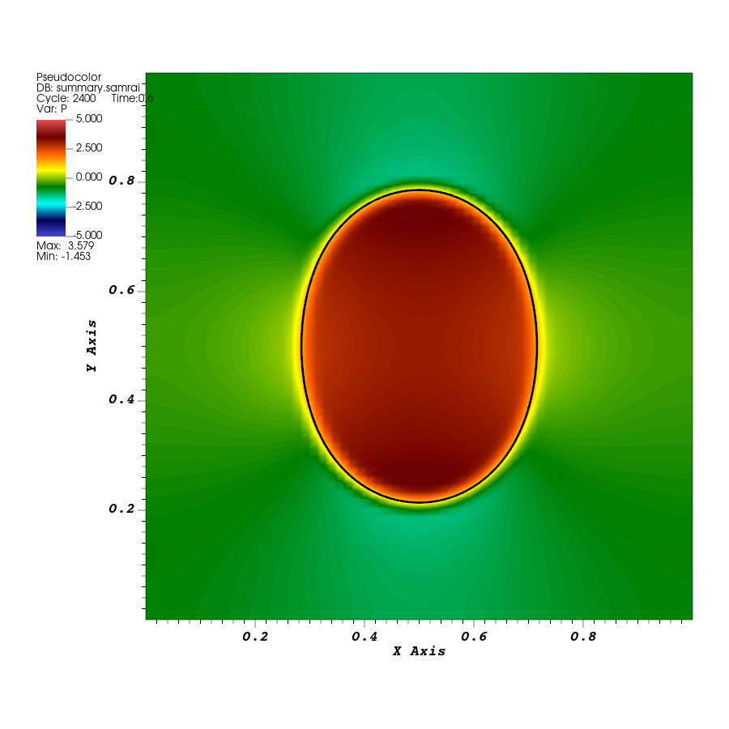

# Tutorial 11: Save and restart a simulation

## Introduction

Save the state of the elastic rubber band and the surrounding fluid, then start a new run from that checkpoint. Compare the resumed motion with the uninterrupted run from tutorial 04.

## Before you start

Use the original rubber-band application and completed `elastic-loop` run from [tutorial 04](04-elastic-loop.md). Use the same `main2d` executable, input settings, and MPI process count for the checkpoint and the continuation. The commands below run with one process.

## Save a checkpoint

From the rubber-band build directory, create separate directories for the checkpoint run and the resumed run. Copy the input and structure files from the original run.

```bash
cd "$EXAMPLES_BUILD/examples/IB/explicit/ex1"
mkdir restart-tutorial
mkdir restart-tutorial/checkpoint restart-tutorial/resumed
cp elastic-loop/{input2d,curve2d_64.vertex,curve2d_64.spring} restart-tutorial/checkpoint/
cd restart-tutorial/checkpoint
```

In this copy of `input2d`, find the two restart settings inside `Main`. Set the interval to `1200` and keep the directory name shown here.

**Edit:** `restart-tutorial/checkpoint/input2d`, inside `Main`. The supplied entries are at [`input2d`, lines 180–181](../examples/IB/explicit/ex1/input2d#L180-L181).

```text
restart_dump_interval = 1200
restart_dump_dirname = "restart_IB2d"
```

The interval counts completed time steps. With the input from tutorial 04, step `1200` is at time `0.3`, halfway to `END_TIME = 0.6`. Run to the original final time.

```bash
../../main2d input2d
```

List the saved checkpoints:

```bash
ls restart_IB2d
```

The directory should contain `restore.000000`, `restore.001200`, and `restore.002400`. The middle directory holds the checkpoint you will use. For this one-process run, its state file is `restore.001200/nodes.00001/proc.00000` under `restart_IB2d`. Keep the directory tree together so IBAMR can locate the files for the requested step.

## Resume from the saved step

Copy the input and structure files into the continuation directory.

```bash
cd ../resumed
cp ../checkpoint/{input2d,curve2d_64.vertex,curve2d_64.spring} .
```

In the resumed run's `input2d`, set `Main.restart_dump_interval` back to `0`. This turns off writing new checkpoints. Leave `END_TIME = 0.6` and the rest of the input as they were. The continuation will write its log and visualization files under `resumed`. Locate the checkpoint file before starting the continuation:

```bash
ls -l ../checkpoint/restart_IB2d/restore.001200/nodes.00001/proc.00000
```

Resume from this checkpoint. The file test also prevents a missing checkpoint from starting a fresh simulation:

```bash
test -f ../checkpoint/restart_IB2d/restore.001200/nodes.00001/proc.00000 &&
  ../../main2d input2d ../checkpoint/restart_IB2d 1200
```

The arguments are the input file, the parent checkpoint directory, and the saved step number. Pass `1200` for the directory named `restore.001200`. The `test -f` check allows the restart command to run only when that checkpoint file exists.

Check the first step in the resumed run’s `IB2d.log`.

```bash
grep -m 1 -A 1 'At beginning of timestep' IB2d.log
```

You should see:

```text
At beginning of timestep # 1200
Simulation time is 0.3
```

The log reports the step counter before the next advance. The continuation starts with 1,200 completed steps and advances from time `0.3`. The final advance should report time `0.6` in the terminal and in `IB2d.log`.

## Compare the resumed and uninterrupted runs

In VisIt, use the pressure and black `curve2d_64_mesh` overlay from tutorial 04. Open `dumps.visit` and `lag_data.visit` from each of the following directories under `$EXAMPLES_BUILD/examples/IB/explicit/ex1`.

| Run | Visualization directory | Saved time range |
| --- | --- | --- |
| Uninterrupted | `elastic-loop/viz_IB2d` | `0` to `0.6` |
| Resumed | `restart-tutorial/resumed/viz_IB2d` | `0.3` to `0.6` |

Make one **Time** correlation for the fluid and structure databases of each run. Keep the pairs separate and use the same pressure limits `[-5,5]` and full-domain view. Compare at physical time `0.6`. It is the last frame in both sequences, even though the resumed sequence starts at the checkpoint. The sequences overlap over `0.3` to `0.6`, so playing them separately avoids repeating those times in a combined sequence.

With the Mesh plot selected, use **Spatial Extents** to get the difference between the maximum and minimum coordinates in each direction. The checked final frames give the same band dimensions to five decimal places.

| Run at time `0.6` | Width | Height |
| --- | --- | --- |
| Uninterrupted | `0.43072` | `0.57178` |
| Resumed | `0.43072` | `0.57178` |

The plots should show the same shape and pressure pattern. Use a tolerance of about `0.00001` for this comparison of the plotted dimensions. It is a check at the precision reported here.



*The resumed run at time 0.6. The mesh and pressure match the uninterrupted run at the same time.*

## How the application saves and restores state

In the [rubber-band source](../examples/IB/explicit/ex1/example.cpp), the time loop advances the hierarchy and increments the step number before checking the restart interval. It uses the completed step number to label the checkpoint.

**Read:** [`example.cpp`, lines 274–278](../examples/IB/explicit/ex1/example.cpp#L274-L278).

```cpp
if (dump_restart_data && (iteration_num % restart_dump_interval == 0 || last_step))
{
    pout << "\nWriting restart files...\n\n";
    RestartManager::getManager()->writeRestartFile(restart_dump_dirname, iteration_num);
}
```

`AppInitializer` reads the restart interval and write directory from `Main`. When the command includes a valid restart directory and saved step, it opens the saved state through SAMRAI's `RestartManager`. The application reads `input2d` and builds its solver objects and hierarchy as usual. During this setup the registered objects restore their saved data, including the integrator's time and step and the fluid and structure state. The first visualization frame of the resumed run is written at that restored time.

The checkpoint and the visualization files serve different purposes. Use `restart_IB2d` to resume the calculation and `viz_IB2d` to view the fluid and structure at the saved plot times.

### Finite-element checkpoints

The finite-element ring application at [`example.cpp`, lines 430–436](../examples/IBFE/explicit/ex1/example.cpp#L430-L436) also calls `writeFEDataToRestartFile` to save libMesh equation-system data alongside the SAMRAI checkpoint. At startup, its `IBFEMethod` constructor in [`example.cpp`, lines 211–218](../examples/IBFE/explicit/ex1/example.cpp#L211-L218) receives the restart directory and saved step to restore the finite-element state. Keep the `libmesh_data_...` files in the checkpoint directory along with the `restore.*` directories.

## Before moving on

You saved the rubber-band state at step `1200`, resumed it at time `0.3`, and compared the resulting band with the original run at time `0.6`. The two run directories hold the checkpoint and the separate visualization sequences.

This completes Fundamentals. Part II starts with a finite-element strip held at its ends. [Tutorial 12](12-finite-element-strip.md)
