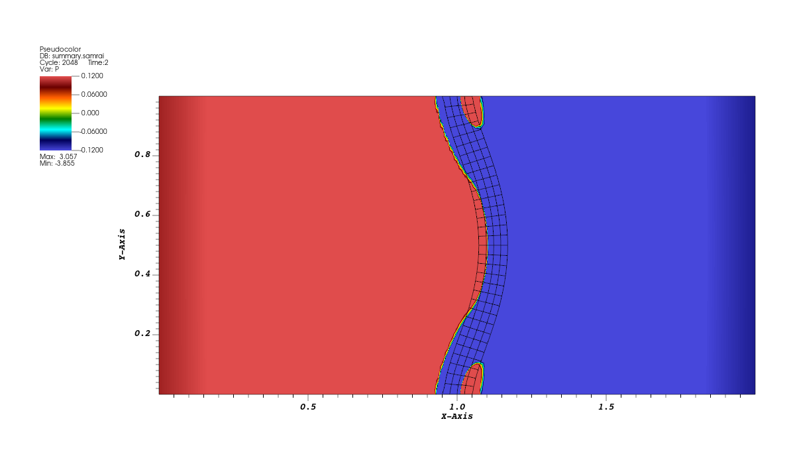

# Tutorial 12: Bend a finite-element strip in a flow

## Introduction

A thin elastic strip stands vertically across the middle of a rectangular fluid domain. Its top and bottom edges are fixed, leaving the middle free to bend. The pressure is higher at the left side of the domain than at the right, so the fluid pushes the strip to the right. The strip pushes back on the fluid as it deforms.

Watch the strip bend and swing back between its held ends. Then increase its stiffness and compare the motion of the two strips at the same times.

## Before you start

Use the configured build and the finite-element visualization workflow from [tutorial 07](07-finite-element-ring.md). This example is `examples/IBFE/explicit/ex2` and uses the same IBAMR installation with libMesh and ExodusII support.

## Running the example

Configure the repository to include the strip application, then build it.

```bash
cmake -S "$EXAMPLES_SRC" -B "$EXAMPLES_BUILD"
cmake --build "$EXAMPLES_BUILD" --target IBFE-ex2-2d --parallel 4
```

Copy the input into a new run directory. The program generates the finite-element mesh when it starts.

```bash
cd "$EXAMPLES_BUILD/examples/IBFE/explicit/ex2"
mkdir strip
cp "$EXAMPLES_SRC/examples/IBFE/explicit/ex2/input2d" strip/
cd strip
../main2d input2d
```

The supplied input sets `END_TIME = 10.0`. Check that the last advance reaches time `10`.

## Results

Open `dumps.visit` and `output.ex2` from `strip/viz_IB2d`. Follow the overlay steps from tutorial 07. Use **Pseudocolor → P** for the fluid and a black **Mesh → Mesh** for the strip. Set the pressure limits to `[-0.12,0.12]` and use `hot_desaturated`. The color scale clips values beyond those limits. For both cases, use the full view with horizontal bounds `0` to `2` and vertical bounds `0` to `1`.

Apply **Displace** to the Mesh plot with a multiplier of `1` and the expression below. This draws the elements at their current physical coordinates.

```text
{<X_0>, <X_1>, 0} - coord(<Mesh>)
```

Create a **Time** correlation for the two databases. Both sequences have 81 states from time `0` to `10`. The input uses `DT = 0.0625*DX` and writes every 128 steps, so the saved states are spaced `0.125` apart. Play the sequence to see the middle bend and swing back while the top and bottom remain in place. Select time `2` for a clear view of the first bend.


*Baseline strip at time 2. The black mesh shows how the solid's interior deforms between its held ends.*

## The input and program

Follow the excerpts alongside the [application](../examples/IBFE/explicit/ex2/example.cpp) and [input](../examples/IBFE/explicit/ex2/input2d).

### Build the strip and hold its ends

The input sets the mesh element type and spacing relative to the finest fluid grid.

```text
DX = L/NFINEST
MFAC = 2.0
ELEM_TYPE = "QUAD9"
```

The application reads these values and generates a rectangular reference mesh.

```cpp
const double dx = input_db->getDouble("DX");
const double ds = input_db->getDouble("MFAC") * dx;
string elem_type = input_db->getString("ELEM_TYPE");
```

```cpp
MeshTools::Generation::build_square(mesh,
                                    static_cast<int>(ceil(0.1 / ds)),
                                    static_cast<int>(ceil(1.0 / ds)),
                                    0.95,
                                    1.05,
                                    0.0,
                                    1,
                                    Utility::string_to_enum<ElemType>(elem_type));
```

The strip spans `0.95` to `1.05` in $x$ and `0` to `1` in $y$. `ds` sets the target element spacing. With `DX = L/NFINEST = 1/64`, the ceiling expressions give four elements across the width and 32 along the length. A `QUAD9` is a quadrilateral with nine nodes, including one at its center.

The application then visits exterior sides of the mesh. For this rectangle, boundary IDs `0` and `2` label the bottom and top edges.

```cpp
if (boundary_info.has_boundary_id(elem, side, 0) || boundary_info.has_boundary_id(elem, side, 2))
{
    boundary_info.add_side(elem, side, FEDataManager::ZERO_DISPLACEMENT_XY_BDRY_ID);
}
```

The added boundary ID marks both displacement components as zero there. When IBAMR sets up the finite-element systems, these nodes are constrained to their reference positions. The remaining nodes can move, which lets the strip bend between its supports.

### Drive the fluid with a pressure difference

The fluid boundary inputs use the component and face numbering from [tutorial 09](09-target-forces-and-boundaries.md). `VelocityBcCoefs_0` sets the horizontal component and `VelocityBcCoefs_1` sets the vertical component.

```text
VelocityBcCoefs_0 {
   acoef_function_0 = "0.0"
   acoef_function_1 = "0.0"
   acoef_function_2 = "0.0"
   acoef_function_3 = "0.0"

   bcoef_function_0 = "1.0"
   bcoef_function_1 = "1.0"
   bcoef_function_2 = "1.0"
   bcoef_function_3 = "1.0"

   gcoef_function_0 = "-1.0e-1"
   gcoef_function_1 = " 1.0e-1"
   gcoef_function_2 = "0.0"
   gcoef_function_3 = "0.0"
}

VelocityBcCoefs_1 {
   acoef_function_0 = "1.0"
   acoef_function_1 = "1.0"
   acoef_function_2 = "1.0"
   acoef_function_3 = "1.0"

   bcoef_function_0 = "0.0"
   bcoef_function_1 = "0.0"
   bcoef_function_2 = "0.0"
   bcoef_function_3 = "0.0"

   gcoef_function_0 = "0.0"
   gcoef_function_1 = "0.0"
   gcoef_function_2 = "0.0"
   gcoef_function_3 = "0.0"
}
```

The horizontal component uses `a = 0` and `b = 1`. On the left and right faces that component is normal to the boundary. For these inputs, the v0.19.0 staggered solver uses `g` as the value of the Cartesian normal stress component on each face:

$
\sigma_{xx}=-p+2\mu_f\frac{\partial u_x}{\partial x}.
$

Here $\mu_f$ is the fluid viscosity, set by `MU = 0.01` in the input. `VelocityBcCoefs_1` sets $u_y=0$ along both vertical faces. Since $u_y$ is constant as you move along either face in the $y$ direction, $\partial u_y/\partial y=0$ there. Incompressibility gives $\partial u_x/\partial x=-\partial u_y/\partial y=0$. The normal stress condition therefore reduces to $p=-g$ on those faces. The left pressure is $0.1$ and the right pressure is $-0.1$. IBAMR applies these conditions through its normal-stress boundary treatment. [v0.19.0 staggered normal-stress implementation](https://github.com/IBAMR/IBAMR/blob/v0.19.0/src/navier_stokes/INSStaggeredPressureBcCoef.cpp#L276)

On the bottom and top faces, `VelocityBcCoefs_1` sets the normal velocity to zero. The horizontal component is tangential there, so its zero stress values prescribe zero shear stress.

### Follow both contributions to the elastic stress

In `namespace ModelData`, the structural coefficient is

```cpp
static const double mu = 10.0;
```

The two functions below it each fill the output tensor `PP` from the deformation gradient `FF`.

```cpp
PP = mu * FF;
```

```cpp
PP = -mu * tensor_inverse_transpose(FF, NDIM);
```

Writing the structural coefficient as $\mu_s$, the contributions add to the first Piola–Kirchhoff stress

$
\mathbf P^e=\mu_s(\mathbf F-\mathbf F^{-T}).
$

The second term uses the inverse transpose of the deformation gradient. When the strip is undeformed, $\mathbf F=\mathbf I$ and the two terms cancel. This stress comes from a **compressible neo-Hookean** strain energy per reference volume. With $J=\det\mathbf F$, the two-dimensional energy is

$
W=\frac{\mu_s}{2}(\mathbf F:\mathbf F-2)-\mu_s\log J.
$

This is the logarithmic form with the first Lamé parameter $\lambda=0$. Differentiating $W$ with respect to $\mathbf F$ gives the two stress contributions above. [FEniCS compressible neo-Hookean model](https://docs.fenicsproject.org/dolfinx/main/cpp/demos/demo_hyperelasticity.html)

The program registers the two contributions separately so each can use its own integration rule.

```cpp
IBFEMethod::PK1StressFcnData PK1_dev_stress_data(PK1_dev_stress_function);
IBFEMethod::PK1StressFcnData PK1_dil_stress_data(PK1_dil_stress_function);
PK1_dev_stress_data.quad_order =
    Utility::string_to_enum<libMesh::Order>(input_db->getStringWithDefault("PK1_DEV_QUAD_ORDER", "THIRD"));
PK1_dil_stress_data.quad_order =
    Utility::string_to_enum<libMesh::Order>(input_db->getStringWithDefault("PK1_DIL_QUAD_ORDER", "FIRST"));
ib_method_ops->registerPK1StressFunction(PK1_dev_stress_data);
ib_method_ops->registerPK1StressFunction(PK1_dil_stress_data);
```

The input sets `PK1_DEV_QUAD_ORDER = "FIFTH"` and `PK1_DIL_QUAD_ORDER = "THIRD"`. These orders control how each contribution is integrated over the elements. During the advance, `IBFEMethod` evaluates the callbacks and uses the resulting stresses in the weak force calculation from tutorial 07. Changing the shared `mu` scales both contributions together.

## Further exploration: increase the strip stiffness

In `$EXAMPLES_SRC/examples/IBFE/explicit/ex2/example.cpp`, change `static const double mu = 10.0;` to

```cpp
static const double mu = 20.0;
```

Rebuild the target and run with a copy of the baseline input.

```bash
cmake --build "$EXAMPLES_BUILD" --target IBFE-ex2-2d --parallel 4
cd "$EXAMPLES_BUILD/examples/IBFE/explicit/ex2"
mkdir strip-stiffer
cp strip/input2d strip-stiffer/
cd strip-stiffer
../main2d input2d
```

Check that this run also reaches time `10`. Open its fluid and structure output in VisIt and create a Time correlation for the new pair. Use the same pressure limits, view, and displaced Mesh plot. Compare the two strips at time `2`, then play both sequences to see how their motion changes.



*Stiffer strip at time 2, with the same view and pressure scale.*

At time `2`, the stiffer strip bows less than the baseline. As you play the sequences, watch the middle of each strip swing back and bend again.

## Before moving on

You ran a strip held at both ends, followed the fluid loading and elastic stress through the input and program, and changed the structural coefficient in C++. You should have two runs you can play in VisIt and compare at matching physical times.

The next tutorial shows how a solid deforms under a prescribed surface load in a solid-only calculation. [Tutorial 13](13-cooks-membrane.md)
