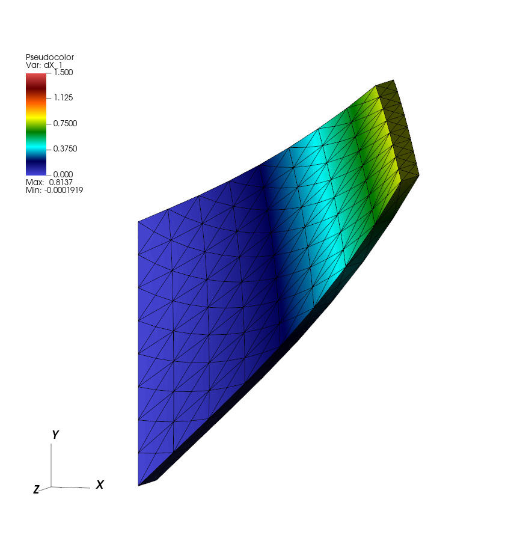
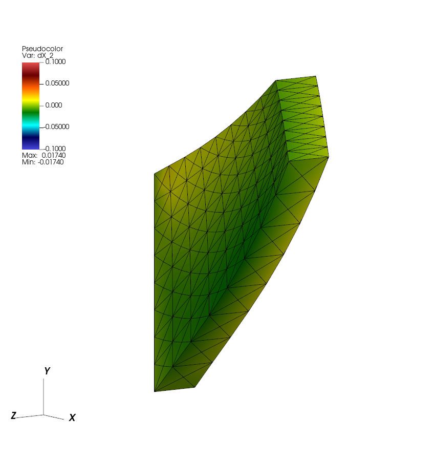
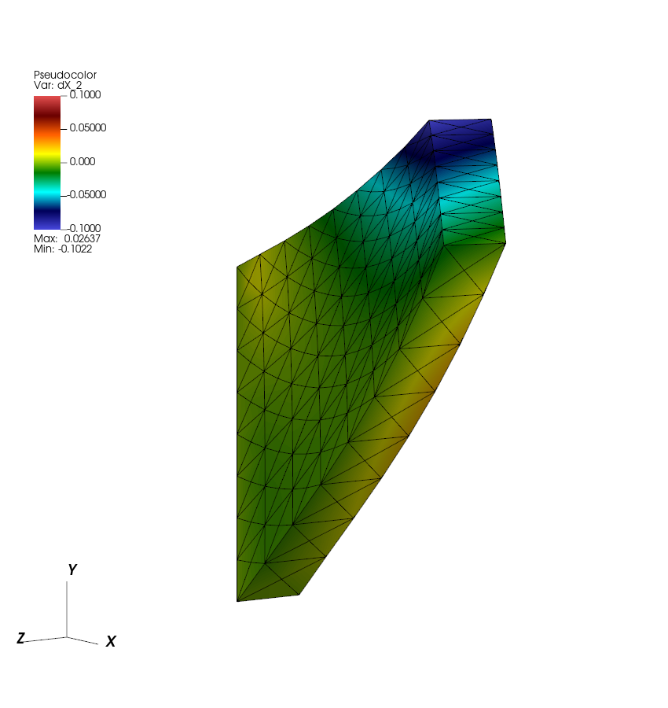

# Tutorial 13: Solve a solid mechanics problem in 3D

## Introduction

Cook’s membrane is a tapered elastic panel. Here it has a thickness of one unit and is meshed with tetrahedra. A penalty support holds the left face close to its starting position. An upward traction on the right face ramps up from zero and then stays constant. The panel bends upward, and damping slows its motion.

This is a solid-only model with no fluid–structure interaction (FSI). The finite-element solver advances the panel under the applied load, the support, and its internal elastic stresses. Run the example, then modify the surface-force callback to distribute the load unevenly across the thickness and twist the panel.

## Before you start

Use the configured build and ExodusII visualization workflow from [tutorial 07](07-finite-element-ring.md). This example uses `examples/fe_mechanics/ex0`. Your IBAMR installation needs 3D support and libMesh with ExodusII support.

## Running the example

Configure the repository to include the Cook’s membrane application and build it.

```bash
cmake -S "$EXAMPLES_SRC" -B "$EXAMPLES_BUILD"
cmake --build "$EXAMPLES_BUILD" --target fe_mechanics-ex0-3d --parallel 4
```

Copy the input to a fresh run directory. The application generates the mesh when it starts.

```bash
cd "$EXAMPLES_BUILD/examples/fe_mechanics/ex0"
mkdir cook3d
cp "$EXAMPLES_SRC/examples/fe_mechanics/ex0/input3d" cook3d/
cd cook3d
../main3d input3d
```

The input sets `END_TIME = 4.0`. Check that the last advance reaches time `4` and that the run directory contains `output.ex2` and `FEM3d.log`.

## Results

Open `cook3d/output.ex2` in VisIt. Add **Pseudocolor → dX_1** and a black **Mesh → Mesh**. The color shows vertical displacement from the starting position. Use `hot_desaturated` and fix the range at `0` to `1.5` for both runs.

Create a vector expression named `cook_displacement`.

```text
{<dX_0>, <dX_1>, <dX_2>}
```

Apply **Displace** to both plots with this expression and a multiplier of `1`. This adds the saved displacement to the reference mesh. Rotate the 3D view slightly to see both the broad face and the thickness of the panel. Use the same viewing angle and zoom for both cases.

The mesh and displacement field share one database and one time slider. Play the 41 states from time `0` to `4`. The loaded right face rises while the supported left face stays close to its original position. By the last frames, the motion has slowed considerably.



*Cook’s membrane at time 4 with the baseline load. Color shows how far each point has moved vertically from its starting position.*

## The input and program

Follow these excerpts alongside the [application](../examples/fe_mechanics/ex0/example.cpp) and [input](../examples/fe_mechanics/ex0/input3d).

### Create the tapered panel

The input chooses four-node tetrahedra and sets the subdivisions used to generate the reference mesh.

```text
N_X = 8
N_Y = ceil(N_X * (L_Y / L_X))
N_Z = ceil(N_X * (L_Z / L_X))
ELEM_TYPE = "TET4"
```

The supplied input gives `N_Y = 8` and `N_Z = 1`. The program tetrahedralizes the unit cube, then maps each node to the panel.

```cpp
libMesh::Point s = **nd;
(**nd)(0) = 4.8 * s(0) + 2.6;
(**nd)(1) = -2.8 * s(0) * s(1) + 4.4 * s(0) + 4.4 * s(1) + 2.0;
```

The map changes the first two coordinates and leaves $z$ from `0` to `1`. The left face is at $x=2.6$ and extends from $y=2$ to $y=6.4$. The right face is at $x=7.4$ and extends from $y=6.4$ to $y=8$. The mesh connectivity and face labels carry over from the cube. In this three-dimensional libMesh grid, the left face has boundary ID `4` and the right face has ID `2`. [libMesh mesh generator](https://libmesh.github.io/doxygen/mesh__generation_8C_source.html)

### Apply the support and the load

The program reads the support stiffness, load amplitude, and ramp time from the input.

```cpp
kappa = input_db->getDouble("KAPPA");
traction_force = input_db->getDouble("TRACTION_FORCE");
load_time = input_db->getDouble("LOAD_TIME");
```

In `solid_surface_force_function`, the callback arguments `X` and `x` are the reference and current positions. The function checks the boundary ID of the element side before assigning the surface force.

```cpp
const auto dim = elem->dim();
if (lag_bdry_info->has_boundary_id(elem, side, dim == 2 ? 3 : 4))
{
    F = kappa * (X - x);
}
else if (lag_bdry_info->has_boundary_id(elem, side, dim == 2 ? 1 : 2))
{
    F = libMesh::Point(0.0, time_ramp(time) * traction_force, 0.0);
}
else
{
    F.zero();
}
```

On the left face (ID `4`), the callback applies a spring-like traction `kappa * (X - x)` to pull each point toward its reference position. For example, if a point moves up, `X - x` points down, so the support pulls it back down. `KAPPA` sets the strength of that traction per unit displacement. This is the penalty support, like the stiff tethers in tutorial 09. The membrane’s elasticity acts separately through the internal stress throughout the solid.

On the right face (ID `2`), the applied traction points upward. The other faces have zero applied traction.

```text
LOAD_TIME = .05
TRACTION_FORCE = 6.25
```

During the ramp, `time_ramp` evaluates $3s^2-2s^3$ with $s=t/t_{\mathrm{load}}$, where `LOAD_TIME` gives $t_{\mathrm{load}}$. It returns `1` at and after time `0.05`, so the upward traction then stays at `6.25`. The value is force per unit reference area. The loaded face is `1.6` units high and `1` unit thick, so the total upward force at full load is `6.25 × 1.6 = 10`.

### Supply the material response and damping

The active input selects the modified neo-Hookean stress and includes the volume-change term.

```text
USE_STATIC_PRESSURE = FALSE
USE_DYNAMIC_PRESSURE = FALSE
STRESS_FUNCTION = "MODIFIED"
USE_VOLUMETRIC_TERM = TRUE
```

The `MODIFIED` branch registers `PK1_dev_stress_function_mod`. This callback supplies the part of the first Piola–Kirchhoff stress associated with shape change. The application also registers `PK1_dil_stress_function`, which supplies the part associated with changes in volume. The two contributions come from the strain energy per reference volume

$
W = \frac{G}{2}\left(J^{-2/3}\operatorname{tr}(\mathbf F^T\mathbf F)-3\right)
    + \frac{K}{2}(\log J)^2,
\qquad J=\det\mathbf F.
$

Here $G$ and $K$ come from `SHEAR_MOD` and `BULK_MOD`. The first term uses the volume-preserving part of the deformation. The second term penalizes a change in volume through $J$. Its coefficient $K$ comes from `BULK_MOD`, while `KAPPA` controls the support traction on the left face. Both optional solid pressure systems are disabled, so this second stress term supplies the resistance to volume change. In three dimensions, $J^{-2/3}$ removes the effect of a uniform volume change from the squared stretches in the first term.

The body-force callback needs the solid velocity. The program attaches the velocity system to the callback through its `SystemData` entry.

```cpp
velocity_data[0] = SystemData(fem_solver->getVelocitySystemName(), vars);
```

The solver supplies the velocity at each point where it evaluates the force. The callback reads that velocity as `U` and applies the force below, with `damping` read from `ETA`.

```cpp
F = -damping * U;
```

This force opposes motion throughout the solid. As the load ramps up, the panel can overshoot and oscillate. The damping dissipates energy from that motion so the panel can settle under the constant load. The force goes to zero as the solid velocity goes to zero.

### Advance the solid and write the result

`FEMechanicsExplicitIntegrator` receives the mesh and its input database. The program registers the surface and body force callbacks with it.

```cpp
FEMechanicsBase::LagSurfaceForceFcnData solid_surface_force_data(solid_surface_force_function);
FEMechanicsBase::LagBodyForceFcnData solid_body_force_data(solid_body_force_function, velocity_data);
fem_solver->registerLagSurfaceForceFunction(solid_surface_force_data);
fem_solver->registerLagBodyForceFunction(solid_body_force_data);
```

After registering the stress callbacks, the program initializes the finite-element equation systems and data. Those systems hold the coordinates, displacement, and velocity used during the calculation. Each step follows the `MODIFIED_TRAPEZOIDAL_RULE` selected in the input and calls

```cpp
fem_solver->modifiedTrapezoidalStep(loop_time, loop_time + dt);
```

The integrator advances the solid using the internal stress and the registered forces. This tutorial uses the following time step and support stiffness.

```text
DT = 0.025*CFL_MAX*DX/U_MAX
SAFETY = 0.5
KAPPA = SAFETY * 1.25e-1 * DX / DT^2
```

The tutorial uses `DT = 0.00125`, which gives `KAPPA = 50000`. At fixed mesh spacing, halving `DT` quadruples `KAPPA`. For a given support traction, the displacement from the tether point is inversely proportional to `KAPPA`. As `DT` tends to zero and `KAPPA` grows, each supported point approaches its own prescribed reference position $X$, provided the support traction stays bounded.

The writer saves a frame every 80 steps, so the saved times are spaced `0.1` apart.

## Further exploration: load one side of the thickness more strongly

Change the surface-force callback so the upward traction varies across the thickness. Keep the total upward force the same and shift more of it toward the face with reference coordinate $Z=1$.

### Read a parameter for the load distribution

In `$EXAMPLES_SRC/examples/fe_mechanics/ex0/example.cpp`, add this declaration immediately after `static double load_time;` in `namespace ModelData`.

```cpp
static double load_skew;
```

In `main`, add this line immediately after reading `LOAD_TIME`.

```cpp
load_skew = input_db->getDouble("LOAD_SKEW");
```

The new `LOAD_SKEW` input controls how unevenly the traction is distributed. The application now requires this value each time it starts.

### Use reference position in the surface-force callback

In the loaded-face branch of `solid_surface_force_function`, replace

```cpp
F = libMesh::Point(0.0, time_ramp(time) * traction_force, 0.0);
```

with

```cpp
const double load_factor = 1.0 + load_skew * (2.0 * X(2) - 1.0);
F = libMesh::Point(0.0, time_ramp(time) * traction_force * load_factor, 0.0);
```

The callback's `X(2)` is the material point's reference coordinate through the thickness, from `0` to `1`. With `LOAD_SKEW = 0.8`, the multiplier varies linearly from `0.2` at $Z=0$ to `1.8` at $Z=1$. The factor has an average of `1` over the reference thickness, so integrating the traction gives the same total upward force as the uniform load.

The stronger load on one side also applies a twisting moment. Using reference coordinates defines the distribution on the material as the panel moves.

### Build and run the modified application

Create a new run directory and copy the baseline input.

```bash
cmake --build "$EXAMPLES_BUILD" --target fe_mechanics-ex0-3d --parallel 4
cd "$EXAMPLES_BUILD/examples/fe_mechanics/ex0"
mkdir cook3d-skewed
cp cook3d/input3d cook3d-skewed/
```

In `cook3d-skewed/input3d`, add this top-level entry alongside `TRACTION_FORCE`.

```text
LOAD_SKEW = 0.8
```

Run the modified application.

```bash
cd "$EXAMPLES_BUILD/examples/fe_mechanics/ex0/cook3d-skewed"
../main3d input3d
```

Open `cook3d-skewed/output.ex2` in VisIt and apply the same Mesh plot and three-component displacement expression as the baseline. Change the Pseudocolor field to `dX_2`, the displacement through the thickness, and set its range to `[-0.1,0.1]`. Make the same change for the baseline output. Keep the Displace multiplier at `1` and compare at time `4` using the same viewing angle. Rotate the panel to see both its broad face and its thickness.



*Uniform loading at time 4, colored by displacement in the thickness direction.*



*The total upward force matches the baseline, with a larger share applied toward the $Z=1$ side.*

The uneven load makes the two sides of the loaded face rise by different amounts. The resulting twist is visible in the deformed mesh and the stronger variation in `dX_2`.

To recover the uniform loading with this callback, use `LOAD_SKEW = 0.0` in a separate run's input. This sets `load_factor` to `1` everywhere on the loaded face.

## Before moving on

You ran a 3D solid-only calculation, followed the support and load on the two faces through the application, and modified the surface-force callback to vary the load across the thickness. You should have two ExodusII sequences you can compare at the same time.

The next tutorial returns to flow around a cylinder and shows how the immersed interface method represents changes across the cylinder surface.
