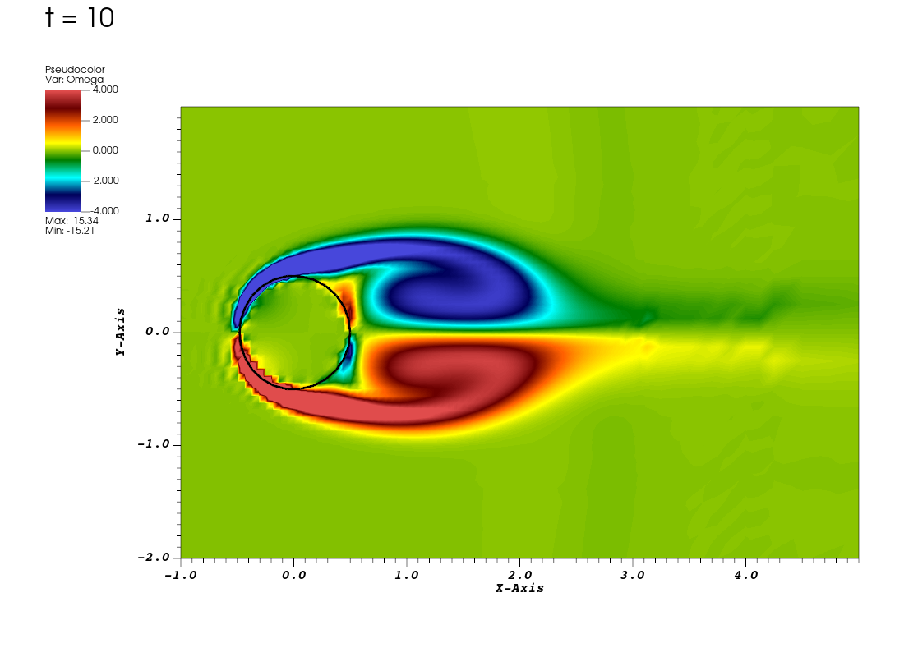
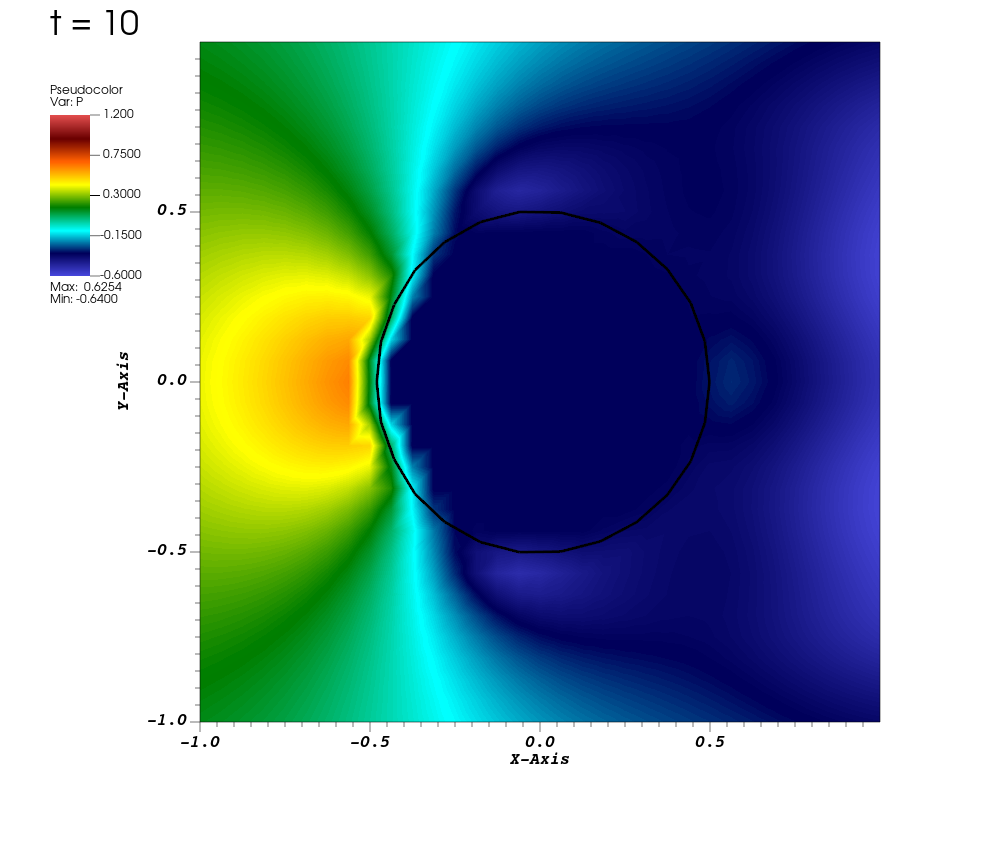
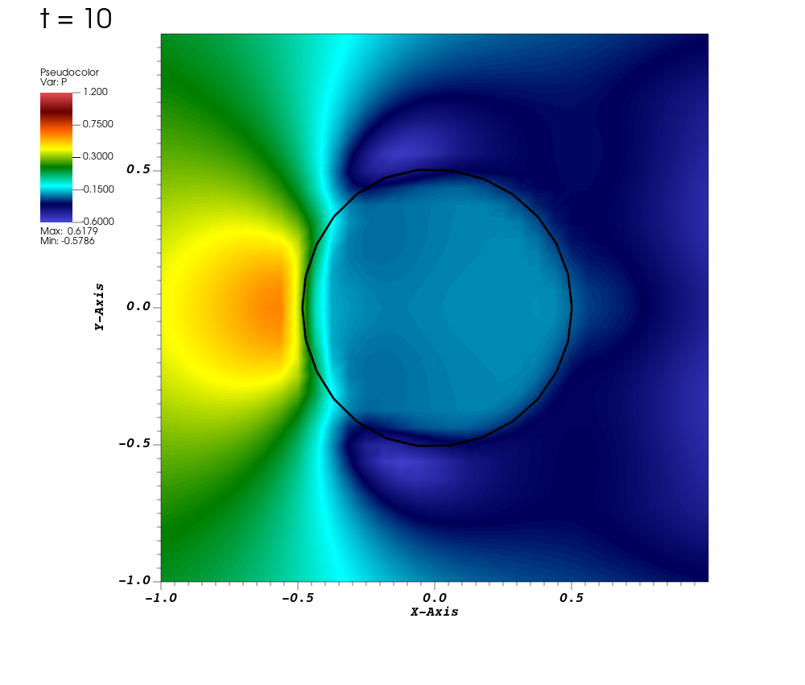
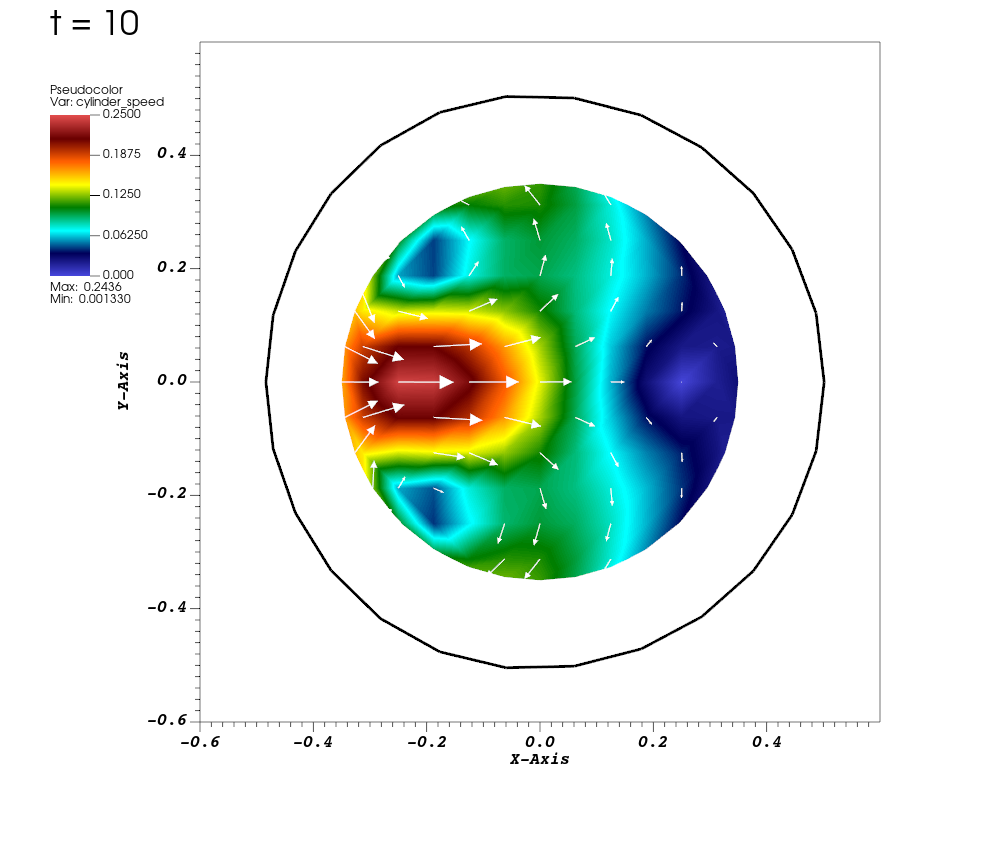
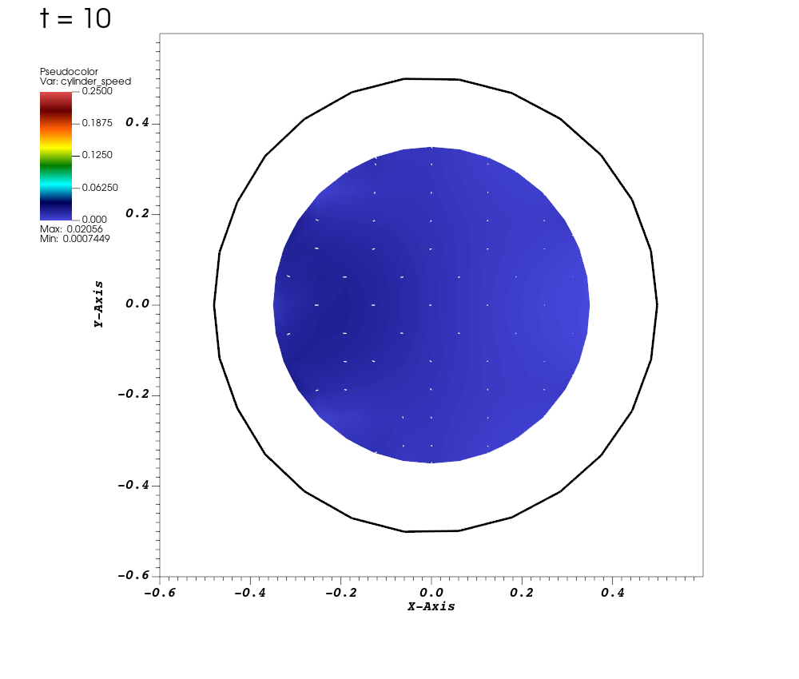

# Tutorial 14: Resolve jumps across an immersed surface

## Introduction

Return to flow past a cylinder held near its starting position by tether forces. This application represents the cylinder with a finite-element surface mesh and uses the immersed interface method (IIM) to account for jumps in pressure and velocity derivatives across that surface.

Run the example, view the wake and the pressure near the cylinder, then follow how the application connects its surface force to `IIMethod`. Finally, compare the result with a regularized IB calculation using the same model and numerical settings.

## Before you start

Use the build setup from [tutorial 00](00-orientation.md), the boundary-condition discussion from [tutorial 09](09-target-forces-and-boundaries.md), and the ExodusII overlay workflow from [tutorial 07](07-finite-element-ring.md). This example is in `examples/IIM/ex0`. Its mesh generator requires libMesh with Triangle support, and its surface output requires ExodusII support.

## Running the example

Configure the repository and build the IIM application.

```bash
cmake -S "$EXAMPLES_SRC" -B "$EXAMPLES_BUILD"
cmake --build "$EXAMPLES_BUILD" --target IIM-ex0-2d --parallel 4
```

The target produces `main2d` in the example's build directory. Copy the input into a run directory; the program generates the cylinder mesh.

```bash
cd "$EXAMPLES_BUILD/examples/IIM/ex0"
mkdir iim-cylinder
cp "$EXAMPLES_SRC/examples/IIM/ex0/input2d" iim-cylinder/
cd iim-cylinder
../main2d input2d
```

The supplied [`input2d`, line 33](../examples/IIM/ex0/input2d#L33) sets `END_TIME = 10.0`. Check that the final advance reaches time `10`. The run directory contains `IIM_2d.log` and the visualization directory `viz_IIM_2d`.

## Results

### View the wake and cylinder

Open `iim-cylinder/viz_IIM_2d/dumps.visit` and `output.ex2` in VisIt.

1. From `dumps.visit`, add **Pseudocolor → Omega**, choose `hot_desaturated`, and set limits to `-4` and `4`.
2. From `output.ex2`, add a black **Mesh → Mesh** plot.
3. Create a vector expression named `iim_displacement`:

   ```text
   {<X_0>, <X_1>, 0} - coord(<Mesh>)
   ```

4. Apply **Displace** to the surface Mesh plot with this expression and multiplier `1`.
5. Create a **Time** correlation for these two databases and select it as the active time slider. Both have 41 saved states, from `0` to `10` at intervals of `0.25`.
6. Use horizontal bounds `[-1,5]` and vertical bounds `[-2,2]`. Play the sequence, then select time `10`.



*Baseline at time 10. Oppositely signed vorticity forms above and below the cylinder and extends into the wake. Values outside the chosen color range use the end colors.*

The black curve is the current surface mesh. Its small displacements supply the tether force that holds the cylinder near its initial position.

### Inspect pressure near the surface

Change the fluid Pseudocolor variable to `P`. Set its limits to `[-0.6,1.2]`, keep the same color table, and zoom to `[-1,1]` in both directions at time `10`.



*Fluid-grid pressure and the displaced surface at time 10. The pressure changes sharply across the upstream side of the cylinder.*

For a direct view of the jump stored on the surface, hide the fluid and Mesh plots and add **Pseudocolor → P_jump_** from `output.ex2`. Apply the same Displace operator to this new plot. `P_jump_` is the pressure difference across the interface; `P` is the pressure field on the Cartesian fluid grid. Return to the fluid/mesh overlay for the comparison later.

Save the wake and pressure views in the run directory with their physical time in the filenames.

## What changes with IIM?

The fluid equations and the moving-surface coupling remain those introduced in the earlier IB tutorials. A force concentrated on a surface produces discontinuities in pressure and in derivatives of velocity. IIM uses these jumps to correct fluid-grid differences and interpolation near the surface.

Let `n` point from the cylinder interior toward the exterior, and write $[q]=q_{\mathrm{out}}-q_{\mathrm{in}}$. For force per current surface length $\mathbf g$ and constant viscosity $\mu$, the relevant relations are

$
[\mathbf u]=0,\qquad
[p]=\mathbf g\cdot\mathbf n,\qquad
\mu\left[\frac{\partial\mathbf u}{\partial n}\right]
=-\left(\mathbf g-(\mathbf g\cdot\mathbf n)\mathbf n\right).
$

Velocity is continuous, while its normal derivative can jump. The normal force gives the pressure jump; the tangential force gives the velocity-derivative jump. The force callback below supplies force per reference length, and `IIMethod` converts between reference and current length when forming the jumps.

The method accounts for an interface cutting through the fluid grid without fitting the grid to it. See [Kolahdouz et al., *An immersed interface method for discrete surfaces*](https://doi.org/10.1016/j.jcp.2019.07.052) for the formulation.

## The input and program

Read `input2d` and `example.cpp` in `examples/IIM/ex0`. The familiar fluid solver, hierarchy, and coupled time loop keep their previous roles. Here the new pieces are the surface mesh, its force callback, and the IIM correction settings.

### Build the surface mesh

**Read:** [`input2d`, lines 13–17](../examples/IIM/ex0/input2d#L13-L17).

```text
NFINEST = (REF_RATIO^(MAX_LEVELS - 1))*N
DX0 = L/N
DX = L/NFINEST
MFAC = 2.0
ELEM_TYPE = "TRI3"
```

The grid settings at [`input2d`, lines 9–12](../examples/IIM/ex0/input2d#L9-L12) give `DX = 16/256 = 0.0625`. The application sets `ds = MFAC*DX = 0.125` as its structural mesh-spacing scale. The radius comes from `R = 0.5` at [line 5](../examples/IIM/ex0/input2d#L5).

**Read:** [`example.cpp`, lines 225–230](../examples/IIM/ex0/example.cpp#L225-L230).

```cpp
const int num_circum_nodes = ceil(2.0 * M_PI * R / ds);
for (int k = 0; k < num_circum_nodes; ++k)
{
    const double theta = 2.0 * M_PI * static_cast<double>(k) / static_cast<double>(num_circum_nodes);
    solid_mesh.add_point(libMesh::Point(R * cos(theta), R * sin(theta)));
}
```

This places 26 points around the circle. The following Triangle call creates a triangular disk mesh. After projecting its boundary nodes onto the circle, the application extracts the boundary:

**Read:** [`example.cpp`, lines 271–274](../examples/IIM/ex0/example.cpp#L271-L274).

```cpp
BoundaryMesh boundary_mesh(solid_mesh.comm(), solid_mesh.mesh_dimension() - 1);
BoundaryInfo& boundary_info = solid_mesh.get_boundary_info();
boundary_info.sync(boundary_mesh);
boundary_mesh.prepare_for_use();
```

The mesh passed to `IIMethod` is this boundary mesh, selected by `Mesh& mesh = boundary_mesh;` at [line 278](../examples/IIM/ex0/example.cpp#L278). In two dimensions its elements are line segments around the cylinder. The intermediate disk mesh supplies the geometry; the simulation's finite-element force is defined on its surface.

### Supply the tether force

**Read:** [`input2d`, lines 52–53](../examples/IIM/ex0/input2d#L52-L53).

```text
KAPPA_S_SURFACE = 0.002/DT^2
ETA_S_SURFACE = 0.005/DT
```

The step bound `DT = 0.25*CFL_MAX*DX` at [line 31](../examples/IIM/ex0/input2d#L31), with `CFL_MAX = 0.4`, gives `DT = 0.00625`. The surface coefficients are therefore `51.2` and `0.8`. `TetherData` reads them from the input and holds them for the callback.

**Read:** [`example.cpp`, lines 129–134](../examples/IIM/ex0/example.cpp#L129-L134), in the surface overload of `tether_force_function`.

```cpp
const std::vector<double>& U = *var_data[0];
double u_bndry_n = 0.0;
for (unsigned int d = 0; d < NDIM; ++d) u_bndry_n += n(d) * U[d];

for (unsigned int d = 0; d < NDIM; ++d)
    F(d) = tether_data->kappa_s_surface * (X(d) - x(d)) - tether_data->eta_s_surface * u_bndry_n * n(d);
```

`X` is the reference position, `x` the current position, `U` the surface velocity, and `n` the current unit normal. In vector form, this is

$
\mathbf F=K_s(\mathbf X-\mathbf x)-\eta_s(\mathbf U\cdot\mathbf n)\mathbf n.
$

The first term pulls each point toward its reference location. The second damps the normal component of motion. As in tutorial 09, a small displacement generates the force needed to approximate the prescribed stationary boundary.

### Connect the model to the integrator

**Read:** [`example.cpp`, lines 303–311](../examples/IIM/ex0/example.cpp#L303-L311).

```cpp
ib_ops = new IIMethod("IIMethod",
                      app_initializer->getComponentDatabase("IIMethod"),
                      &mesh,
                      app_initializer->getComponentDatabase("GriddingAlgorithm")->getInteger("max_levels"));
Pointer<IBHierarchyIntegrator> time_integrator =
    new IBExplicitHierarchyIntegrator("IBHierarchyIntegrator",
                                      app_initializer->getComponentDatabase("IBHierarchyIntegrator"),
                                      ib_ops,
                                      navier_stokes_integrator);
```

`IIMethod` receives its input database, the surface mesh, and the permitted hierarchy-level count. The coupled integrator receives that strategy and the fluid integrator, just as it received `IBMethod` or `IBFEMethod` in earlier tutorials.

The callback needs surface velocity as well as positions. The application requests that data and registers the force:

**Read:** [`example.cpp`, lines 335–340](../examples/IIM/ex0/example.cpp#L335-L340).

```cpp
vector<SystemData> sys_data(1, SystemData(IIMethod::VELOCITY_SYSTEM_NAME, vars));
Pointer<IIMethod> ibfe_ops = ib_ops;
ibfe_ops->initializeFEEquationSystems();
equation_systems = ibfe_ops->getFEDataManager()->getEquationSystems();
IIMethod::LagSurfaceForceFcnData surface_fcn_data(tether_force_function, sys_data, tether_data_ptr);
ibfe_ops->registerLagSurfaceForceFunction(surface_fcn_data);
```

`vars` selects the velocity components. The `SystemData` entry makes their interpolated values available through `var_data[0]`. `tether_data_ptr` supplies the address of the coefficient data through the callback's `ctx` argument. The registration object packages the function and these data requests.

The name `ibfe_ops` is a local variable in this application; its type here is `Pointer<IIMethod>`. The later `initializeFEData()` and `initializePatchHierarchy(...)` calls at [lines 398–399](../examples/IIM/ex0/example.cpp#L398-L399) initialize the surface and fluid data. Each `advanceHierarchy(dt)` call then coordinates force evaluation, the fluid solve, and surface motion.

### Select the jump corrections

**Read:** [`input2d`, lines 21–23](../examples/IIM/ex0/input2d#L21-L23).

```text
USE_PRESSURE_JUMP_CONDITIONS = TRUE
USE_VELOCITY_JUMP_CONDITIONS = TRUE
USE_U_INTERP_CORRECTION = TRUE
```

These top-level names feed the `IIMethod` database:

**Read:** [`input2d`, lines 114–117](../examples/IIM/ex0/input2d#L114-L117).

```text
IB_delta_fcn = IB_DELTA_FUNCTION
use_pressure_jump_conditions = USE_PRESSURE_JUMP_CONDITIONS
use_velocity_jump_conditions = USE_VELOCITY_JUMP_CONDITIONS
use_u_interp_correction = USE_U_INTERP_CORRECTION
```

| Entry | Role |
| --- | --- |
| `use_pressure_jump_conditions` | Accounts for the pressure jump in fluid-grid calculations |
| `use_velocity_jump_conditions` | Accounts for jumps in velocity derivatives |
| `use_u_interp_correction` | Corrects interpolation of fluid velocity to the surface near those jumps |

The kernel selection remains present: `IB_DELTA_FUNCTION = "IB_3"` at [line 20](../examples/IIM/ex0/input2d#L20). The jump corrections account for the discontinuities when grid calculations cross the surface. The [`IIMethod` class reference](https://ibamr.github.io/IBAMR-docs/ibamr/classIBAMR_1_1IIMethod.html) documents its setup and registration interfaces.

### Follow the inlet ramp and saved times

The coefficient blocks use the component and face conventions from tutorial 09. The horizontal inlet expression is different in this application:

**Read:** [`input2d`, lines 65–78](../examples/IIM/ex0/input2d#L65-L78), selected entries in `VelocityBcCoefs_0`.

```text
t_half = 0.5
tau = 0.25
acoef_function_0 = "1.0"
bcoef_function_0 = "0.0"
gcoef_function_0 = "(tanh(t/2-t_half/tau)+tanh(t_half/tau))/(1+tanh(t_half/tau))"
```

This prescribes the horizontal inlet velocity. With these constants, the ramp is about halfway to its final value at time `4` and approaches `1` by time `10`. The vertical inlet expression at [line 97](../examples/IIM/ex0/input2d#L97) is `"cos(pi*X_1/L)*exp(-2.0*t)"`; it supplies a disturbance that decays with time.

**Read:** [`input2d`, lines 182–184](../examples/IIM/ex0/input2d#L182-L184), inside `Main`.

```text
viz_writer = "VisIt","ExodusII"
viz_dump_interval = 40
viz_dump_dirname = "viz_IIM_2d"
```

The two writers receive the same physical time. Forty steps of `0.00625` separate saved states by `0.25`, giving the matching sequences used above.

## Further exploration: compare with regularized IB

Use the same application to compare IIM with a regularized IB treatment of the surface force. Keep the Reynolds number, mesh, kernel, tether coefficients, inlet, and time settings the same.

With jump corrections disabled, `IIMethod` spreads the full surface force through the regularized kernel and interpolates velocity without the jump correction. This provides an IB surface calculation within the same application.

### Run the IB case

Create a second run directory and copy the baseline input.

```bash
cd "$EXAMPLES_BUILD/examples/IIM/ex0"
mkdir ib-cylinder
cp iim-cylinder/input2d ib-cylinder/
```

In `ib-cylinder/input2d`, change all three correction flags to `FALSE`.

**Edit:** [`input2d`, lines 21–23](../examples/IIM/ex0/input2d#L21-L23), in the new run copy.

```text
USE_PRESSURE_JUMP_CONDITIONS = FALSE
USE_VELOCITY_JUMP_CONDITIONS = FALSE
USE_U_INTERP_CORRECTION = FALSE
```

Turning off the pressure and velocity-derivative corrections puts the whole force into the regularized spreading calculation. Turning off the interpolation correction makes the surface velocity use the regularized IB interpolation as well. The executable and surface-force callback are unchanged.

```bash
cd "$EXAMPLES_BUILD/examples/IIM/ex0/ib-cylinder"
../main2d input2d
```

This run also ends at time `10` and writes 41 states in `viz_IIM_2d`. Open its fluid and surface databases and make a Time correlation for this pair.

### Compare pressure across the surface

Use the pressure overlay from the baseline, with the same displaced surface mesh, view `[-1,1]` in each direction, and pressure limits `[-0.6,1.2]`. Select time `10` for each run.

| IIM | Regularized IB |
| --- | --- |
|  |  |

*Both methods at time 10, using the same view and pressure scale.*

In regularized IB, the pressure transition is spread across a band of fluid cells. IIM represents a sharper pressure change at the surface. The pressure inside the IB cylinder also varies more noticeably.

### View the flow inside the cylinder

Plot the velocity magnitude to see the interior motion. Create two scalar expressions in VisIt's Expressions window:

| Name | Definition |
| --- | --- |
| `cylinder_speed` | `magnitude(<U>)` |
| `cylinder_radius` | `sqrt(coord(<amr_mesh>)[0]^2 + coord(<amr_mesh>)[1]^2)` |

The second expression measures distance from the cylinder's original center. Use it to select the same inner disk in both runs, away from the surface transition.

1. From the fluid database, add **Pseudocolor → cylinder_speed** and set limits to `[0,0.25]` with `hot_desaturated`.
2. Apply **Operators → Selection → Isovolume** to this plot. Set its variable to `cylinder_radius`, lower bound `0`, and upper bound `0.35`. This keeps the inner disk; see the [Isovolume documentation](https://visit-sphinx-github-user-manual.readthedocs.io/en/v3.5.0/using_visit/Operators/OperatorTypes/Isovolume_operator.html).
3. Keep the black displaced surface Mesh plot. Use view bounds `[-0.6,0.6]` in both directions.
4. Add **Vector → U** from the fluid database and apply the same Isovolume selection to it. Choose 100 fixed vectors, white arrows, **Scale by magnitude** enabled, **Auto scale** disabled, and **Scale** `0.4`. Use these same settings in both runs.
5. After adding the plots, select that run's Time correlation again and set physical time `10`.



*Regularized IB at time 10: color gives speed and white arrows show velocity in the disk $r<0.35$. The black curve is the cylinder surface.*



*IIM at the same time, with the same speed limits, arrow scale, and selected disk. The interior motion is much weaker.*

The fluid grid extends through the cylinder's interior. The intended stationary cylinder should leave that fluid at rest once startup motion has decayed. The larger artificial interior circulation in the regularized IB result is often called **parasitic flow**.

For a numerical comparison, select the speed plot and query **MinMax** with **Actual data**. The checked maxima in the selected inner disk at time `10` are:

| Method | Maximum interior speed |
| --- | --- |
| Regularized IB | `0.244` |
| IIM | `0.0206` |

IIM reduces this maximum by about a factor of twelve in these runs. It strongly suppresses the interior flow, with a small residual remaining at this resolution and time.

Save the paired pressure and interior-speed images. This comparison changes the interface treatment within one application; the cylinder from tutorial 09 uses different input and geometry settings.

## Before moving on

You ran an IIM cylinder simulation, viewed pressure and its surface jump, and followed the surface mesh, tether callback, and correction settings through the program. You should have matched IIM and regularized IB runs, synchronized fluid/surface views, and paired images showing pressure sharpness and interior flow.

In [tutorial 15](15-complex-fluids.md), run a fluid with polymer stress, then implement a PTT material model through `CFStrategy`.
