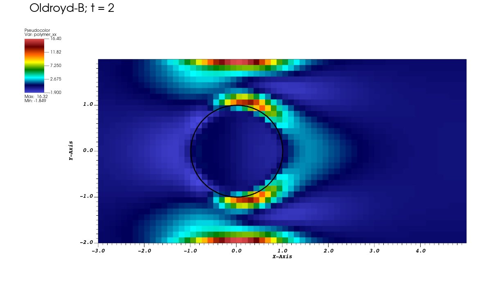
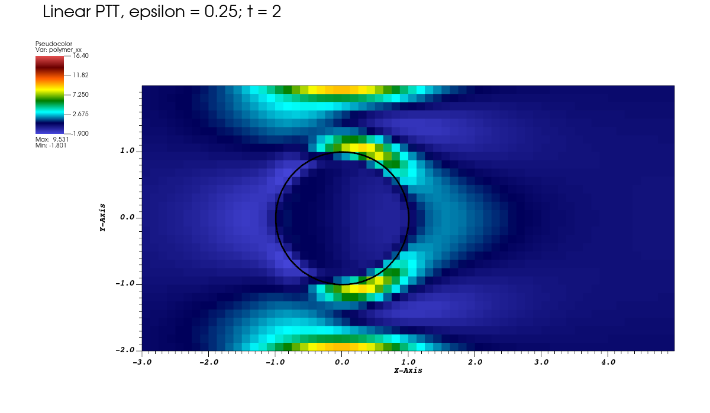

# Tutorial 15: Add a complex-fluid model

## Introduction

Run a fluid with polymer stress past a cylinder, then write a new material model. Start with IBAMR's built-in Oldroyd-B model and replace its relaxation law with a simplified linear Phan-Thien–Tanner (PTT) model through `CFStrategy`. The cylinder is held in place; the new behavior comes from the fluid.

## Before you start

Complete [tutorial 14](14-immersed-interface.md) and keep the directory variables from [tutorial 00](00-orientation.md) set. This example also requires libMesh with Triangle and ExodusII support.

The supplied files are in `examples/complex_fluids/ex2`. The walkthrough refers to `input2d`, `example.cpp`, and the two `InterpolationUtilities` files in that directory. The starting application uses the built-in model; you will add `PTTStrategy.h` yourself.

## Running the example

Configure the application:

```bash
cmake -S "$EXAMPLES_SRC" -B "$EXAMPLES_BUILD" \
  -DCMAKE_PREFIX_PATH="$IBAMR_ROOT"
```

Compile the application:

```bash
cmake --build "$EXAMPLES_BUILD" --target complex_fluids-ex2 -j 2
```

Prepare the run directory and copy the input files:

```bash
cd "$EXAMPLES_BUILD/examples/complex_fluids/ex2"
mkdir -p oldroyd-b
cp "$EXAMPLES_SRC/examples/complex_fluids/ex2/input2d" oldroyd-b/
cd oldroyd-b
```

Run the simulation:

```bash
../main2d input2d
```

Use the same build configuration as tutorial 00 if reconfiguring a new build directory. The simulation ends at time `2.0`. Fluid output is in `viz2d/dumps.visit`, and the cylinder mesh is in `viz2d/output.ex2`.

## Results

Open `oldroyd-b/viz2d/dumps.visit` in VisIt. In **Controls → Expressions**, create a scalar named `polymer_xx`:

```text
<PolymericStressForcing_Stress_Tensor>[0][0]
```

This selects the horizontal normal component of the polymer stress tensor. IBAMR also saves `PolymericStressForcing_Conformation_Tensor`; it is a different field, discussed below.

Add a **Pseudocolor** plot of `polymer_xx` and draw it. Advance through the saved times. Zoom to approximately `[-3,5]` horizontally and `[-2,2]` vertically to inspect stress around the cylinder and downstream of it. Use **Query → MinMax** at the last state to record the stress range. For the reference views below, set the Pseudocolor limits to `[-1.9,16.4]` and select the `hot_desaturated` color table.

To locate the cylinder precisely, open `oldroyd-b/viz2d/output.ex2` and add its **Mesh** plot. As in tutorial 14, displace the mesh using

```text
{<X_0>, <X_1>, 0} - coord(<Mesh>)
```

Create a **Time** correlation for the fluid and structure databases and select time `2.0` after adding both plots. You can also plot the speed expression `magnitude(<U>)` from tutorial 02.



*Horizontal polymer normal stress at time 2, with the displaced cylinder mesh in black. The color range is shared with the PTT comparison below.*

## The equations and input

### Where the polymer enters

The fluid momentum equation now includes the divergence of an additional stress:

$$
\rho\left(\frac{\partial\mathbf u}{\partial t}
+\mathbf u\cdot\nabla\mathbf u\right)
=-\nabla p+\mu_s\nabla^2\mathbf u
+\nabla\cdot\boldsymbol\tau_p+\mathbf f_{\mathrm{IB}},
\qquad \nabla\cdot\mathbf u=0.
$$

Here $\mu_s$ is the solvent viscosity, $\boldsymbol\tau_p$ is the polymer stress, and $\mathbf f_{\mathrm{IB}}$ is the force from the tethered cylinder. The solvent still uses a constant viscosity. Polymer effects enter through an additional force density, $\nabla\cdot\boldsymbol\tau_p$.

The material state is a dimensionless, symmetric **conformation tensor**, $\mathbf C$. Its equilibrium value is the identity, $\mathbf I$. The stress is

$$
\boldsymbol\tau_p=\frac{\eta_p}{\lambda}(\mathbf C-\mathbf I),
$$

where $\eta_p$ is the polymer viscosity contribution and $\lambda$ is its relaxation time. Both $\mu_s$ and $\eta_p$ have viscosity units, while $\lambda$ has time units. As in tutorial 09, choose consistent units throughout the input. The zero-shear viscosity is $\mu_s+\eta_p$.

IBAMR transports $\mathbf C$ with the fluid, stretches it with the velocity gradient, and adds material relaxation:

$$
\frac{\partial\mathbf C}{\partial t}
+\mathbf u\cdot\nabla\mathbf C
=(\nabla\mathbf u)\mathbf C+\mathbf C(\nabla\mathbf u)^{\mathsf T}+\mathbf R(\mathbf C),
\qquad (\nabla\mathbf u)_{ij}=\frac{\partial u_i}{\partial x_j}.
$$

The time derivative, transport, and stretching terms together form the **upper-convected derivative**. For a tensor $\mathbf A$, we write it as

$$
\overset{\triangledown}{\mathbf A}
=\frac{\partial\mathbf A}{\partial t}
+\mathbf u\cdot\nabla\mathbf A
-(\nabla\mathbf u)\mathbf A
-\mathbf A(\nabla\mathbf u)^{\mathsf T}.
$$

Thus the conformation equation is $\overset{\triangledown}{\mathbf C}=\mathbf R(\mathbf C)$. For Oldroyd-B, $\mathbf R=(\mathbf I-\mathbf C)/\lambda$. In fluid at rest, this relaxes the material toward equilibrium. Equivalently, the polymer stress satisfies

$$
\boldsymbol\tau_p+\lambda\overset{\triangledown}{\boldsymbol\tau_p}
=2\eta_p\mathbf D,
\qquad
\mathbf D=\frac{\nabla\mathbf u+(\nabla\mathbf u)^{\mathsf T}}{2}.
$$

Here $\mathbf D$ is the rate-of-deformation tensor. Later, when adding the PTT model, we will supply its relaxation term $\mathbf R(\mathbf C)$ and its stress relation $\boldsymbol\tau_p(\mathbf C)$ through the two methods required by `CFStrategy`.

### The material parameters

**Read:** [`input2d`, lines 19–28](../examples/complex_fluids/ex2/input2d#L19-L28).

```text
FLUID_MODEL = "OLDROYDB"
EVOLVE_TYPE = "STANDARD"
LOG_DETERMINANT     = TRUE
LOG_DIVERGENCE = TRUE
CONVECTIVE_OPERATOR_TYPE     = "WAVE_PROP"
OUTPUT_CONFORMATION_TENSOR = TRUE
OUTPUT_STRESS_TENSOR = TRUE
DRAW_DIVERGENCE = TRUE
RELAXATION_TIME = 0.1
VISCOSITY = 0.694915
```

`FLUID_MODEL` selects the built-in strategy. `RELAXATION_TIME` is $\lambda$, and `VISCOSITY` is $\eta_p$; the solvent viscosity `MU = 1.0` is set at the top of `input2d`. `EVOLVE_TYPE = "STANDARD"` means the transported values are the components of $\mathbf C$ itself.

IBAMR supports three representations, selected through `EVOLVE_TYPE` and passed into `ComplexFluid.evolve_type`:

| Input value | Transported tensor | Recovering $\mathbf C$ |
| --- | --- | --- |
| `"STANDARD"` | The conformation tensor $\mathbf C$ | Use the stored tensor directly. |
| `"SQUARE_ROOT"` | Its symmetric square root $\mathbf B$ | Compute the matrix product $\mathbf C=\mathbf B\mathbf B$. |
| `"LOGARITHM"` | Its matrix logarithm $\boldsymbol\Psi=\log\mathbf C$ | Compute the matrix exponential $\mathbf C=\exp\boldsymbol\Psi$. |

The square root and logarithm are matrix functions, rather than functions applied separately to each stored component. These choices change how the same material state is stored and advanced. This tutorial uses `"STANDARD"` throughout.


**Read:** [`input2d`, lines 156–160](../examples/complex_fluids/ex2/input2d#L156-L160).

```text
   relaxation_time            = RELAXATION_TIME
   viscosity                  = VISCOSITY
   alpha                      = ALPHA
   fluid_model                = FLUID_MODEL
   evolve_type                = EVOLVE_TYPE
```

These entries pass the top-level values into the `ComplexFluid` database. `ALPHA` belongs to the built-in Giesekus model and is unused by Oldroyd-B and the PTT implementation below.

**Read:** [`input2d`, lines 79–81](../examples/complex_fluids/ex2/input2d#L79-L81).

```text
TT_XX = "1.0"
TT_YY = "1.0"
TT_XY = "0.0"
```

**Read:** [`input2d`, lines 83–88](../examples/complex_fluids/ex2/input2d#L83-L88).

```text
ComplexFluid {
   InitialConditions {
      function_0 = TT_XX
      function_1 = TT_YY
      function_2 = TT_XY
   }
```

The three stored components in 2D are $C_{xx}$, $C_{yy}$, and $C_{xy}$, in that order. The initial values therefore give $\mathbf C=\mathbf I$ and zero polymer stress.

The three `ExtraStressBoundaryConditions_0`, `_1`, and `_2` blocks immediately afterward apply to these transported components despite their historical names. Each uses `a = 0`, `b = 1`, `g = 0` on all four faces: zero outward normal derivative. For example:

**Read:** [`input2d`, lines 96–109](../examples/complex_fluids/ex2/input2d#L96-L109).

```text
      acoef_function_0 = "0.0"
      acoef_function_1 = "0.0"
      acoef_function_2 = "0.0"
      acoef_function_3 = "0.0"

      bcoef_function_0 = "1.0"
      bcoef_function_1 = "1.0"
      bcoef_function_2 = "1.0"
      bcoef_function_3 = "1.0"

      gcoef_function_0 = "0.0"
      gcoef_function_1 = "0.0"
      gcoef_function_2 = "0.0"
      gcoef_function_3 = "0.0"
```

The other two component blocks use the same coefficients. These conditions supply the boundary values needed by the transport/ghost-fill operations.

### The cylinder and inlet

**Read:** [`input2d`, lines 1–4](../examples/complex_fluids/ex2/input2d#L1-L4).

```text
// physical parameters
MU = 1.0
RE = 1.0
RHO = RE*1.694915
```

These give solvent viscosity $1$, polymer viscosity $0.694915$, and density $1.694915$. With the inlet mean speed approaching $1$ and cylinder radius $1$, `RE` is the Reynolds number based on that radius and the zero-shear viscosity $1.694915$. The same values are used for both fluid models.

The setup is another confined cylinder, with its geometry generated in C++:

**Read:** [`example.cpp`, line 177](../examples/complex_fluids/ex2/example.cpp#L177).

```cpp
        const double R = 1.0;
```

The source builds the radius-one mesh, extracts its boundary, and supplies that boundary to `IBFESurfaceMethod`. This class couples a finite-element surface to the fluid: it evaluates the registered surface force, transfers its effect to the Cartesian fluid grid, interpolates fluid velocity to the surface, and updates the surface position. Here that force is a tether that holds the cylinder near its reference location. The callback at [`example.cpp`, lines 65–95](../examples/complex_fluids/ex2/example.cpp#L65-L95) uses the same spring-and-damping idea as tutorial 09.

Only the cylinder boundary participates in this coupling. There is no volumetric elastic constitutive law inside the cylinder; the new constitutive law describes polymer stress on the fluid grid. This is why a surface representation fits the example, rather than the volumetric `IBFEMethod` used for the elastic ring and strip.

The related classes serve these roles:

| Class | Representation and role |
| --- | --- |
| [`IBFEMethod`](https://ibamr.github.io/IBAMR-docs/ibamr/classIBAMR_1_1IBFEMethod.html) | A finite-element solid with interior elements and an elastic stress law. |
| [`IBFESurfaceMethod`](https://ibamr.github.io/IBAMR-docs/ibamr/classIBAMR_1_1IBFESurfaceMethod.html) | A finite-element boundary with a surface-force law; supports regularized IB coupling and IIM jump corrections. |
| [`IIMethod`](https://ibamr.github.io/IBAMR-docs/ibamr/classIBAMR_1_1IIMethod.html) | Another finite-element surface coupling implementation, used in tutorial 14, with regularized IB and IIM options. |

In particular, `IBFESurfaceMethod` does not imply that all interface forces are smoothed. This input enables its pressure and velocity-derivative jump corrections:

**Read:** [`input2d`, lines 38–39](../examples/complex_fluids/ex2/input2d#L38-L39).

```text
USE_VELOCITY_JUMPS = TRUE
USE_PRESSURE_JUMPS = TRUE
```

These values enter the `IBFESurfaceMethod` database at [`input2d`, lines 229–236](../examples/complex_fluids/ex2/input2d#L229-L236). The application therefore already uses IIM-style corrections through this surface class.

There is currently no IBAMR IIM implementation that correctly incorporates the viscoelastic contribution to the stress jumps. This limitation also applies to the jump corrections used here; replacing `IBFESurfaceMethod` with `IIMethod` would not resolve it. This example demonstrates complex-fluid coupling and material-model implementation, rather than a complete IIM treatment of viscoelastic stress jumps.

**Read:** [`input2d`, lines 76–77](../examples/complex_fluids/ex2/input2d#L76-L77).

```text
KAPPA_S = 0.04102*DX/DT^2
ETA_S = 0.010625*DX/DT
```

`KAPPA_S` controls the positional penalty and `ETA_S` damps motion. Here they depend on the finest grid spacing and time step. Changing either numerical setting therefore also changes these coefficients.

For the channel bounds, see [`input2d`, lines 365–370](../examples/complex_fluids/ex2/input2d#L365-L370), and for velocity conditions see [lines 177–216](../examples/complex_fluids/ex2/input2d#L177-L216). The new inlet expression is

**Read:** [`input2d`, lines 193–196](../examples/complex_fluids/ex2/input2d#L193-L196).

```text
   gcoef_function_0 = "3.0/2.0*tanh(t/(200.0*dt))*(1.0-X_1*X_1/4.0)"
   gcoef_function_1 = "0.0"
   gcoef_function_2 = "0.0"
   gcoef_function_3 = "0.0"
```

The `dt = DT` entry in that block makes the ramp $\tanh(t/(200\,DT))$. Thus the prescribed parabolic inlet starts from zero and approaches a maximum speed of $1.5$. The remaining face coefficients prescribe stationary channel walls and zero solvent traction at the outlet using the fluid boundary convention from tutorial 09. The polymer boundary conditions above are supplied separately.

## How the program connects the model

### Transport and fluid integration

**Read:** [`example.cpp`, lines 264–268](../examples/complex_fluids/ex2/example.cpp#L264-L268).

```cpp
        Pointer<AdvDiffSemiImplicitHierarchyIntegrator> adv_diff_integrator;
        adv_diff_integrator = new AdvDiffSemiImplicitHierarchyIntegrator(
            "AdvDiffSemiImplicitHierarchyIntegrator",
            app_initializer->getComponentDatabase("AdvDiffSemiImplicitHierarchyIntegrator"));
        navier_stokes_integrator->registerAdvDiffHierarchyIntegrator(adv_diff_integrator);
```

Constructing `AdvDiffSemiImplicitHierarchyIntegrator` creates the object that advances transported data. Registering it with the fluid integrator supplies the fluid advection velocity and connects their advancement. Later, `CFINSForcing` registers the conformation variable and its initial/boundary data with this transport integrator.

The transport of $\mathbf C$ needs more than three independent passive scalars: velocity gradients stretch the tensor. `CFINSForcing` installs `CFUpperConvectiveOperator` to handle that part and obtains the material relaxation from the selected strategy.

**Read:** [`example.cpp`, lines 365–378](../examples/complex_fluids/ex2/example.cpp#L365-L378).

```cpp
        Pointer<CFINSForcing> polymericStressForcing;
        double viscosity = 0.0, relaxation_time = 0.0;
        if (input_db->keyExists("ComplexFluid"))
        {
            polymericStressForcing = new CFINSForcing("PolymericStressForcing",
                                                      app_initializer->getComponentDatabase("ComplexFluid"),
                                                      navier_stokes_integrator,
                                                      grid_geometry,
                                                      adv_diff_integrator,
                                                      visit_data_writer);
            time_integrator->registerBodyForceFunction(polymericStressForcing);
            viscosity = input_db->getDatabase("ComplexFluid")->getDouble("viscosity");
            relaxation_time = input_db->getDatabase("ComplexFluid")->getDouble("relaxation_time");
        }
```

The constructor receives the `ComplexFluid` database, fluid integrator, grid geometry, transport integrator, and visualization writer. It uses those objects to connect conformation transport, material stress, force evaluation, and output. With `"OLDROYDB"` it constructs `CFOldroydBStrategy` internally.

`registerBodyForceFunction` connects this force provider to the IB time integrator. During advancement, `CFINSForcing` obtains conformation data, fills neighboring values, converts them to stress, and computes stress divergence for the fluid equation. The application supplies the material law; IBAMR supplies transport and coupling.

This setup occurs before `initializePatchHierarchy` at [`example.cpp`, lines 383–384](../examples/complex_fluids/ex2/example.cpp#L383-L384). A custom material strategy must also be registered before that initialization.

### What the output names mean

The `OUTPUT_CONFORMATION_TENSOR` and `OUTPUT_STRESS_TENSOR` switches shown earlier request the two tensor fields. `OUTPUT_STRAIN` elsewhere in the input controls the fluid strain-rate output through `INSStaggeredHierarchyIntegrator.output_EE`; it does not request polymer stress.

The additional `CD_Force_integral.curve` file contains time and the horizontal reaction force from integrating the cylinder tethers. The source does not divide by a reference dynamic pressure or length, so the filename alone does not make its values a normalized drag coefficient. For the model comparison below, use the directly identified polymer-stress component.

## Add the simplified linear PTT model

The PTT model changes the relaxation rate according to the current stress. In stress form it is

$$
f(\operatorname{tr}\boldsymbol\tau_p)\boldsymbol\tau_p
+\lambda\overset{\triangledown}{\boldsymbol\tau_p}
=2\eta_p\mathbf D,
\qquad
f=1+\frac{\epsilon\lambda}{\eta_p}
\operatorname{tr}\boldsymbol\tau_p,
$$

Here $\mathbf D$ and the upper-convected derivative are the same as in the Oldroyd-B equation above. PTT replaces the coefficient one multiplying $\boldsymbol\tau_p$ with the stress-dependent factor $f$. This is the simplified, upper-convected, **linear** PTT model; $\epsilon$ is dimensionless. See [Oliveira and Pinho (1999), *Journal of Fluid Mechanics* 387, 271–280, equations (1)–(2)](https://doi.org/10.1017/S002211209900453X).

To express $f$ in terms of the stored conformation tensor, take the trace of
$\boldsymbol\tau_p=(\eta_p/\lambda)(\mathbf C-\mathbf I)$:

$$
\operatorname{tr}\boldsymbol\tau_p
=\frac{\eta_p}{\lambda}(\operatorname{tr}\mathbf C-d).
$$

The identity tensor has trace $d$, the number of dimensions. Substituting this expression into $f$ cancels the viscosity and relaxation-time factors:

$$
f=1+\frac{\epsilon\lambda}{\eta_p}
\frac{\eta_p}{\lambda}(\operatorname{tr}\mathbf C-d)
=1+\epsilon(\operatorname{tr}\mathbf C-d).
$$

Next rewrite the stress equation in terms of $\mathbf C$. Although $\mathbf I$ is constant, its upper-convected derivative includes the stretching terms:
$\overset{\triangledown}{\mathbf I}=-2\mathbf D$. Therefore

$$
\overset{\triangledown}{\boldsymbol\tau_p}
=\frac{\eta_p}{\lambda}
\left(\overset{\triangledown}{\mathbf C}+2\mathbf D\right).
$$

Substitution into the PTT stress equation gives

$$
\frac{\eta_p}{\lambda}f(\mathbf C-\mathbf I)
+\eta_p\overset{\triangledown}{\mathbf C}
+2\eta_p\mathbf D
=2\eta_p\mathbf D.
$$

The $\mathbf D$ terms cancel. Solving for the conformation derivative gives the relaxation term required by IBAMR:

$$
\overset{\triangledown}{\mathbf C}=\mathbf R(\mathbf C)
=\frac{f}{\lambda}(\mathbf I-\mathbf C).
$$

The stress conversion remains $\boldsymbol\tau_p=(\eta_p/\lambda)(\mathbf C-\mathbf I)$. The PTT implementation therefore changes the relaxation factor while retaining the Oldroyd-B stress conversion.

Here $d=2$. In planar flow the missing third diagonal component remains one, so subtracting two from the stored 2D trace gives the corresponding three-dimensional trace excess. Setting $\epsilon=0$ recovers the Oldroyd-B relaxation law with the solvent term retained. Our comparison uses $\epsilon=0.25$.

### Declare the class and its components

Read the [`CFStrategy` documentation](https://ibamr.github.io/IBAMR-docs/ibamr/classIBAMR_1_1CFStrategy.html), especially `computeRelaxation` and `computeStress`. The interface determines which arrays the solver provides and which ones the model must fill.

Create `PTTStrategy.h` beside `example.cpp`. Start by declaring the stored parameters and the three functions. The function bodies will follow the class declaration in the same file.

```cpp
#ifndef included_PTTStrategy
#define included_PTTStrategy

#include <ibamr/CFStrategy.h>
#include <CellData.h>
#include <CellIterator.h>
#include <cmath>
#include <ibamr/app_namespaces.h>

#if NDIM != 2
#error This tutorial strategy is written for two dimensions.
#endif

class PTTStrategy : public IBAMR::CFStrategy
{
private:
    double d_lambda;
    double d_eta;
    double d_epsilon;

public:
    PTTStrategy(Pointer<Database> db);

    void computeRelaxation(int R_idx,
                           Pointer<CellVariable<NDIM, double>> R_var,
                           int C_idx,
                           Pointer<CellVariable<NDIM, double>> C_var,
                           IBAMR::TensorEvolutionType evolve_type,
                           Pointer<PatchHierarchy<NDIM>> hierarchy,
                           double data_time) override;

    void computeStress(int sig_idx,
                       Pointer<CellVariable<NDIM, double>> sig_var,
                       Pointer<PatchHierarchy<NDIM>> hierarchy,
                       double data_time) override;
};
```

The private members store the material parameters: `d_lambda` is the relaxation time $\lambda$, `d_eta` is the polymer viscosity $\eta_p$, and `d_epsilon` is the dimensionless PTT parameter $\epsilon$. Each strategy object retains these values for later evaluations.

The public declarations state how the solver can use the class. The constructor reads the parameters. `computeRelaxation` reads conformation data and fills the relaxation array. `computeStress` converts a supplied conformation array to stress. `override` checks that the two method signatures match the required base-class interface.

### Implement the constructor

Append this definition after the closing `};` of the class:

```cpp
inline
PTTStrategy::PTTStrategy(Pointer<Database> db)
    : CFStrategy("PTTStrategy"),
      d_lambda(db->getDouble("relaxation_time")),
      d_eta(db->getDouble("viscosity")),
      d_epsilon(db->getDouble("epsilon"))
{
    if (!std::isfinite(d_lambda) || d_lambda <= 0.0 ||
        !std::isfinite(d_eta) || d_eta <= 0.0 ||
        !std::isfinite(d_epsilon) || d_epsilon < 0.0)
        TBOX_ERROR("PTT requires positive relaxation_time and viscosity, and nonnegative epsilon.\n");
}
```

The initializer list now assigns values to the three members declared above. It also gives the base class the name `"PTTStrategy"`. Required database lookups report missing entries, and the check rejects invalid parameter values immediately.

The `PTTStrategy::` prefix identifies the class whose constructor we are defining. These definitions are `inline` because they live in a header. Including the header in `example.cpp` is sufficient; it does not need another CMake source entry.

### Find the conformation and relaxation arrays

Append the beginning of `computeRelaxation`:

```cpp
inline
void
PTTStrategy::computeRelaxation(int R_idx,
                               Pointer<CellVariable<NDIM, double>> /*R_var*/,
                               int C_idx,
                               Pointer<CellVariable<NDIM, double>> /*C_var*/,
                               IBAMR::TensorEvolutionType evolve_type,
                               Pointer<PatchHierarchy<NDIM>> hierarchy,
                               double /*data_time*/)
{
    for (int ln = 0; ln <= hierarchy->getFinestLevelNumber(); ++ln)
    {
        Pointer<PatchLevel<NDIM>> level = hierarchy->getPatchLevel(ln);
        for (PatchLevel<NDIM>::Iterator p(level); p; p++)
        {
            Pointer<Patch<NDIM>> patch = level->getPatch(p());
            Pointer<CellData<NDIM, double>> C_data = patch->getPatchData(C_idx);
            Pointer<CellData<NDIM, double>> R_data = patch->getPatchData(R_idx);
            for (CellIterator<NDIM> ci(patch->getBox()); ci; ci++)
            {
```

`C_idx` locates the supplied conformation data and `R_idx` locates the array to fill. These indices are supplied by IBAMR for this evaluation, so the strategy does not register or allocate another variable. The variable arguments describe the fields; their names are commented out in the definition because this calculation needs only the supplied indices.

The loops visit every level and each locally owned patch, as in tutorial 03. `getPatchData` gives access to that patch's arrays. The inner loop visits interior cells, where the transport operator needs the relaxation term.

Inside this cell loop, append the material calculation and close the loops and method:

```cpp
                const CellIndex<NDIM>& idx = ci();
                const IBTK::MatrixNd C =
                    IBAMR::convert_to_conformation_tensor(*C_data, idx, evolve_type);
                const double f = 1.0 + d_epsilon * (C.trace() - NDIM);
                const IBTK::MatrixNd R =
                    (f / d_lambda) * (IBTK::MatrixNd::Identity() - C);
                (*R_data)(idx, 0) = R(0, 0);
                (*R_data)(idx, 1) = R(1, 1);
                (*R_data)(idx, 2) = R(0, 1);
            }
        }
    }
}
```

`convert_to_conformation_tensor` reconstructs the physical conformation tensor from the representation identified by `evolve_type`, using the conversions listed above. For our `"STANDARD"` input it simply unpacks the three components. The PTT formula that follows therefore always acts on $\mathbf C$.

`trace()` adds the diagonal entries. The next line is the PTT relaxation equation derived above; the final assignments put its independent components back in IBAMR's 2D storage order. No neighbor values are needed for this local material calculation.

### Convert conformation to stress, including ghost cells

Append the beginning of the second method:

```cpp
inline
void
PTTStrategy::computeStress(int sig_idx,
                           Pointer<CellVariable<NDIM, double>> /*sig_var*/,
                           Pointer<PatchHierarchy<NDIM>> hierarchy,
                           double /*data_time*/)
{
    const double modulus = d_eta / d_lambda;
    for (int ln = 0; ln <= hierarchy->getFinestLevelNumber(); ++ln)
    {
        Pointer<PatchLevel<NDIM>> level = hierarchy->getPatchLevel(ln);
        for (PatchLevel<NDIM>::Iterator p(level); p; p++)
        {
            Pointer<Patch<NDIM>> patch = level->getPatch(p());
            Pointer<CellData<NDIM, double>> sig_data = patch->getPatchData(sig_idx);
            for (CellIterator<NDIM> ci(sig_data->getGhostBox()); ci; ci++)
            {
```

`computeStress` has a different contract: the array at `sig_idx` already contains physical conformation, with its ghost cells filled. Convert that supplied array to stress **in place**. `CFINSForcing` uses a temporary copy for this operation, so this does not replace the transported solution with stress.

The loop uses `getGhostBox()` because the following stress-divergence calculation needs values outside patch interiors. Allocation or correct interior values alone would leave that calculation incomplete.

Finish the cell calculation and method, then close the include guard:

```cpp
                const CellIndex<NDIM>& idx = ci();
                (*sig_data)(idx, 0) = modulus * ((*sig_data)(idx, 0) - 1.0);
                (*sig_data)(idx, 1) = modulus * ((*sig_data)(idx, 1) - 1.0);
                (*sig_data)(idx, 2) *= modulus;
            }
        }
    }
}

#endif
```

Only diagonal components subtract one, because the off-diagonal entries of $\mathbf I$ are zero. Both material laws use this same conversion; the new PTT behavior is in `computeRelaxation`. Neither method uses `data_time` because this material has no explicit time dependence.

### Register the strategy

In `example.cpp`, add this include beside `#include "InterpolationUtilities.h"` at original line 53:

```cpp
#include "PTTStrategy.h"
```

In the `ComplexFluid` setup block shown earlier, insert the following immediately after constructing `polymericStressForcing` and before `registerBodyForceFunction` at original line 375:

```cpp
Pointer<Database> cf_db = input_db->getDatabase("ComplexFluid");
if (cf_db->getString("fluid_model") == "USER_DEFINED")
    polymericStressForcing->registerCFStrategy(new PTTStrategy(cf_db));
```

`"USER_DEFINED"` tells `CFINSForcing` that the application will supply its strategy. The registration passes that object to both the force provider and its upper-convected operator: stress evaluation and relaxation now use your model. Retaining the conditional also lets the same executable run the built-in Oldroyd-B model.

See [`CFINSForcing::registerCFStrategy`](https://ibamr.github.io/IBAMR-docs/ibamr/classIBAMR_1_1CFINSForcing.html) for the registration interface.

## Run and compare PTT

Rebuild after adding the header and registration:

```bash
cmake --build "$EXAMPLES_BUILD" --target complex_fluids-ex2 -j 2
```

Prepare the run directory and copy the input files:

```bash
cd "$EXAMPLES_BUILD/examples/complex_fluids/ex2"
mkdir -p ptt
cp oldroyd-b/input2d ptt/
```

In `ptt/input2d` replace the top-level model selection with

```text
FLUID_MODEL = "USER_DEFINED"
```

and add this entry inside `ComplexFluid`, beside `relaxation_time` and `viscosity`:

```text
epsilon = 0.25
```

The existing `fluid_model = FLUID_MODEL` entry passes the new selection into that database. Keep the other settings identical, including `RELAXATION_TIME = 0.1` and `VISCOSITY = 0.694915`. This input edit selects the class you just compiled. Change to the PTT run directory:

```bash
cd "$EXAMPLES_BUILD/examples/complex_fluids/ex2/ptt"
```

Run the simulation:

```bash
../main2d input2d
```

Open `ptt/viz2d/dumps.visit` in a second VisIt window. Plot `polymer_xx` with the same view and color limits as the Oldroyd-B result, and select time `2.0` in both windows. Record each plot's MinMax and save the pair. Compare the stress distribution near the cylinder and in its wake; use the numerical ranges to see changes that a shared color scale may make subtle.

| Oldroyd-B | Simplified linear PTT |
| --- | --- |
|  |  |

*Horizontal polymer normal stress at time 2. Both panels use the same view and color range, with the displaced cylinder mesh in black.*

In these runs the maximum saved $\tau_{p,xx}$ is approximately $16.32$ for Oldroyd-B and $9.53$ for PTT. The PTT result has smaller stress peaks near the cylinder and channel walls. Where the trace excess is positive, its factor $f>1$ increases relaxation relative to Oldroyd-B. The velocity and stress also influence each other through the momentum equation, so this is a coupled model comparison, rather than applying a new formula to a fixed velocity field. These are finite-time results on the tutorial grid, not a statement of steady state or grid convergence.

## Further exploration

The same strategy interface can support a different stress-dependent relaxation factor. The exponential PTT variant uses $f=\exp[\epsilon(\operatorname{tr}\mathbf C-d)]$. That would change the local expression for `f` while retaining the data access and registration. Its numerical behavior needs its own checks before choosing new parameters or time steps.

## Before moving on

You have run Oldroyd-B and a simplified linear PTT fluid around the same cylinder, added a constitutive strategy in `PTTStrategy.h`, and connected it to the existing transport and fluid solvers. Your two run directories contain fluid/structure output and matched polymer-stress plots.
